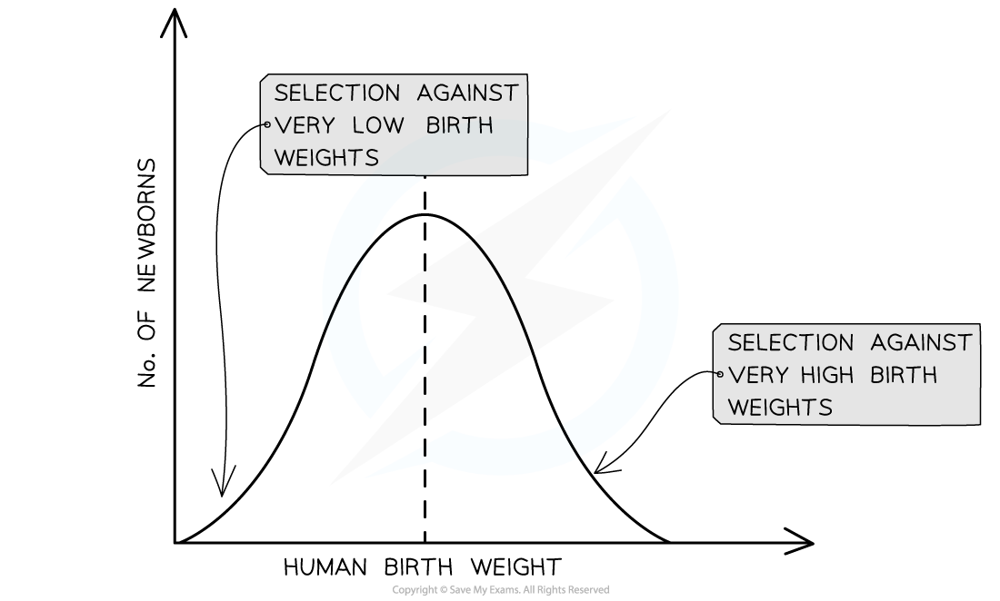
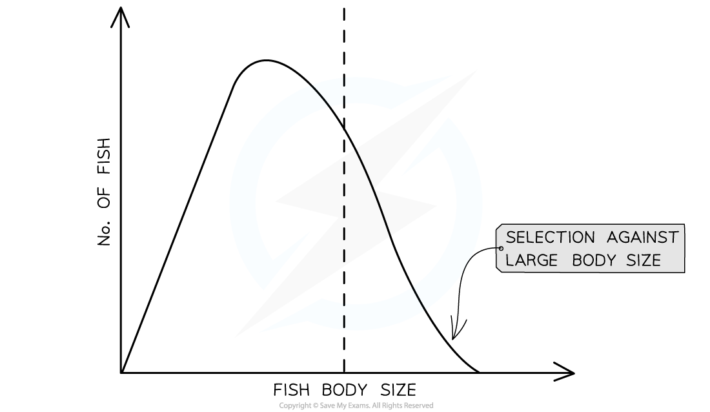
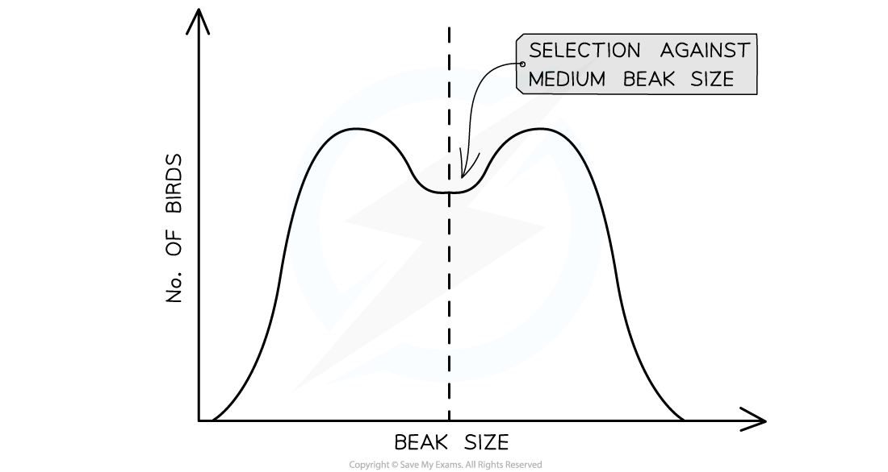

# Natural Selection: Types of Selection

## Natural Selection: Types of Selection

> **Spec point** — `spcpt_WzjcJ4msX4xp7jFh` · explain how environmental factors can act as stabilising, disruptive and directional forces of natural selection

## Natural selection: types of selection

- Environmental factors that affect the chance of survival of an organism are **selection pressures**

  - For example, there could be **high competition for food** between lions if there is not plentiful prey available
  - This environmental factor ‘selects’ for faster, more powerful lions that are better hunters
- These selection pressures can have different effects on the **allele frequencies** of a population through **natural selection**
- There are three types of selection:

  - **Stabilising**
  - **Disruptive**
  - **Directional**

### Stabilising selection

- **Stabilising** selection is natural selection that keeps allele frequencies relatively** constant **over generations

  - This means that **allele frequencies stay constant** unless there is a change in the environment
- A classic example of stabilising selection can be seen in human birth weights

  - Very low and very high birth weights are selected against leading to the **maintenance of intermediate birth weights**
  
    - It is disadvantageous to have a very low birth weight because it increases the risk of health complications for the baby
    - It is disadvantageous to have a very high birth weight as this increases the risk of birth complications

*Stabilising selection on human birth weight*

### Directional selection

- **Directional** selection is natural selection that produces a **gradual change** in allele frequencies over several generations
- This usually happens when there is a **change in the environment **or new selection pressures which leads to a certain allele becoming advantageous
- For example, a recent finding has shown that climate change is having an effect on fish size in certain habitats; the increase in temperature is **selecting for a smaller body size** and against a larger body size

  - Warmer seas cause fish metabolism to speed up and so increase their need for **oxygen**; oxygen levels are lower in warmer seas
  - Larger fish have greater **metabolic** needs than smaller fish, so they feel the effect of increased temperatures more strongly
  - Organisms are **sensitive** to changes in **temperature** primarily because of the effect that temperature can have on **enzyme** activity
  - **Fish** with a **smaller** body size are therefore fitter and **better** **adapted** to living in seas experiencing increased temperatures
  - Fish body size is determined by both genetic and environmental factors
  - Fish of a smaller size are **more likely** to reproduce and pass on their alleles to offspring
  - Over **generations,** this leads to an **increase** in the **frequency** of **alleles** that code for a small body size and a decrease in the frequency of alleles that code for a larger body size

*Directional selection acting on fish body size*

### Disruptive selection

- **Disruptive** selection is natural selection that **maintains high frequencies of two different sets of alleles**

  - In other words, individuals with intermediate phenotypes or alleles are selected against
- Disruptive selection maintains **polymorphism**; the continued existence of **two or more distinct phenotypes** in species
- This can occur in an environment that shows **variation**
- For example, birds that live on the Galapagos Islands use their beaks to forage for different-sized seeds

  - Different sizes of seed are more efficiently foraged by a shorter or longer beak than by a medium-sized beak
  - The size of the bird's beaks are either small or large with the intermediate, medium-sized beak selected against

*Disruptive selection acting on beak size in a bird population*

> **Exam Hint**
> Become familiar with the shapes of the graphs above. They can help you answer questions about the type of selection that is occurring in a population.
