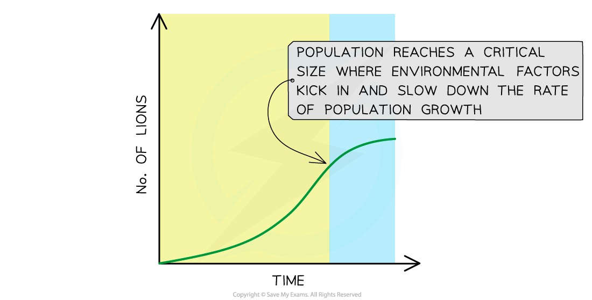
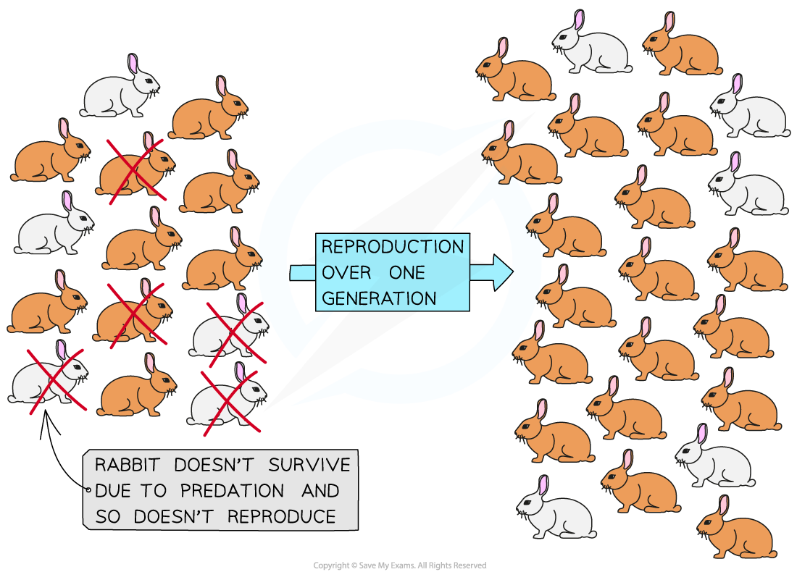

# Natural Selection

## Natural Selection

> **Spec point** — `spcpt_NfbRShNhYKWHVFj4` · explain that natural selection occurs because populations have the capacity to produce many offspring that compete for resources; in the ‘struggle for existence’, individuals that are best adapted are most likely to survive to reproduce and pass on their alleles to the next generation

## Natural selection

Every individual within a species population has the **potential to reproduce** and have offspring which contribute to population growth

- If the offspring for every individual survived to adulthood and reproduced then the population would experience **exponential growth**

  - This type of growth only happens when no environmental factors or population checks are acting on the population (for example, when there are plentiful resources and no disease)
  - One well-known but rare example of exponential growth in a population is the introduction of 24 European rabbits into Australia in the 1800s
  - The rabbits had an abundance of resources, little or no competition and no natural predators
  - This meant the population increased rapidly and they became a major pest
- In reality, several environmental factors prevent every individual in a population from making it to adulthood and reproducing

*Exponential growth in a population of rabbits that have no environmental checks*

### Environmental factors

- **Environmental factors** limit population sizes by reducing the rate of population growth whenever a population reaches a certain size
- Environmental factors can be **biotic** or **abiotic**
- Biotic factors involve **other living organisms**

  - This includes things like predation, competition for resources and disease
- Abiotic factors involve the **non-living parts** of an environment

  - Examples of abiotic factors include light availability, water supply and soil pH
- When biotic and abiotic factors come into play, not all individuals within a population will survive

  - For example, if a food source is limited some animals within a population will not get enough to eat and will starve to death
- For most populations in the wild, the number of offspring produced is much higher than the number of individuals that make it to adulthood

#### Population limitation by environmental factors

For African lions living in the wild, there are several environmental factors that limit their population growth rate:

1. Competition for food

  - There is a limited supply of prey: other lions and carnivores will also be hunting the same prey
  - If a lion is not able to hunt and feed then they will die from starvation

2. Competition for a reproductive mate

  - Female lions will often outnumber male lions in a population
  - This means the males compete with each other to mate with the females
  - When one male is in a contest with another male one (or both) could be injured or killed
  - Whichever male loses the contest won’t be able to mate with the females in the pride and so won’t pass on his alleles to any offspring

3. Supply of water

  - African habitats can be very arid during the dry season
  - The water sources that the lions drink from can be miles apart
  - If a lake or source of water dries up then they can die of dehydration
4. Temperature

  - The extreme heat experienced in the lion’s African habitat can cause them to overheat and die
  - It can also prevent them from hunting for long periods during the day, meaning they are less likely to get the food they need to survive

- The combined effect of all these environmental factors leads to a **decrease in population growth** as fewer individuals survive to adulthood and reproduce

*The different effects of environmental factors on the population growth of African lions in the wild*

### Natural selection and survival

- **Variation **exists within a species' population
- This means that some individuals within the population possess **different phenotypes **(due to genetic variation in the alleles they possess; remember, members of the same species will have the same genes)
- Environmental factors affect the chance of survival of an organism; they therefore act as a **selection pressure**
- Selection pressures **increase** **the** **chance** of individuals with a **specific phenotype **surviving and reproducing over others
- The individuals with the favoured phenotypes are described as having a higher **fitness**

  - The fitness of an organism is defined as its ability to **survive** and **pass on its alleles** to offspring
  - Organisms with higher fitness possess **adaptations** that make them **better suited to their environment**
- When selection pressures act over several generations of a species they have an effect on the** ****[frequency of alleles](https://www.savemyexams.com/a-level/biology/cie/25/revision-notes/17-selection-and-evolution/17-2-natural-and-artificial-selection/natural-selection-changes-in-allele-frequencies/?_ai=internal-linking)**[ in a population](https://www.savemyexams.com/a-level/biology/cie/25/revision-notes/17-selection-and-evolution/17-2-natural-and-artificial-selection/natural-selection-changes-in-allele-frequencies/?_ai=internal-linking) through **natural selection**

  - Natural selection is the process by which individuals with a fitter phenotype are more likely to survive and pass on their alleles to their offspring so that the **advantageous alleles increase in frequency over time and generations**

#### Example of natural selection in rabbits

- **Variation in fur colour **exists within rabbit populations
- At a single gene locus, normal **brown fur **is produced by a dominant allele whereas **white fur** is produced by a recessive allele in a ***homozygous*** individual
- Rabbits have natural predators (eg. foxes, stoats) which act as a selection pressure
- Rabbits with a white coat do not **camouflage **as well as rabbits with brown fur, meaning predators are more likely to see white rabbits when hunting
- As a result, rabbits with white fur are less likely to survive than rabbits with brown fur
- The **rabbits with brown fur **therefore have a selection advantage, so they are **more likely to survive** to reproductive age and be able to pass on their alleles to their offspring
- **Over many generations,** the **frequency** of **alleles** for **brown** fur will **increase** and the frequency of alleles for white fur will decrease

*Selective pressures acting on a rabbit population for one generation. Predation by foxes causes the frequency of brown fur alleles in rabbits to increase and the frequency of white fur alleles in rabbits to decrease*

> **Exam Hint**
> Remember that organisms better suited to their environments are more likely to survive, but survival is not guaranteed. Organisms that are less suited to an environment are still able to survive and potentially reproduce within it, but their chance of survival and reproduction is lower than their better-suited peers.
> 
> Also, it is important to be aware that an environment, and the selection pressures it exerts on an organism, **can change **over time. When a change occurs then a **different phenotype may become fitter**. Finally, remember that all organisms (not just animals) experience selection pressures as a result of the environment they are in!
