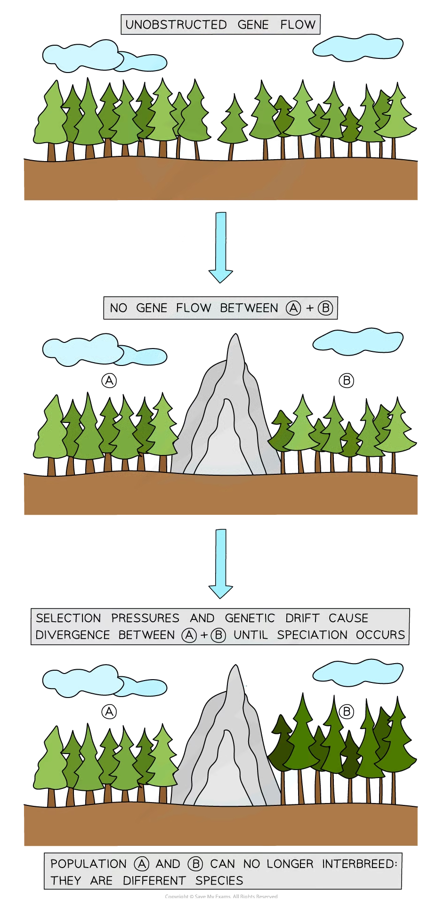

# Allopatric & Sympatric Speciation

## Allopatric & Sympatric Speciation

> **Spec point** — `spcpt_bVcGtBQP2HmgSMWT` · explain how speciation may occur as a result of genetic isolation by:
• geographical separation (allopatric speciation)
• ecological and behavioural separation (sympatric speciation)

## Allopatric & sympatric speciation

- **Evolution **causes **speciation**: the formation of **new species** from pre-existing species over time, as a result of **changes to gene pools** from generation to generation
- **Genetic isolation **between the new population and the pre-existing species population is necessary for speciation
- There are two different situations when speciation can take place:

  - Two groups within a species are separated by a** geographic** barrier
  - Two groups of species are **reproductively isolated** but still living in the same area (experiencing similar environmental selection pressures)

### Allopatric speciation

- Allopatric speciation occurs as a result of **geographical isolation**
- It is the **most common type of speciation**
- A species population splits into one or more groups which then become separated from each other by geographical **barriers**

  - The barrier could be natural like a body of water, or a mountain range
  - It can also be man-made (like a motorway)
- This separation creates two populations of the same species who are isolated from each other, and as a result, **no genetic exchange **can occur between them
- If there is sufficient [selection pressure or genetic drift](https://www.savemyexams.com/a-level/biology/cie/25/revision-notes/17-selection-and-evolution/17-2-natural-and-artificial-selection/natural-selection-changes-in-allele-frequencies/?_ai=internal-linking) acting to change the gene pools within both populations then eventually these populations will** diverge and form separate species**

  - The changes in the alleles/genes of each population will affect the phenotypes present in both populations
  - Over time, the two populations may begin to differ physiologically, behaviourally and morphologically (structurally)

#### Example of allopatric speciation in trees

- Imagine there is a population of trees that are all one species
- A new mountain range forms that divides the population into two
- The natural barrier prevents the two groups from interbreeding, so there is no gene flow between them
- The two populations experience **different selection pressures and genetic drift**
- Over thousands of years the divided populations **form two distinct species** that can no longer interbreed

*The natural geographical barrier of a mountain range can lead to allopatric speciation in trees*

### Sympatric speciation

- Sympatric speciation takes place with **no geographical barrier**
- A group of the same species could be living in the same place but in order for speciation to take place there must exist two populations within that group and **no gene flow** occurs between them
- Something has to happen that splits or separates the population:

  - **Ecological **separation: Populations are separated because they **live in different environments within the same area**
  
    - For example, soil pH can differ greatly in different areas
    - Soil pH has a major effect on plant growth and flowering
  - **Behavioural **separation: Populations are separated because they have **different behaviours**
  
    - For example differences in feeding, communication or social behaviour

#### Example of sympatric speciation in fish

- A species of fish lives in a lake
- Some individuals within the population feed on the bottom while others remain higher up in the open water
- The different feeding behaviours separate the population into different environments

  - **Behavioural separation leads to ecological separation**
- The separated groups experience **different selection pressures**

  - Long jaws are advantageous for bottom-feeding whereas shorter jaws are advantageous for mid-water feeding
- Over time natural selection causes the populations to **diverge** and evolve **different courtship displays**
- They can no longer interbreed; they are separate species

> **Exam Hint**
> When looking at cases of sympatric speciation try not to confuse the factors that **originally caused a separation** between the populations vs the factors that then **prevent them from breeding **after genetic isolation. For the example of the fish: the difference in feeding behaviour is what originally causes separation but it is a difference in courtship displays (which is caused by genetic isolation) that prevents them from breeding together.
> 
> Also, do not forget that speciation is reliant on **mutation**! Without mutation, there are no new alleles or genes for selection to act on. The change in genetic material by mutation is important as it is what produces the differences in physiology, behaviour and morphology between species.
