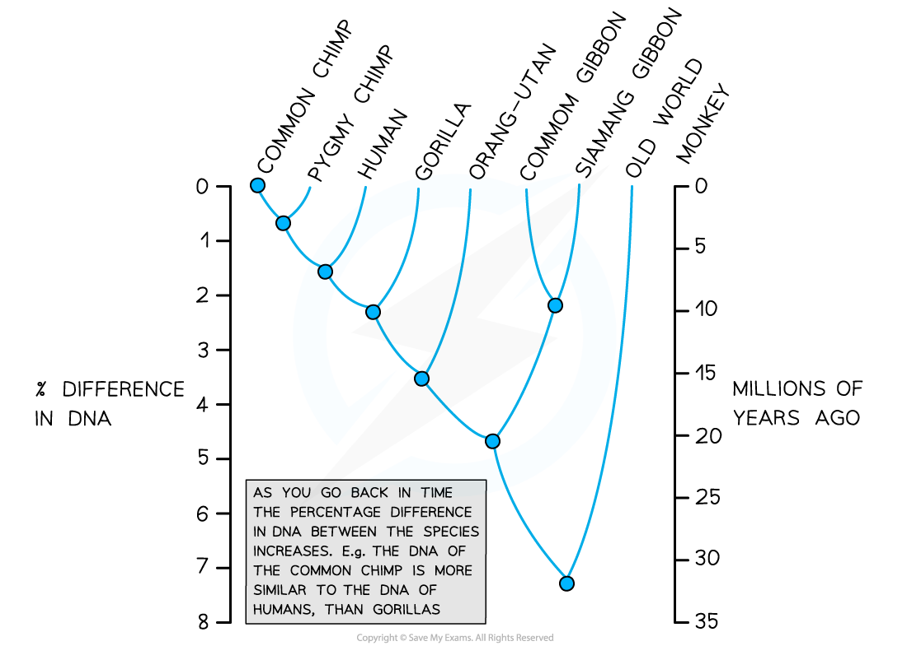
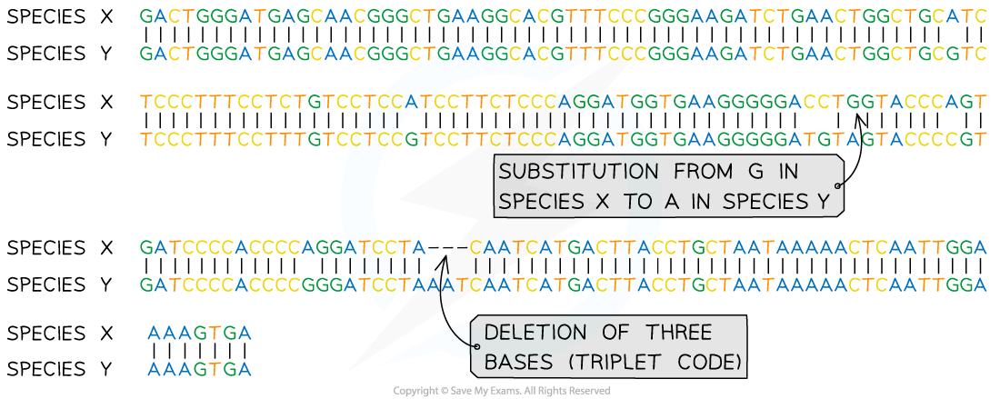

# Theory of Evolution

## Theory of Evolution

> **Spec point** — `spcpt_sV6wdhnw7W3NGVd8` · outline the theory of evolution as a process leading to the formation of new species from pre-existing species over time, as a result of changes to gene pools from generation to generation

## Theory of evolution

- A species can be defined as a group of organisms that are able to **interbreed** and** produce fertile offspring**
- Members of one species are **reproductively isolated** from members of another species
- In reality, it is quite hard to define ‘species’ and the determination of whether two organisms belong to the same species is dependent on investigation
- Individuals of the same species have similar behavioural, morphological (structural) and physiological (metabolic) features
- A common example used to illustrate this concept is mules; the infertile offspring produced when a male donkey and a female horse mate

### The gene pool

- The phenotype of all organisms is dependent on its **genotype** and **environmental** influence on this
- Members of the same species will have the same genes, of which there may exist alleles (alternate versions)
- A **gene pool** is the collection of **genes** within an interbreeding population
- A **gene pool** can be thought of as the sum of all the alleles at all of the **loci** within the **genes** of a population of a single species or a population

#### Changes to the gene pool

- The gene pool (or [allele frequencies](https://www.savemyexams.com/a-level/biology/cie/25/revision-notes/17-selection-and-evolution/17-2-natural-and-artificial-selection/natural-selection-changes-in-allele-frequencies/?_ai=internal-linking)**)** in a species population can **change** over time due to processes such as:

  - Natural selection
  - Genetic drift
  - The founder effect
- When the **gene pool within a species population changes** sufficiently over time, the characteristics of the species will also change
- The **change can become so great that a new species forms**

  - This is **evolution**

- For a population to have evolved into a separate species it must be **genetically and reproductively isolated **from the pre-existing species population

  - **Reproductive isolation** can occur due to mutations that lead to the incompatibility of gametes or sex organs, or differences in breeding behaviour.
  - When two populations are reproductively isolated, they can also be said to be **genetically** **isolated** from each other, meaning that they **do not exchange genes** with each other in the production of offspring
- Changes in the **allele** **frequencies** of isolated populations are not shared so they** evolve independently** of each other; this can lead to the formation of two groups that are no longer successfully able to interbreed and that are said to be separate species

  - The formation of new species in this way is known as **speciation**
- The evolution of a new species can take a **very long time** and many generations
- For organisms with a short generation time (such as bacteria), the evolution of new species can be observed far more quickly

## Evidence of Evolutionary Relationships in DNA

> **Spec point** — `spcpt_6KnTSCsYcDPKj5wj` · Evidence of Evolutionary Relationships in DNA

## Evidence of evolutionary relationships in DNA

- DNA found in the nucleus, mitochondria and chloroplasts of cells can be **sequenced** and used to show evolutionary relationships between species
- The **differences between the nucleotide sequences** (DNA) of different species can provide a lot of information:

  - The **more similar** the sequence the **more closely related** the species are
  - Two groups of organisms with very similar DNA will have separated into separate species more recently than two groups with less similarity in their DNA sequences
- DNA sequence analysis and comparison can also be used to create family trees (phylogenetic trees) that show the evolutionary relationships between species

*Example of a tree diagram showing the relationship between primate species*

### DNA analysis and comparison

- **DNA is extracted** from the nuclei of cells taken from an organism

  - DNA can be extracted from blood or skin samples from living organisms or from fossils
- The extracted DNA is processed, analysed and the **base sequence is obtained**
- The **base sequence is compared** to that of other organisms to determine evolutionary relationships

  - The **more similarities** there are in the DNA base sequence, the **more closely related** (in that the less distant the species separation) members of different species are
- In 2005, the chimpanzee genome was sequenced, and when compared to the human genome it was discovered that humans and chimpanzees share almost 99% of their DNA sequences, making them our closest living relatives

  - In 2012, the sequencing of the bonobo genome also revealed that humans and bonobos also share 98% of their genome (with slight differences from the differences seen in chimpanzees)

*The DNA base sequences of two closely related species being compared - Species X is the ancestor of Species Y*

### Mitochondrial DNA

- When analysing DNA from the mitochondria, is important to remember that:

  - A zygote only contains the mitochondria of the egg and none from the sperm so **only maternal mitochondrial DNA is present in a zygote**
  - There is **no crossing over** that occurs in mtDNA so the base sequence can only change by mutation
- The lack of crossing over in mtDNA has allowed scientists to research the origins of species, genetic drift and migration events
- It has even been possible to estimate how long ago the first human lived and where

  - Mitochondrial Eve is thought to have lived in Africa ~200,000 years ago
  - The estimation of this date relies on the **molecular clock theory **which assumes there is a **constant rate of mutation** over time
  - The greater the number of differences there are between nucleotide sequences, the longer ago the common ancestor of both species existed
  - The molecular clock is calibrated using **fossils of known age** (dated by radiometric dating of the rocks they are found in)
  - A fossil of a known species is dated using radiometric dating to estimate how long ago that organism lived
  - The mtDNA of this species is then used as a **baseline for comparison** with the mtDNA of other species
- Although for your exams you should say that only maternal mitochondrial DNA can be passed on or inherited by the zygote, recent research suggests that paternal mDNA may also be present in zygotes
