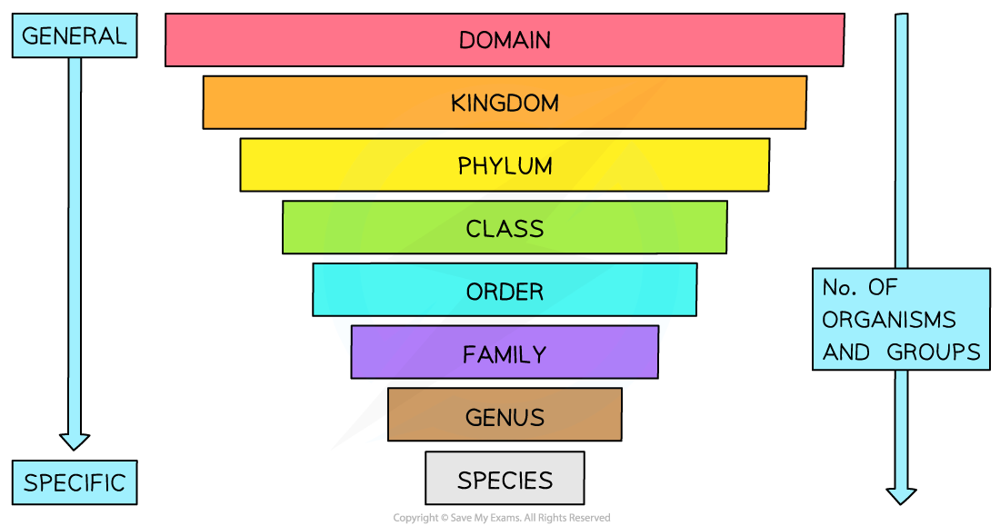
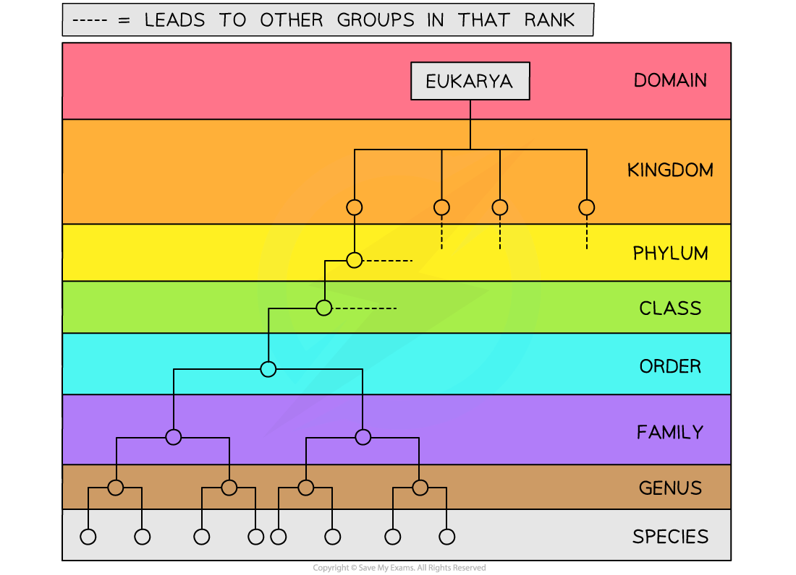
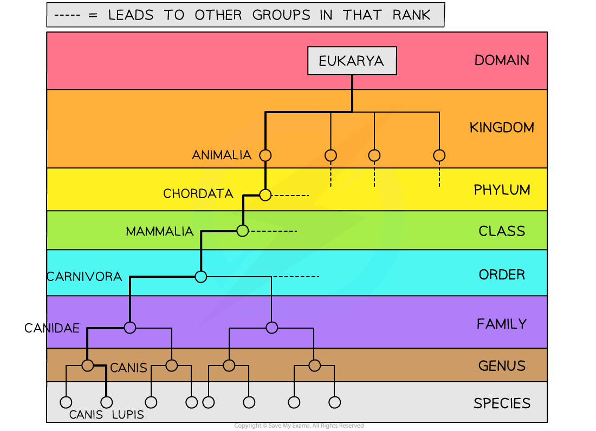
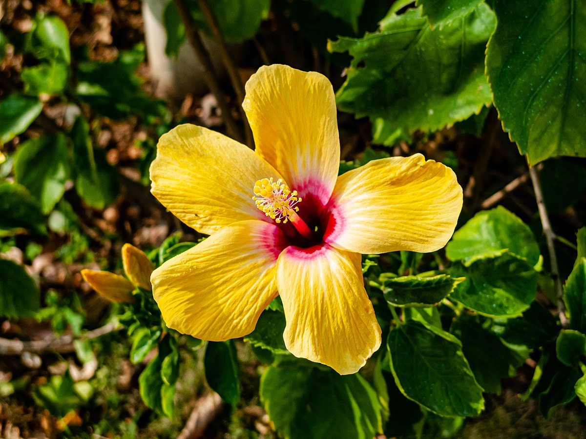

# Eukarya

## Eukarya

> **Spec point** — `spcpt_KHjh7xjDkKDc5TWY` · describe the classification of organisms in the Eukarya domain into the taxonomic hierarchy of kingdom, phylum, class, order, family, genus and species

## Eukarya

- The hierarchical classification system of organisms in biology is used to organise and **group similar organisms together** so that evolutionary relationships between organisms can be more easily understood
- There are several taxonomic ranks that exist
- **Species is the lowest taxonomic rank **in the system

  - Similar species can be grouped in a **genus**
  - Similar genuses can be grouped in a **family**
  - Similar families can be grouped into an **order**
  - Similar orders can be grouped into a **class**
  - Similar classes can be grouped into a **phylum**
  - Similar phyla can be grouped into a **kingdom**
  - Similar kingdoms can be grouped into a **domain**
- **Domains are the highest taxonomic rank** in the system
- There are a few different mnemonics that exist to help you remember the different ranks in the taxonomic classification system. You can always make up your own but the one below is super helpful!
- The first letters of all the different ranks below the domains can be remembered as:

  - **K**ings **P**lay **C**hess **O**n **F**ancy **G**old **S**quares
  - **K**ingdom **P**hylum **C**lass **O**rder **F**amily **G**enus **S**pecies

*The hierarchical classification system. The higher ranks contain more organisms with less similarity between them. The lower ranks contain fewer organisms with more similarity between them*

### Classification of an organism in the Eukarya domain

- Just like[ the other domains](https://www.savemyexams.com/a-level/biology/cie/25/revision-notes/18-classification-biodiversity-and-conservation/18-1-classification/the-three-domains-archaea-bacteria-and-eukarya/?_ai=internal-linking), **Eukarya** contains the taxonomic hierarchy of kingdom, phylum, class, order, family, genus and species

*The classification system is organised within the Eukarya domain—note there are missing groups at each rank*

- A **wolf **is an example of an organism in the Eukarya domain
- It can be classified further into its kingdom, phylum, class, order, genus and species
- A wolf belongs to the following taxonomic groups:

  - Domain: Eukarya
  - Kingdom: Animalia
  - Phylum: Chordata
  - Class: Mammalia
  - Order: Carnivora
  - Family: Canidae
  - Genus: *Canis*
  - Species: *Canis lupus*

*The classification of a wolf (Canis lupus)*

- The *Hibiscus rosa-sinensis* is another example of of an organism in the Eukarya domain
- It is a colourful flowering plant
- It belongs to the following taxonomic groups:

  - Domain: Eukarya
  - Kingdom: Plantae
  - Phylum: Angiospermae
  - Class: Dicotyledonae
  - Order: Malvales
  - Family: Malvaceae
  - Genus: *Hibiscus*
  - Species: *Hibiscus rosa-sinensis*

*Hibiscus rosa-sinensis  (Dinkun Chen, CC BY-SA 4.0, via Wikimedia Commons)*

| **Taxonomic rank** | **Wolf** | **Hibiscus** |
|---|---|---|
| Domain | Eukarya | Eukarya |
| Kingdom | Animalia | Plantae |
| Phylum | Chordata | Angiospermae |
| Class | Mammalia | Dicotyledonae |
| Order | Carnivora | Malvales |
| Family | Canidae | Malvaceae |
| Genus | *Canis* | *Hibiscus* |
| Species | *Canis lupus* | *Hibiscus rosa-sinensis* |

> **Exam Hint**
> The Latinised name of a species always consists of two words: the **genus and species**. This means when provided with the Latin name of a species you are automatically provided with information about the last two taxonomic ranks that the organism belongs to. Remember this when being asked to show or explain the classification of an organism in the exam.
