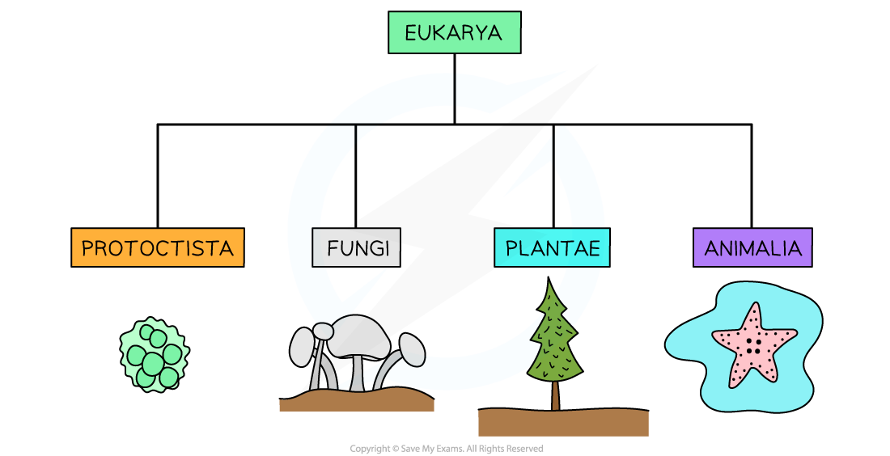
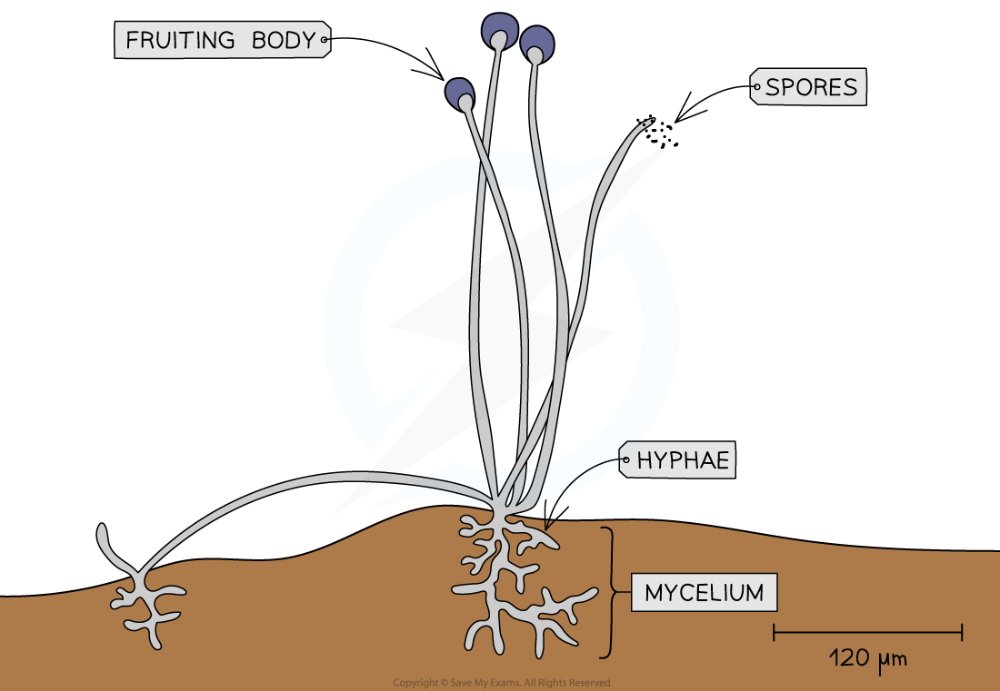

# Kingdoms

## Kingdoms

> **Spec point** — `spcpt_jN6xmVx4xD9myHPw` · outline the characteristic features of the kingdoms Protoctista, Fungi, Plantae and Animalia

## Kingdoms

- The [domain Eukarya ](https://www.savemyexams.com/a-level/biology/cie/25/revision-notes/18-classification-biodiversity-and-conservation/18-1-classification/the-three-domains-archaea-bacteria-and-eukarya/?_ai=internal-linking)can be divided into 4 kingdoms:

  - **Protoctista **(protoctists)
  - **Fungi**
  - **Plantae** (plants)
  - **Animalia** (animals)
- Organisms from each of the four kingdoms have **distinct** **characteristics** and features
- Although they share similarities:

  - They have cells with membrane-bound nuclei separating genetic material from the cytoplasm
  - They have compartmentalisation within their cells as a result of the presence of other organelles

*The four kingdoms within the Eukarya domain: protoctista, fungi, plantae and animalia*

### Kingdom Protoctista

- All Protoctista are **eukaryotic, **and this broad group of cellular life encompasses all eukaryotic cells that do not belong to the other three eukaryotic kingdoms
- Members of this kingdom show **great diversity** in all aspects of life including structure, life cycle, feeding and trophic levels and well as modes of locomotion
- Protoctists can exist as **single-celled organisms **or as a **group of similar cells**
- A group of Protoctista known as protozoa possess cells similar to animal cells

  - Their cells have **no cell wall**
- Another group of Protoctista known as algae possess cells similar to plant cells

  - Their cells have [cellulose](https://www.savemyexams.com/a-level/biology/cie/22/revision-notes/2-biological-molecules/2-2-carbohydrates--lipids/2-2-6-cellulose/)** cell walls and chloroplasts**

### Kingdom Fungi

- The oldest organism in the world is thought to be a fungus aged somewhere between 1500 - 10,000 years old
- All fungi are **eukaryotic** cells
- The cells of fungi:

  - Possess non-cellulose **cell walls** (often made of the polysaccharides **chitin **and **glucans**)
  - Don’t have cilia
- Fungi are **heterotrophs:**

  - They use organic compounds made by other organisms as their source of energy and molecules for metabolism
  - They obtain this energy and carbon by **digesting dead/decaying matter **extracellularly or from being **parasites** on living organisms
- Fungi **reproduce using spores** that disperse onto the ground nearby
- Fungi have a simple body form:

  - They can be unicellular (like the common baker’s yeast *Saccharomyces cerevisiae*
  - Some consist of long threads called hyphae that grow from the main fungus body (mycelium)
  - Larger fungi possess fruiting bodies that release large numbers of spores

*The structure of a fungus with its hyphae, mycelium and fruiting bodies*

### Kingdom Plantae

- Plants are **multicellular eukaryotic** organisms
- Plant cells:

  - All have **cell walls** composed of cellulose
  - Possess large (and usually permanent) **vacuoles **that provide structural support
  - Are able to differentiate into **specialised cells** to form **tissues and organs**
  - Possess **chloroplasts** that enable **photosynthesis** (not all plant cells have chloroplasts)
  - Can sometimes have **flagella**
- They are **autotrophs**

  - This means they can synthesise their organic compounds and molecules for energy use and building biomass from inorganic compounds
- Plants have **complex body forms**

  - They have branching systems above and below the ground

### Kingdom Animalia

- Animals are also **multicellular eukaryotic** organisms
- Animal cells:

  - Are able to differentiate into **many different specialised cell types** that can form **tissues and organs**
  - Have **small temporary vacuoles** (for example, lysosomes)
  - Have **no cell walls**
  - Sometimes have cilia
- They are **heterotrophs**

  - They have a wide range of feeding mechanisms
- They have a wide range of body forms:

  - Communication within their complex body forms takes place through a **nervous system and chemical signalling**
