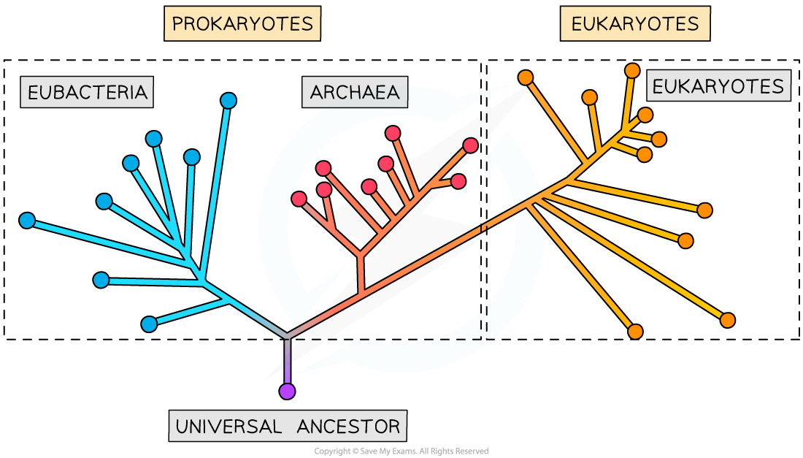
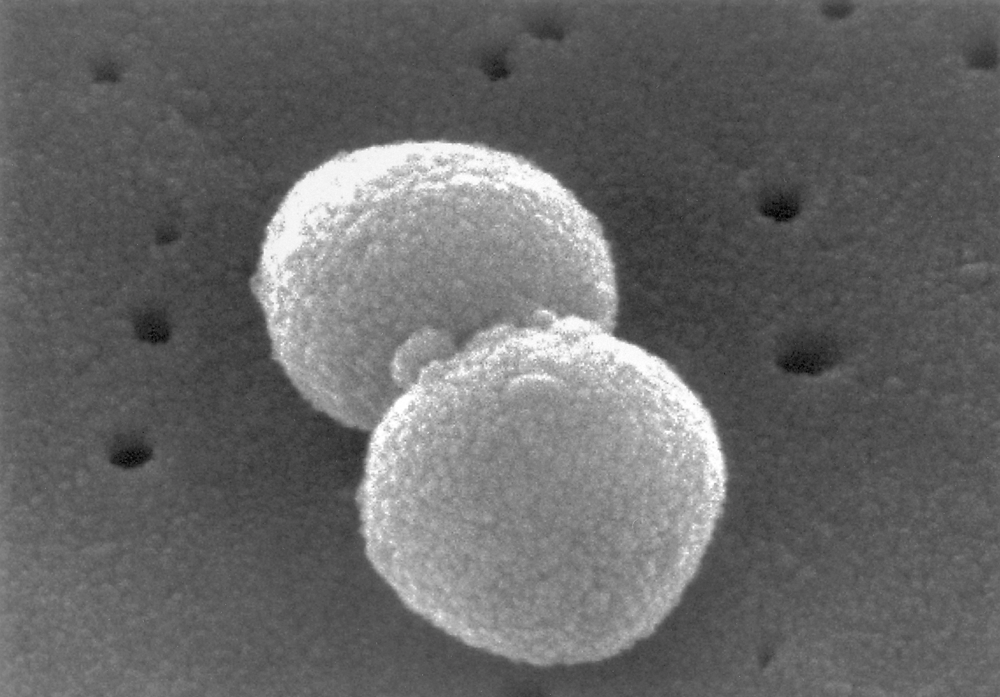

# The Three Domains: Archaea, Bacteria & Eukarya

## The Three Domains: Archaea, Bacteria & Eukarya

> **Spec point** — `spcpt_CJxZ2HzSMy5z6rDy` · describe the classification of organisms into three domains: Archaea, Bacteria and Eukarya

## The three domains: Archaea, Bacteria & Eukarya

- **Taxonomy** is the practice of biological classification
- It involves placing organisms into a series of categories or **taxa**
- By grouping organisms into taxa it can make it easier to see evolutionary relationships between organisms
- There are several **different ranks **or levels within the hierarchical classification system used in biology
- The highest rank is the **domain**
- **Cell type** has a major role in the classification of organisms into the three domains; but do not confuse cell types and domain

  - **Prokaryotic** cells are easily distinguishable in that they lack a nucleus
  - **Eukaryotic** cells have compartmentalised structures, with at least their genetic material segregated from the rest of the cell in a nucleus
- Based upon molecular analysis of RNA genes in particular, scientists have realised that using cell type to classify organisms is insufficient, and that **prokaryotes** could be divided into two separate groups (domains)
- The **three domains** are:

  - Archaea (prokaryotes)
  - Bacteria (prokaryotes)
  - Eukarya (eukaryotes)

*The taxonomic classification system with the three domains*

### Archaea

- Archaea are single-celled (unicellular) organisms
- Organisms within this domain are sometimes referred to as the extremophile **prokaryotes**

  - Archaea were first discovered living in **extreme environments, **but not all archaea do
- Archael cells have **no nucleus **(and so are **prokaryotic**)
- They were initially classified as bacteria until several unique properties were discovered that separated them from known bacteria, including:

  - Unique lipids being found in the membranes of their cells
  - No **peptidoglycan** in their cell walls
  - Ribosomal structure (particularly that of the small subunit) are more similar to the eukaryotic ribosome than that of the bacteria
- Archaea have a similar size range as bacteria (and in many ways metabolism is similar between the two groups)
- DNA transcription is more similar to that of eukaryotes
- Example: *Halobacterium salinarum *are a species of the archaea domain that can be found in environments with high salt concentrations like the Dead Sea

### Bacteria

- Bacteria are single-celled (unicellular) organisms
- These are organisms that have **prokaryotic cells** which contain no nucleus
- They vary in size over a wide range: the smallest are bigger than the largest known-viruses and the largest are smaller that the smallest known single-celled eukaryotes
- Bacterial cells divide by binary fission
- Example: *Streptococcus pneumoniae *is a bacterial species that causes pneumonia

*Streptococcus pneumoniae (Janice Haney Carr, Public domain, via Wikimedia Commons)*

#### Eukarya

- Organisms that have **eukaryotic cells** with nuclei and membrane-bound organelles are placed in this domain
- They vary massively in size from single-celled organisms several micrometres across to large multicellular organisms many-metres in size, such as blue whales
- Eukaryotic cells divide by mitosis
- Eukaryotes can reproduce sexually or asexually
- Example: *Canis lupus *also known as wolves

*Canis lupus, CC BY-SA 4.0, via Wikimedia Commons*

> **Exam Hint**
> It might be worth refreshing your knowledge on the defining features of prokaryotic and eukaryotic cells before tackling this new topic!

## Differences Between Archaea & Bacteria

> **Spec point** — `spcpt_FJRsHsZD2nDw26j4` · state that Archaea and Bacteria are prokaryotes and that there are differences between them, limited to differences in membrane lipids, ribosomal RNA and composition of cell walls

## Differences between Archaea & Bacteria

- Domains are the highest taxonomic rank that exist within the hierarchical classification system of organisms
- Initially, all organisms within the Archaea domain were classified as Bacteria
- Then several unique features possessed by Archaea were discovered that separated them from both Bacteria and Eukarya
- The main differences between Archaea and Bacteria are seen in:

  - **Membrane lipids**
  - **Ribosomal RNA**
  - **Cell wall composition**

### Membrane lipids

- The membrane lipids found in the cells of Archaea organisms are completely **unique**
- They are not found in any **bacterial** or **eukaryotic** cells
- The membrane lipids of Archaea consist of** branched** hydrocarbon chains bonded to glycerol by **ether** linkages
- The membrane lipids of Bacteria consist of **unbranched **hydrocarbon chains bonded to glycerol by **ester **linkages

### Ribosomal RNA

- Both Archaea and Bacteria possess 70S ribosomes
- The 70S ribosomes in Archaea possess a smaller subunit that is **more similar to the subunit found in Eukaryotic** ribosomes than subunits in Bacterial ribosomes

  - The **base sequences of ribosomal RNA** in Archaea show more similarity to the rRNA of Eukarya than Bacteria
  - The **primary structure of ribosome proteins** in Archaea show more similarity to the ribosome proteins in Eukarya than Bacteria

### Composition of cell walls

- Organisms from the **Bacteria** domain have cells that always possess cell walls **with peptidoglycan**
- Organisms from the **Archaea **domain also have cells that always possess cell walls, however these **do not contain peptidoglycan**

|   | **Archaea** | **Bacteria** | **Eukaryotes** |
|---|---|---|---|
| **Cell type** | Prokaryotic | Prokaryotic | Eukaryotic |
| **Chromosome** | Circular | Circular | Linear chromosomes + circular mtDNA and cpDNA |
| **Cell membrane lipids** | Glycerol - ether lipids | Glycerol - ester lipids | Glycerol - ester lipids |
| **Ribosomes** | 70S ribosomes but small subunit is more similar to eukaryotic ribosomes | 70S ribosomes | Large 80S ribosomes in the cytosol and 70S ribosomes in mitochondria and chloroplasts |
| **Cell walls** | Always present (without peptidoglycan) | Always present (with peptidoglycan) | Sometimes present (without peptidoglycan) |
| **Histones** | Yes | No | Yes |
| **Introns** | Sometimes | Rarely | Yes |
