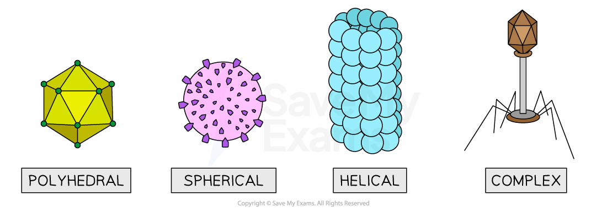
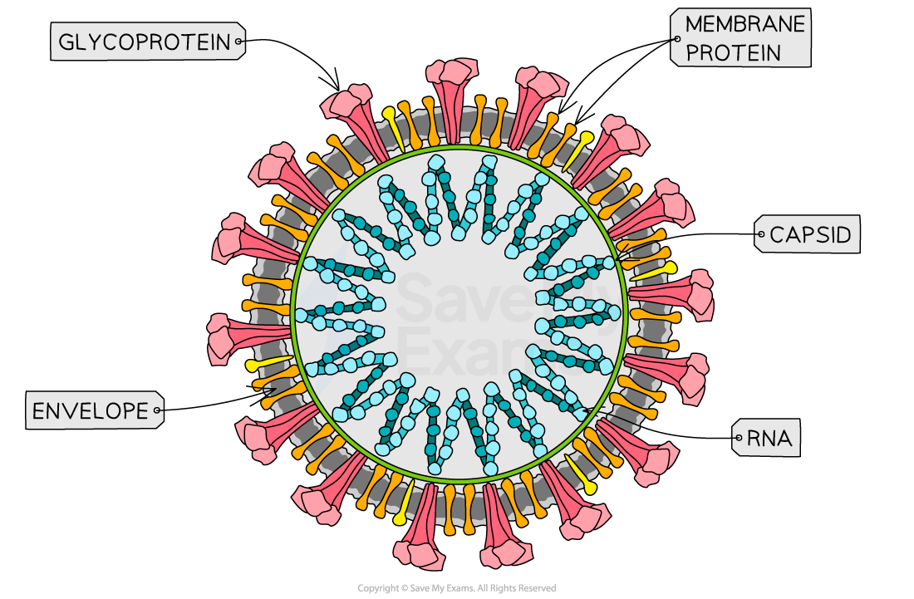

# Viruses

## Viruses

> **Spec point** — `spcpt_8w6kBS8bkXGmqKJ6` · outline how viruses are classified, limited to the type of nucleic acid (RNA or DNA) and whether this is single stranded or double stranded

## Viruses

- Viruses are **microorganisms** that can only be seen using an electron microscope
- They have no cellular structure (and so are **acellular**) and **no metabolism**
- Viruses **hijack the DNA replication machinery** in host cells
- The energy viruses need for replication is provided by **respiration **in the host cell
- Viruses possess none of the characteristic features used for classifying organisms so they sit **outside **of the [three-domain classification system](https://www.savemyexams.com/a-level/biology/cie/25/revision-notes/18-classification-biodiversity-and-conservation/18-1-classification/the-three-domains-archaea-bacteria-and-eukarya/?_ai=internal-linking)
- There is a wide-ranging debate as to whether viruses should be classified as ‘living’ or ‘non-living’ based on their inability to carry out the defining features of life outside of a host cell

### Classifying viruses by their genetic material

- Viruses are classified according to the **type of nucleic acid** (RNA or DNA) their genome is made from, and whether it is single-stranded or double-stranded
- In **cellular organisms** like animals and plants, **DNA is always double-stranded **and **RNA is usually always single-stranded**
- However, in **viruses, **DNA and RNA can be **either single-stranded or double-stranded**
- As a result, there are four groups of viruses that exist:

  - DNA single-stranded viruses
  - DNA double-stranded viruses
  - RNA single-stranded viruses (this is the type of genome of SARS-CoV-2, the virus responsible for the COVID-19 pandemic)
  - RNA double-stranded viruses

*The diversity of viral structures*

*Coronavirus structure*

| **Nucleic acid** | **Single or double stranded** | **Virus** | **Host Organism** | **Disease** |
|---|---|---|---|---|
| DNA | Single | Canine parvovirus type 2 | Dog | Canine parvovirus |
| DNA | Double | Varicella zoster virus (VZV) | Human | Chickenpox & shingles |
| RNA | Single | Morbillivirus | Human | Measles |
| RNA | Double | Rotavirus | Human | Gastroenteritis (severe diarrhoea) |
