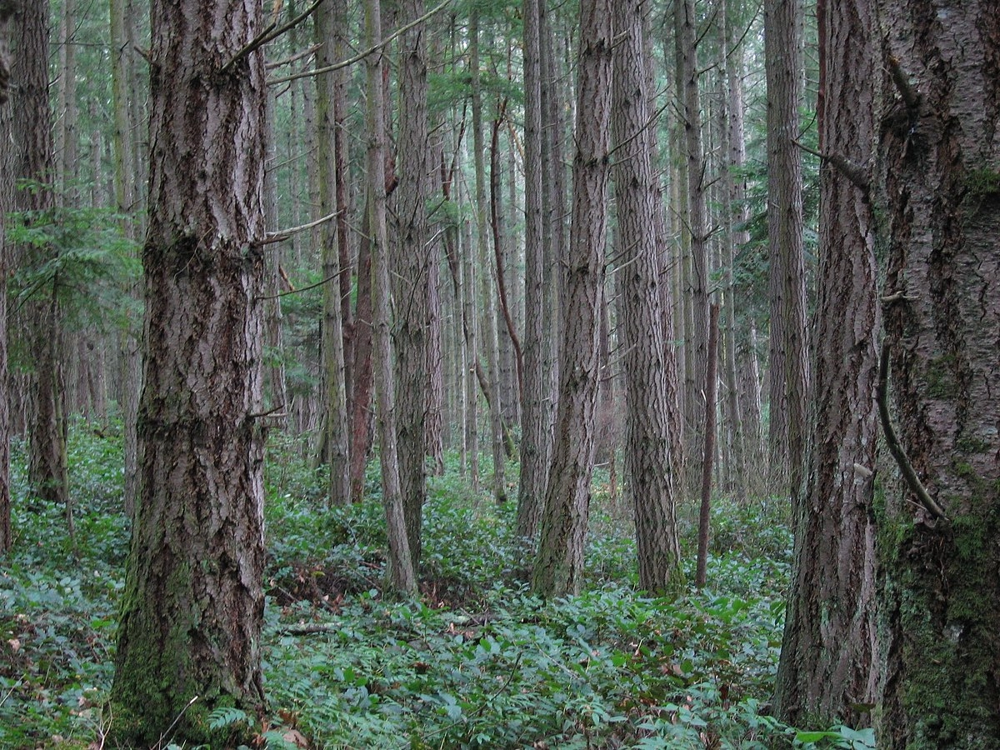
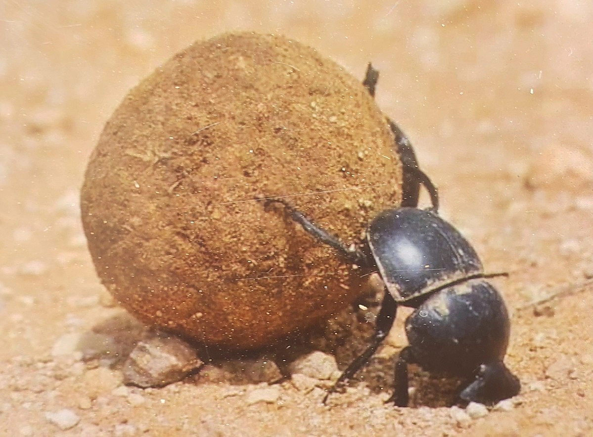

# Ecosystems & Niches

## Ecosystem & Niches

> **Spec point** — `spcpt_b4TJ8JYcmnyxGB6s` · define the terms ecosystem and niche

## Ecosystem & niches

### Ecosystems

- ***Species***** **do not exist by themselves in their own isolated environment, they interact with other species forming **communities**
- These communities interact with each other and the **environment **they live in, forming ecosystems
- An **ecosystem** is a relatively self-contained community of interacting organisms and the environment they live in, and interact with
- There is a** flow of energy **within an ecosystem and nutrients within it are recycled
- There are both **living **(biotic)** components** and **non-living **(abiotic)**components** within an ecosystem
- Ecosystems **vary greatly in size and scale**

  - Both a small pond in a back garden and the open ocean could be described as ecosystems
  - A human being could also be described as an ecosystem; there are thousands of species of bacteria living on and in every person
- Ecosystems **vary in complexity**:

  - A desert is a relatively simple ecosystem
  - A tropical rainforest is a very complex ecosystem
- No ecosystem is completely self-contained as organisms from one ecosystem are often linked to organisms from another

  - For example, birds are able to fly long distances to feed from multiple ecosystems

### Example of an ecosystem

- A **forest **is a perfect example of a complex ecosystem
- There is a large community of organisms including trees, birds, small and large mammals, insects and fungi
- The non-living components of the ecosystem include: the soil, dead leaves, water from the rain and streams, the rocks and any other physical or chemical factors
- The non-living components of the ecosystem influence the community of organisms

*A forest ecosystem (Photographed by  Tom Harpel, CC BY 2.0, via Wikimedia Commons)*

### Niche

- The place where a species lives within an ecosystem is its **habitat**
- The role that species plays within an ecosystem is its **niche**

  - It encompasses **where** in the environment the organism is, how it gets its **energy **and how it **interacts** with other species and its physical environment
  - This is how an organism fits into the ecosystem

### Example of a niche

- A **dung beetle** (example species *Scarabaeus satyrus*) occupies a **very specific niche** within its ecosystem
- Dung beetles have learned to exploit the **dung **(faeces) of animals as a **food source** and they have a characteristic behaviour of rolling the dung into balls before transporting it to their underground burrow for **storage **as food
- Their behaviour within their ecosystem has **many knock-on effects** on the environment and other organisms living in it
- The burrows and tunnels that they create turns over and **aerates the soil**
- The buried dung **releases nutrients** into the soil both of which can benefit other organisms like plants
- The transportation of the dung underground by the beetles also helps to **keep fly populations under control**

*A dung beetle occupies its niche by feeding on faeces and recycling nutrients (Achiri Bitamsimli, CC BY-SA 4.0, via Wikimedia Commons)*
