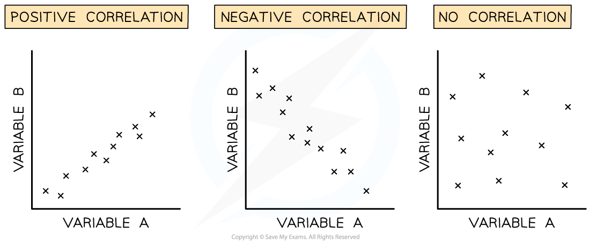

# Pearson's Linear Correlation

## Pearson's Linear Correlation

> **Spec point** — `spcpt_hwYyP8sTwpQC7QJs` · use Spearman’s rank correlation and Pearson’s linear correlation to analyse the relationships between two variables, including how biotic and abiotic factors affect the distribution and abundance of species

## Pearson's linear correlation

- When recording the **abundance** and **distribution** of species in an area different trends may be observed
- Sometimes **correlation** between two variables can appear in the data

  - **Correlation** is an association or relationship between variables
  - There is a clear distinction between **correlation** and **causation**: a correlation does not necessarily imply a causative relationship
  - **Causation** occurs when one variable has an influence on, or is influenced by, another
- There may be a correlation **between species; **for example, two species always occurring together
- There may be a correlation **between a species and an *****abiotic factor***, for example, a particular plant species and the soil pH
- The apparent correlation between variables can be analysed using **scatter** **graphs** and different **statistical** **tests**

### Correlation between variables

- In order to get a broad overview of the correlation between two variables the data points for both variables can be plotted on a **scatter graph**
- The correlation coefficient (r) indicates the **strength of the relationship** between variables
- Perfect correlation occurs when **all of the data points lie on a straight line** with a **correlation coefficient of 1.0 or -1.0**
- Correlation can be **positive or negative**

  - Positive correlation: as variable A increases, variable B increases
  - Negative correlation: as variable A increases, variable B decreases
- If there is **no correlation** between variables the **correlation coefficient will be 0**

*Different types of correlation in scatter graphs*

- The **correlation coefficient (*****r*****)** can be calculated to determine whether a linear relationship exists between variables and how strong that relationship is

### Pearson's linear correlation

- Pearson's linear correlation is a statistical test that determines whether there is **linear correlation** between two variables
- The data must:

  - Be **quantitative**, e.g. the number of individuals has been counted and a numerical value recorded
  - Show a **linear relationship** upon visual inspection
  - Show a *normal distribution*
- Method:

  - **Step 1:**  Create a scatter graph of data gathered and identify if a linear correlation exists
  - **Step 2:**  State a null hypothesis
  - **Step 3: ** Use the following equation to work out Pearson’s correlation coefficient* r*

Where:

- r = correlation coefficient
- x =  number of species A
- y = number of species B
- n = number of readings
- Sx = standard deviation of species A
- Sy = standard deviation of species B
- x̄= mean number of species A
- ȳ= mean number of species B

- If the correlation coefficient *r* is close to 1.0 or -1.0 then it can be stated that there is a **strong linear correlation** between the two variables and the **null hypothesis can be rejected**

> **Worked Example**
> Some students used [quadrats](https://www.savemyexams.com/a-level/biology/cie/25/revision-notes/18-classification-biodiversity-and-conservation/18-2-biodiversity/testing-for-distribution-and-abundance/?_ai=internal-linking) to measure the abundance of different plant species in a garden. They noticed that two particular species seemed to occur alongside each other. They plotted a scatter graph and the data they collected had no major outliers and showed roughly normal distribution.
> 
> 
> 
> *Scatter graph showing the linear correlation between the abundance of species A and B. It shows linear correlation and so is suitable for analysis by Pearson’s correlation coefficient.*
> 
> Investigate the possible correlation using Pearson’s linear correlation coefficient.

**Null hypothesis**: There is no correlation between the abundance of species A and species B.

**Steps to calculate the correlation coefficient:**

**Step 1:** Calculate xy

**Step 2:** Calculate  x̅ and y̅ (these are the means of *x* and *y*)

**Step 3:** Calculate nx̅y̅

**Step 4:** Find *∑xy*

**Step 5:** Calculate **standard** **deviation** for each set of data Sx  and Sy

**Step 6:** Substitute the appropriate numbers into the equation

| **Quadrat** | **No. of individuals of species A (x)** | **No. of individuals of species B (y)** | **xy** |
|---|---|---|---|
| **1** | 10 | 21 | 210 |
| **2** | 11 | 19 | 209 |
| **3** | 11 | 22 | 242 |
| **4** | 6 | 15 | 90 |
| **5** | 8 | 16 | 128 |
| **6** | 14 | 24 | 336 |
| **7** | 10 | 19 | 190 |
| **8** | 12 | 24 | 288 |
| **9** | 11 | 21 | 231 |
| **10** | 10 | 19 | 190 |
| **Mean** | x̄ = 10.3 | ȳ = 20 | ∑xy = 2114 |
| **nx̄ȳ** | 10 × 10.3 × 20 = 2060 |   |   |
| **Standard deviation** | Sx = 2.16 | Sy = 3.02 |   |

- *n* = 10 as there are 10 quadrat samples
- The sum of ***x*** x* ****y**** (∑xy)* = 2114
- *n *x mean of ***x*** x mean of ***y*** = nx̅y̅ = 2060
- Sx = 2.16 and Sy = 3.02
- Substitute values into the equation above: $r = \frac{2114 - 2060}{( 10 - 1 ) ( 2.16 ) ( 3.02 )} = 0.92$

  - As the value of r lies close to 1, the null hypothesis can be rejected
  - There is a **strong positive correlation** between the abundance of species A and species B

> **Exam Hint**
> You will be provided with the formula for Pearson’s linear correlation in the exam. You need to be able to carry out the calculation to test for correlation, as you could be asked to do this in the exam. You should understand when it is appropriate to use the different statistical tests that crop up in this topic, and the conditions in which each is valid.
