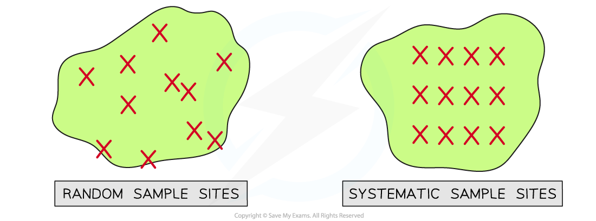

# Random Sampling

## Random Sampling

> **Spec point** — `spcpt_HZgxVJdRjPsnbHYV` · explain the importance of random sampling in determining the biodiversity of an area

## Random sampling

- Measuring the different levels of biodiversity within an ecosystem can be a time-consuming task
- Finding out which species live in an ecosystem and the size of the populations requires the **identification and cataloging** of all organisms present to build a **species list**
- This is possible for areas that are very small or where the species are very large, like trees
- However, for larger and more complex ecosystems like rainforests, it is simply **impossible **to find, identify and count every organism that exists there
- When this is the case different** samples **of the area can be taken and used to make **estimates of the total** species numbers in the area

### Sampling

- Sampling is a method of investigating the **[abundance and distribution of species ](https://www.savemyexams.com/a-level/biology/cie/25/revision-notes/18-classification-biodiversity-and-conservation/18-2-biodiversity/testing-for-distribution-and-abundance/?_ai=internal-linking)****and populations**
- There are two different types of sampling:

  - **Random**
  - **Systematic**
- In random sampling the positions of the **sampling points **are completely random or **due to chance**

  - This method is beneficial because it means **there will be no bias** on the part of the person that is carrying out the sampling that may affect the results
- In systematic sampling the sampling points are placed at regular intervals, for example every 2 m along a transect line; this is used when there is a gradient in conditions across the area
- When a sampling area is **reasonably uniform** or has **no clear pattern** to the way the species are distributed then** random sampling **is the best choice

*Random sampling differs from systematic sampling when choosing sample sites on an island*
