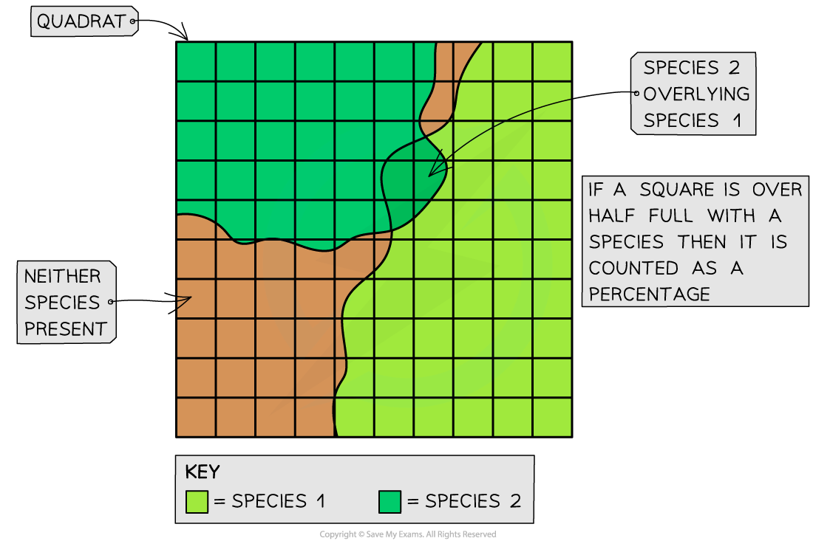
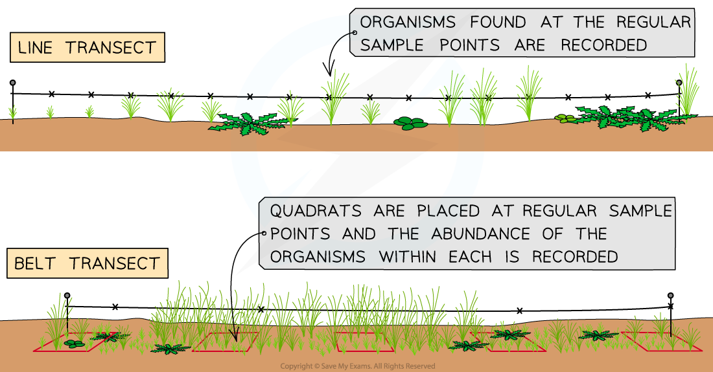

# Testing for Distribution & Abundance

## Testing for Distribution & Abundance

> **Spec point** — `spcpt_3f7ZyNb4ZQPjFZkF` · describe and use suitable methods to assess the distribution and abundance of organisms in an area, limited to frame quadrats, line transects, belt transects and mark-release-recapture using the Lincoln index

## Testing for distribution & abundance

- The **distribution** of a species describes how it is spread throughout the ecosystem
- The **abundance** of a species is the number of individuals of that species
- The distribution and abundance of a species in an area can be assessed using different practical methods:

  - Frame** quadrats**
  - Line and belt **transects**
  - **Mark-release-recapture**

### Frame quadrats

- Some ecosystems are very complex with large numbers of different species of different sizes
- For the sake of logistics, **sampling** is often used to estimate the **distribution** and **abundance** of species
- When carrying out sampling, square frames called **quadrats** can be used to mark off the area being sampled
- Quadrats of different sizes can be used depending on what is being measured and what is most suitable in the space the samples are being made in

  - These are usually made of wood or metal and measure 25 cm × 25 cm, 50 cm × 50 cm or 1 m × 1 m
- Quadrats must be laid **randomly** in the area to **avoid *****sampling bias***

  - This random sampling can be done by converting the sampling area into a **grid format **and labelling each square on the grid with a number
  - Then a random number generator is used to pick the sample points
- Once the quadrat has been laid on the chosen sample point the **abundance** of all the **different** **species** present can be recorded

#### Results from quadrats

- The results from the quadrats can be used to calculate the **predicted frequency** and **density **of a species within an area
- **Species frequency **is the probability that the species will be found within any quadrat in the sample area

  - The number of **quadrats** that the species was present in is divided by the total number of quadrats and then multiplied by 100
  - For example, if bluebells were found in 18 out of 50 quadrats the species frequency would be (18÷50) x 100 = 36%
- **Species density **indicates how many individuals of that species there are per unit area

  - The number of individuals counted across **all quadrats** is divided by the total area of all the quadrats
  - For example, if 107 bluebells were found across 50 quadrats that are 1m2 each the species density would be 107/50 = 2.14 individuals per m2
- It can sometimes be difficult to count individual plants or organisms. When this is the case **percentage cover** of the species within the quadrat can be estimated instead

  - The quadrat is divided into 100 smaller squares
  - The number of squares the species is found in is equivalent to its percentage cover in that quadrat
  - For example, if grass is found in 89 out of 100 squares in the quadrat then it has a percentage cover of 89%

*Percentage cover of grass in a quadrat - There may be some squares lacking any species and other squares with multiple species overlying one another. Therefore the total percentage cover of a single quadrat can sometimes be over or under 100%*

### Line and belt transects

- Throughout some areas, there can be **changes in the physical conditions**

  - For example, there may be changes in altitude, soil pH or light intensity
- When investigating the species distribution in these kinds of areas, **systematic sampling **is more appropriate
- Methods using **transects **can help show how species distribution changes with the different physical conditions in the area

  - A transect is a line represented by a **measuring tape**, along which sample are taken
- For a **line transect:**

  - Lay out a measuring tape in a straight line across the sample area
  - At **equal distances **along the tape **record the identity of the organisms that touch the line. **For example, every 2m
  - This produces qualitative data
- For a **belt transec**t:

  - Place quadrats at **regular intervals **along the tape and **record the abundance of each species within each quadrat**
  - This produces quantitative data

*A line transect and belt transect is carried out in the field*

### Mark-release-recapture

- The methods above are only useful for stationary organisms
- Different methods are required for estimating the number of individuals in a population of **mobile animals**
- The **mark-release-recapture** method is used in conjunction with** the Lincoln Index**
- For a single species in the area:

  - The **first large sample is taken**. As many individuals as possible are captured / collected, counted and **marked** in a way that won’t affect their survival
  - They are **returned to their habitat **and allowed to mix randomly with the rest of the population
  - When a sufficient amount of time has passed **another large sample is captured**
  - The numbers of marked and unmarked individuals within the sample are **counted**
  - The proportion of marked to unmarked individuals is used to calculate an **estimate of the population size**
  - The formula for the calculation is:

$N=\frac{n_{1}\timesn_{2}}{m_{2}}$

- Where:

  - **N** = population estimate
  - **n****1 **= number of marked individuals released
  - **n****2** = number of individuals in the second sample (marked and unmarked)
  - **m****2** = number of marked individuals in the second sample

> **Worked Example**
> ### Lincoln Index with mark-release-recapture
> 
> Scientists wanted to investigate the abundance of leafhoppers (*Cicadellidae* species) in a small grassy meadow. They used sweep nets to catch a large sample of leafhoppers from the meadow.
> 
> 
> 
> *A sweep net used to collect insects (Kieren, CC BY 3.0, via Wikimedia Commons)*
> 
> 
> 
> *A leafhopper after capture in a sweep net (Donald Hobern from Copenhagen, Denmark, CC BY 2.0, via Wikimedia Commons)*
> 
> Each insect was marked on its underside with non-toxic, waterproof paint and then released back into the meadow. The following day, another large sample was captured from the same area using sweep nets.
> 
> - No. caught and marked in first sample  (**n****1**) = 236
> - No. caught in second sample (**n****2**) = 244
> - No. of marked individuals in the second sample (**m****2**)  = 71
> 
> Using the equation
> 
> $N=\frac{n_{1}\timesn_{2}}{m_{2}}$
> 
> $N=\frac{236\times244}{71}=\frac{57584}{71}=811$
> 
> **N** (estimated population size) = <u>811 leafhoppers</u>

> **Exam Hint**
> You will be provided with the formula for Lincoln’s index in the exam. You need to be able to carry out the calculation to estimate population size from mark-release-recapture data, as you could be asked to do this in the exam.
