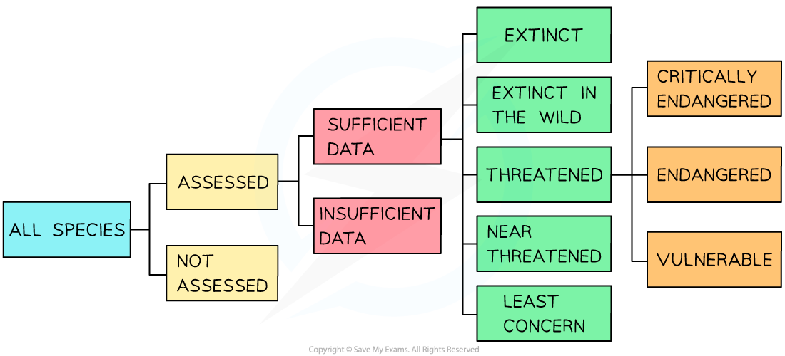

# Role of IUCN in Conservation

## Role of IUCN & CITES in Conservation

> **Spec point** — `spcpt_ysYYPzQv3JgzjPwN` · outline the role in conservation of the International Union for Conservation of Nature (IUCN) and the Convention on International Trade in Endangered Species of Wild Fauna and Flora (CITES)

## Role of IUCN & CITES in conservation

- **International cooperation** is essential if conservation is to be successful
- There are several agreements and authorities that exist within and between countries with the aim of protecting and conserving species worldwide

### IUCN

- The **I**nternational **U**nion for the **C**onservation of **N**ature (IUCN) is described as “The global authority on the status of the natural world and the measures needed to safeguard it”
- One of the duties that the IUCN carries out is **assessing the conservation status of animal and plant species** around the world

  - The IUCN has its own classification system
  - There are several different categories and levels that a species can fall into depending on their **population numbers and the threats and risks** to those populations
  - Scientists use data and modelling to estimate which category each species should be in
- Animals that are on the **IUCN Red List** of Threatened Species™ can be seen online as this list is made public

*The IUCN classification system of species—scientists are continually updating and reviewing the conservation status of species*

### CITES

- The **C**onvention on **I**nternational **T**rade in **E**ndangered **S**pecies of Wild Flora and Fauna (CITES) is a **global agreement** that has been signed by over 150 countries
- Its aim is to **control the trade of endangered species and their associated products**

  - For example, elephants and their ivory tusks
- CITES categorises endangered and vulnerable species into **three appendices:**

  - Appendix I : species that are endangered and** face the greatest risk of extinction **(for example, the red panda)
  - Appendix II: species that are **not currently endangered** or facing extinction, but **will be **unless trade is closely controlled (for example, the venus fly trap)
  - Appendix III: species included at request of the country that is regulating trade of the species and trying to **prevent its overexploitation **(for example, the two-toed sloth in Costa Rica)
- There are different **trading regulations** that apply to each appendix:

  - For species in appendix I: all trade in the species and their associated products is **banned**
  - For species in appendix II: trade is **only granted if an export permit** has been issued by the involved countries
  - For species in appendix III: **permits** are required for regulated trade. Permits are **easier to come by** for species in this appendix
- Scientists are continuously adding new species and reviewing the status of species already in the database
- There are several concerns about the efficacy of CITES listings

  - When the trade of a certain endangered species becomes illegal, its price increases
  - The **increased economic value** of the species can be a major incentive for people to break the law
