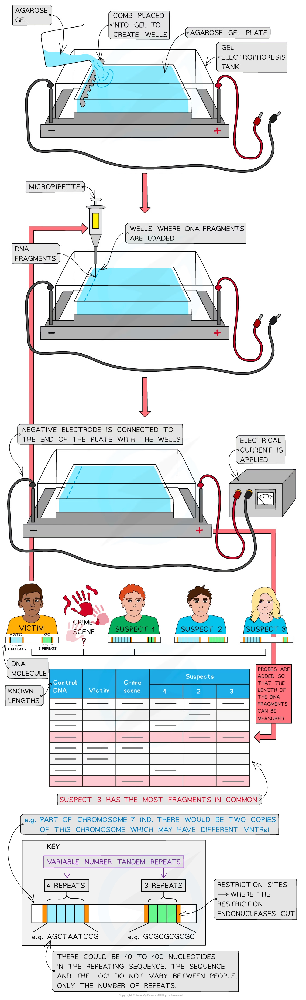

# Gel Electrophoresis

## Gel Electrophoresis

> **Spec point** — `spcpt_JVzmTTfY9XT5MpD9` · describe and explain how gel electrophoresis is used to separate DNA fragments of different lengths

## Gel electrophoresis

- Gel electrophoresis is widely used to analyse DNA, RNA and proteins
- During electrophoresis, the **molecules** are **separated** according to their **size/mass** and their **net (overall) charge**
- The separation occurs because:

  - Of the electrical charge that molecules carry – positively charged molecules will move towards the cathode (negative pole), whereas negatively charged molecules will move towards the anode (positive pole)
  - **DNA is negatively charged** due to the **phosphate** groups and thus when placed in an electric field the molecules **move towards the anode**
  - Different-sized molecules move through the gel (agarose for DNA and polyacrylamide – PAG for proteins) at different rates
  - The tiny pores in the gel result in **smaller molecules** moving **quickly**, whereas **larger molecules** move **slowly**
  - Different types of gel have different-sized pores
  - The pore size affects the speed at which molecules can move through them

### DNA separation

- DNA can be collected from almost any body tissue, e.g. the root of a hair or saliva from a cup.
- After collection, DNA must be prepared for gel electrophoresis so that the **DNA** can be **sequenced** or analysed for **genetic profiling** (**fingerprinting**)
- To prepare the fragments, scientists must first increase (amplify) the number of DNA molecules by the polymerase chain reaction (PCR)
- Then, restriction endonucleases (enzymes) are used to cut the DNA into fragments
- Different restriction enzymes cut the DNA at different base sequences
- Therefore scientists use enzymes that will cut close to the **variable number tandem repeat** (VNTR) regions
- **Variable number tandem repeats** (VNTRs) are regions found in the non-coding part of DNA
- VNTRs contain **variable numbers of repeated DNA sequences** and are known to **vary between different people** (except for identical twins)
- These VNTRs may be referred to as ‘satellite’ or ‘microsatellite’ DNA

#### How scientists separate DNA fragments in gel electrophoresis

- Create an **agarose gel** plate in a tank by pouring liquid agarose and waiting for it to set as a gel
- Mould wells (a series of grooves) into the gel at one end, using a comb that creates wells as the agarose gel solidifies
- Submerge the gel in an **electrolyte** solution (a salt solution that conducts electricity) in the tank
- Load (insert) the fragments into the wells using a **micropipette**
- Apply an **electrical current** to the tank
- The negative electrode must be connected to the end of the plate with the wells as the DNA fragments will then move towards the anode (positive pole) due to the attraction between the negatively charged phosphates of DNA and the anode
- The smaller mass / shorter pieces of DNA fragments will move faster and further from the wells than the larger fragments
- The fragments are not visible so must be transferred onto absorbent paper or nitrocellulose, which is then heated to separate the two DNA strands
- **Probes** are then added, after which an **X-ray** image is taken or **UV light** is shone onto the paper, producing a pattern of bands which is generally compared to a control fragment of DNA
- **Probes** are **single-stranded DNA sequences** that are **complementary** to the **VNTR** regions sought by the scientists
- The probes also contain a means by which to be identified. This can either be:

  - A **radioactive label** (eg. a phosphorus isotope) which causes the probes to emit radiation that makes the X-ray film go dark, creating a pattern of dark bands
  - A **fluorescent label** which fluoresces (shines) when exposed to ultraviolet (UV) light, creating a pattern of coloured bands

### Protein separation

- The amino acid composition of a protein determines the **charge** on each protein

  - Because each individual amino acid's **R group** is charged differently
- The charge of the R groups depends on the **pH** so **buffer solutions** are used during the separation of proteins to keep the pH constant
- Gel electrophoresis is used to **separate polypeptide chains** produced by different genes or alleles, e.g. α-globin and β-globin (coded for by different genes) and normal and sickle cell β-globin (coded for by different alleles of the same gene)

*The separation of DNA fragments using gel electrophoresis. Gel electrophoresis can be used in DNA profiling where scientists separate the VNTRs (as these are unique to every person except identical twins)*

> **Exam Hint**
> Remember gel electrophoresis is the separation of molecules according to their size and charge (negatively charged DNA molecules move to the positive pole). Examiners like to ask questions about gel electrophoresis.
