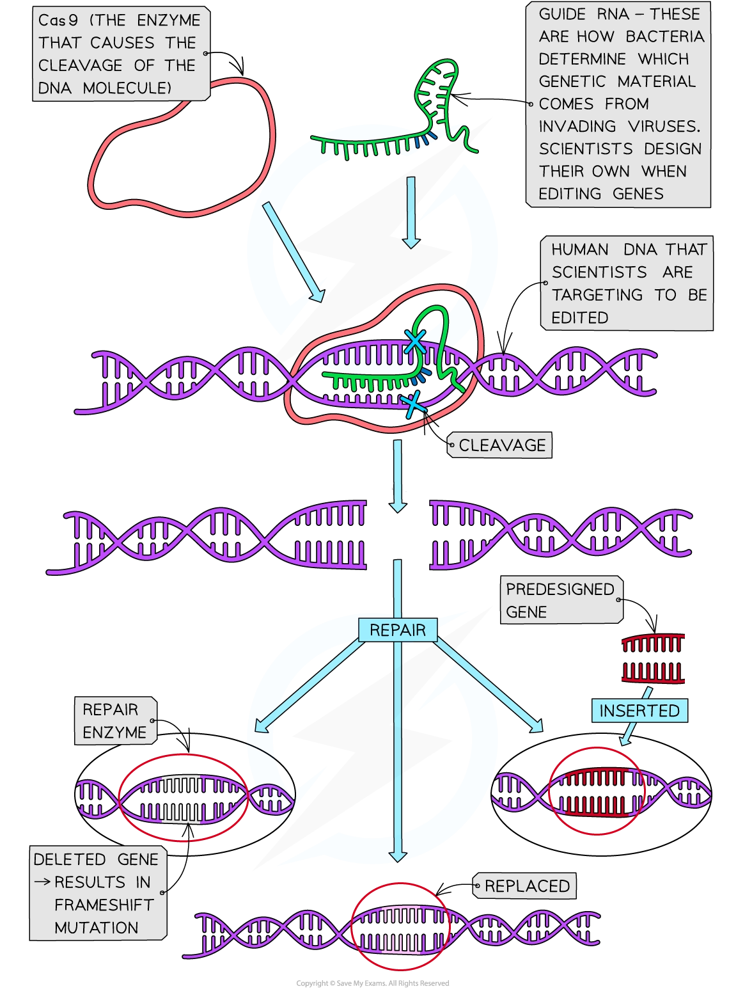

# Gene Editing

## Gene Editing

> **Spec point** — `spcpt_x696dvzhvGmVwznB` · explain that gene editing is a form of genetic engineering involving the insertion, deletion or replacement of DNA at specific sites in the genome

## Gene editing

- Gene editing (or genome editing) allows genetic engineers to **alter the DNA** of organisms by inserting, deleting or replacing DNA at specific sites in the genome known to cause disease
- It is a form of genetic engineering; DNA can be inserted, deleted or replaced at a precise site, and inserted DNA may come from another species, so gene editing can produce a transgenic organism
- Gene editing enables the scientists to be more accurate in their manipulation of the genome
- In the past, inaccurate methods using vectors were used
- These included

  - Modifying viruses to insert DNA into the gene causing the disease
  
    - However this resulted in DNA being inserted into other genes causing **unforeseen consequences**
  - Liposomes (small spheres of lipid molecules) containing the normal gene which was sprayed into noses
  
    - This was only a short-term solution as the epithelial cells lining the nasal passageway were **short-lived**
- Today, scientists have developed new gene-editing techniques

  - The most common is **CRISPR** (Clustered Regularly Interspaced Short Palindromic Repeats)
  
    - This technique involves using the natural defence mechanism that **bacteria **(and some archaea) have evolved to cut the DNA strands at a specific point as determined by a guide **RNA **attached to an **enzyme** (Cas9)
    - Once cut, scientists can then either insert, delete or replace the ‘faulty’ DNA with normal DNA
- Gene editing is involved in gene therapies (e.g. developing treatments for cystic fibrosis and sickle cell anaemia)
- **Gene therapy** is the treatment of a genetic disease by **altering the person’s genotype**
- As scientists learn more about the human genome (from the Human Genome Project) and the *proteome* and have the technology to process large quantities of data through computational biology, they are gaining a better understanding of which genes are responsible for genetic diseases and where they are located and therefore what DNA base (A, G, C, T) changes need to occur to treat or cure the disease

*Gene editing involves inserting, deleting or replacing DNA at a specific site in the genome, located using guide RNA and cut by the Cas9 enzyme*

> **Exam Hint**
> The key point to remember is that gene editing is a form of genetic engineering involving the insertion, deletion or replacement of DNA at specific sites in the genome, and that the inserted DNA can come from another species, so gene editing can produce a transgenic organism.
