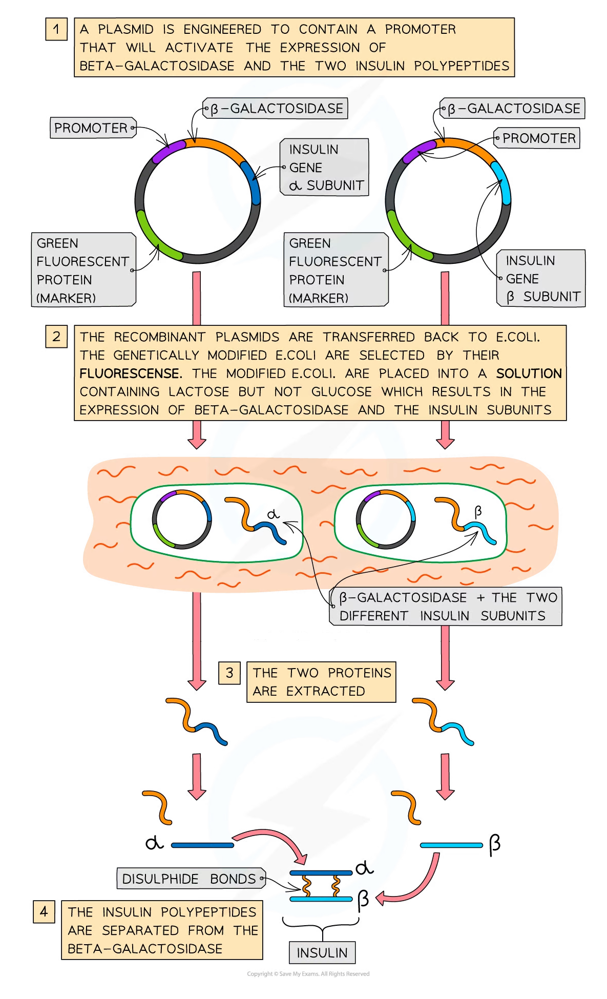
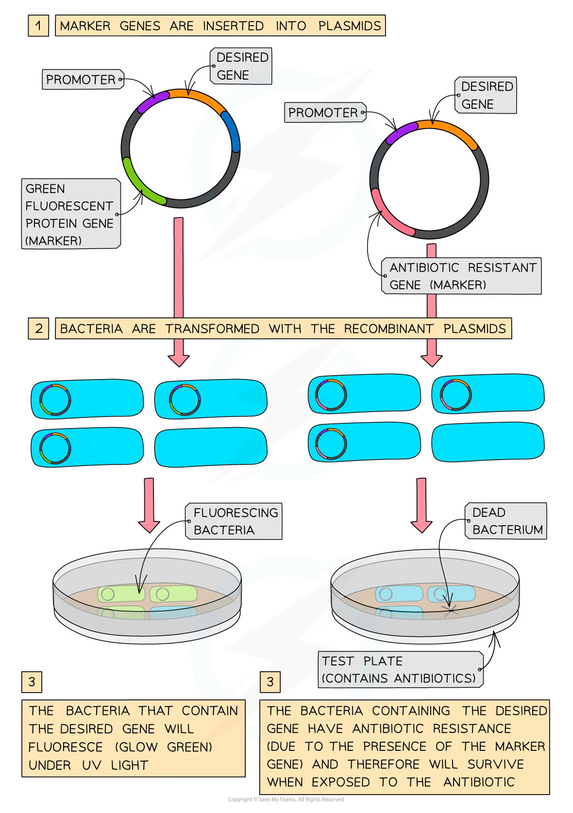

# Genetic Engineering: Promoters & Marker Genes

## Genetic Engineering: Promoter

> **Spec point** — `spcpt_pQsrDVKFqbcTgfG2` · explain why a promoter may have to be transferred into an organism as well as the desired gene

## Genetic engineering: promoter

- The **promoter **is the **region of DNA that determines which gene will be expressed**
- This is because it is the **site where RNA polymerase binds** in order to begin transcription

  - A promoter is one example of a length of non-coding DNA that has a specific function
- The promoter also ensures that RNA polymerase can recognise which strand is the DNA template strand

  - RNA polymerase recognises the template strand as the promoter contains the **transcription start point** (the first nucleotide of the gene to be transcribed) which is where the enzyme will bind
- Thus the promoter is used to **regulate gene expression** because only if it is present will transcription and therefore the expression of the gene occur
- If genetic engineers want to ensure the desired gene is expressed when modifying the plasmid they have to **add an appropriate promoter**
- As with eukaryotic cells, bacteria have many different genes coding for many different proteins although not all genes are switched on at once
- Bacteria will only express genes (to make proteins) if the growing conditions require a certain protein (e.g., *E. coli* bacteria only make[ β-galactosidase enzymes ](https://www.savemyexams.com/a-level/biology/cie/25/revision-notes/16-inheritance/16-3-gene-control/gene-control-lac-operon/?_ai=internal-linking)when their growing medium contains lactose but lacks glucose)
- Scientists used this knowledge when first genetically engineering bacteria to produce insulin

  - In this case, they added the insulin gene along with the β-galactosidase gene to share a promoter (which switched on the gene when the bacteria needed to metabolise lactose)
  - So when the scientists grew the bacteria in a medium containing lactose but no glucose, the bacteria produced the β-galactosidase and human insulin

*Promoters are included in plasmids that have been genetically engineered to produce human insulin*

> **Exam Hint**
> When describing how a plasmid is genetically engineered remember to mention the promoter, as it causes the desired gene to be expressed.

## Genetic Engineering: Marker Genes

> **Spec point** — `spcpt_55vQM6cj9znDF8GY` · explain how gene expression may be confirmed by the use of marker genes coding for fluorescent products

## Genetic engineering: marker genes

- A **marker** is a gene that is transferred with the desired gene to enable scientists to **identify** which **cells** have been **successfully altered** and now contain recombinant DNA
- **Antibiotic-resistant genes **were once commonly used as marker genes

  - Scientists genetically modified the bacteria so that the plasmid contained the desired gene along with a specific antibiotic-resistant gene (and promoter) and then grew the bacteria on agar plates embedded with that antibiotic
  - The bacteria that contained the recombinant plasmids could be identified as these were the bacteria that grew successfully
- Using antibiotic-resistant genes as marker genes concerns scientists as:

  - There is a risk that the antibiotic-resistant genes could be** accidentally transferred **to other bacteria including pathogenic strains creating pathogenic antibiotic-resistant bacteria
  - If the resistance spreads to other bacteria this could **make antibiotics less effective**

- The spread of antibiotic-resistant genes can occur due to:

  - **conjugation** (the transfer of genetic material from one bacterium to another), or
  - **transduction** (the transfer of genetic material from one bacterium to another via a virus)
- So **genes** that express proteins that are **fluorescent** are now commonly used as **markers**
- The fluorescence is due to the presence of a **green fluorescent protein** (GFP)
- The GFP gene along with the desired gene are linked to a specific **promoter**
- Once this promoter is activated, and the protein is expressed, the recombinant bacteria are detected when they glow green under exposure to ultraviolet light
- The use of fluorescent genes as markers is preferable because:

  - They are **easier to identify** (all that is required is the ultraviolet light)
  - **More economical** (do not need to grow the bacteria on plates of agar infused with antibiotics)
  - **No risk of antibiotic resistance **being passed on to other bacteria
  - There are antibiotics that are no longer effective and therefore would not stop any bacteria from growing

*Green fluorescent protein (GFP) and antibiotic-resistant genes are used to determine if an organism has been genetically modified*

> **Exam Hint**
> It is a common question to ask about why fluorescent proteins are being used as markers more often than antibiotic resistance, so ensure you have an understanding of both methods of identifying the recombinant cells.
