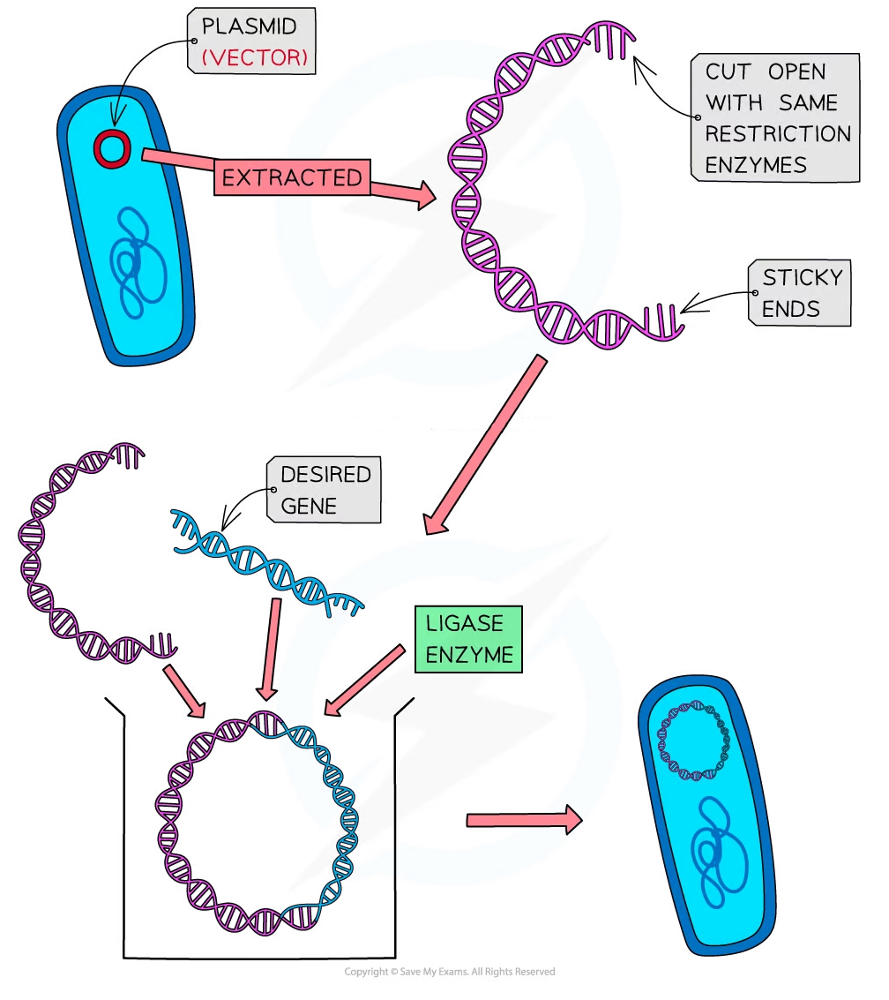

# Genetic Engineering: Vectors

## Genetic Engineering: Vectors

> **Spec point** — `spcpt_zh29HXJWxNby4WGN` · explain the roles of restriction endonucleases, DNA ligase, plasmids, DNA polymerase and reverse transcriptase in the transfer of a gene into an organism

## Genetic engineering: vectors

- Vectors are used to **transfer the desired genes** into a foreign cell
- **Plasmids** are the most commonly used vector but **viruses** and **liposomes** (a small vesicle with a [phospholipid](https://www.savemyexams.com/a-level/biology/cie/22/revision-notes/2-biological-molecules/2-2-carbohydrates--lipids/2-2-8-phospholipids/) layer) can also be used to transfer genes

### Plasmids

- Plasmids are small, circular **rings** of double-stranded DNA
- They occur naturally in bacteria, but can also be found in archaea and eukaryotic organisms (e.g., yeast and fungi) and can contain genes for antibiotic resistance
- Plasmids are used as they can **self-replicate**
- A plasmid is used to **transfer** the desired gene to a new organism
- To insert the desired gene into the circular DNA of the plasmid it is ‘cut’ open

  - The **same restriction endonuclease** that was used to isolate the desired gene is used to ‘cut’ open the plasmid
  - This results in the plasmid having **complementary sticky ends** to the sticky ends on the desired gene fragment
- **DNA ligase** forms phosphodiester bonds between the sugar-phosphate backbone of the DNA fragment and the plasmid to form a **recombinant** plasmid (a closed circle of double-stranded DNA containing the desired gene)
- Scientists can **modify** bacterial plasmids or produce them artificially

  - One benefit of this is that the plasmids can have one or more [marker genes](https://www.savemyexams.com/a-level/biology/cie/22/revision-notes/19-genetic-technology/19-1-principles-of-genetic-technology/19-1-6-genetic-engineering-promoters--marker-genes/#genetic-engineering-marker-genes) so that cells that have the **recombinant plasmids can be identified**
- Plasmids are transferred into host cells (usually bacteria) by a process called **transformation**
- Only a small proportion of bacteria will become transformed and **markers** are used to identify transformed cells
- Transformation can occur by:

  - Bathing the plasmids and bacteria in an ice-cold calcium chloride solution and then briefly incubating at 40°C
  - This makes the bacterial membrane **permeable**
  - Electroporation - where the bacteria are given a small electrical shock, making the membranes very porous (this technique can be used to get DNA fragments into eukaryotic cells)

*A plasmid is genetically engineered with the desired gene*

> **Exam Hint**
> Remember, two enzymes are used in the preparation of a plasmid vector – **restriction endonucleases** and **DNA ligase**. Also, the **same** restriction endonuclease must be used to ‘cut’ open the plasmid as was used to isolate the desired gene.
