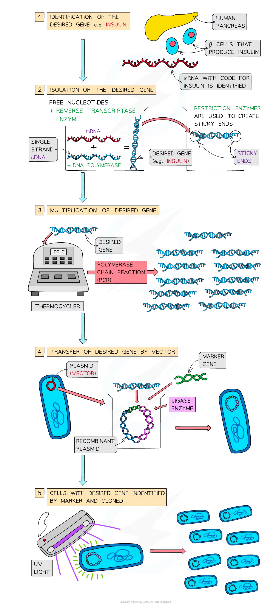

# Genetic Engineering

## Genetic Engineering Explained

> **Spec point** — `spcpt_ChnYcZBbxwvXg9rY` · explain that genetic engineering is the deliberate manipulation of genetic material to modify specific characteristics of an organism and that this may involve transferring a gene into an organism so that the gene is expressed

## Genetic engineering explained

- Genetic engineering is a technique used deliberately to modify a specific characteristic (or characteristics) of an organism
- The technique involves **removing a gene** (or genes) with the desired characteristic from **one organism** and **transferring** the gene (using a **vector**) **into another** organism where the **desired gene is then expressed**
- The genetically engineered organism will then contain **recombinant DNA** and will be a genetically modified organism (GMO)
- For an organism to be genetically engineered the following steps must be taken:

  - **Identification** of the **desired gene**
  - **Isolation** of the desired gene by:
  
    - Cutting from a chromosome using enzymes (**restriction endonucleases**)
    - Using **reverse transcriptase** to make a single strand of complementary DNA (**cDNA**) from mRNA
    - Creating the gene artificially using nucleotides
  - **Multiplication** of the gene (using polymerase chain reaction - PCR)
  - **Transfer** into the organism using a **vector** (e.g. plasmids, viruses, liposomes)
  - **Identification** of the cells with the new gene (by using a **marker**), which is then cloned
- Genetic engineers need the following to modify an organism:

  - **Enzymes** (restriction endonucleases, ligase and reverse transcriptase)
  - **Vectors** - used to deliver genes into a cell (eg. plasmids, viruses and liposomes)
  - **Markers** - genes that code for identifiable substances that can be tracked (e.g. GFP - a green fluorescent protein which fluoresces under UV light or GUS - β-glucuronidase enzyme which transforms colourless or non-fluorescent substrates into products that are coloured or fluorescent)
- Genetic engineering is being used in the new field of science called **synthetic biology**

  - This is an area of research that studies the design and construction of different biological pathways, organisms and devices, as well as the redesigning of existing natural biological systems

*An overview of the steps taken to genetically engineer an organism (in this case bacteria are being genetically engineered to produce human insulin)*

> **Exam Hint**
> In your answer about genetic engineering you should remember to include the names of the enzymes (**restriction endonucleases**, **reverse transcriptase**, **ligase**) involved in genetic engineering **and** mention that markers (genes which can be identified) and vectors (transfer the desired gene) are also used.
