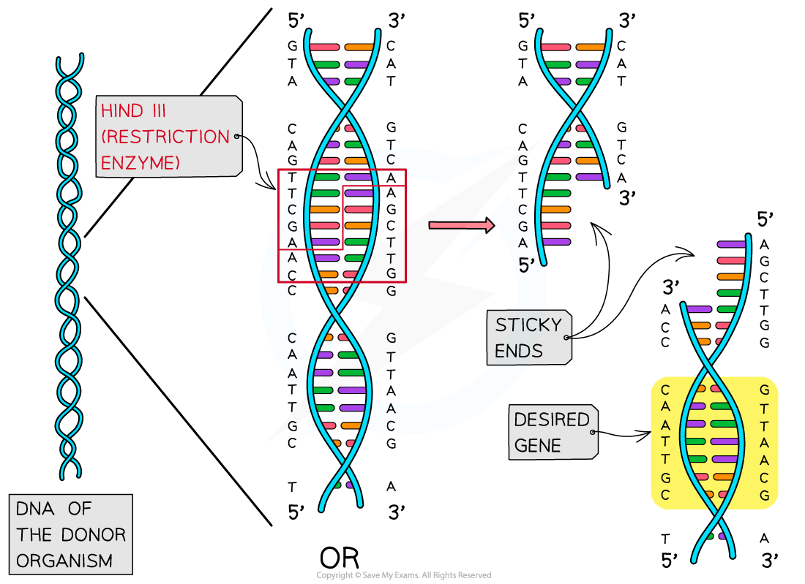
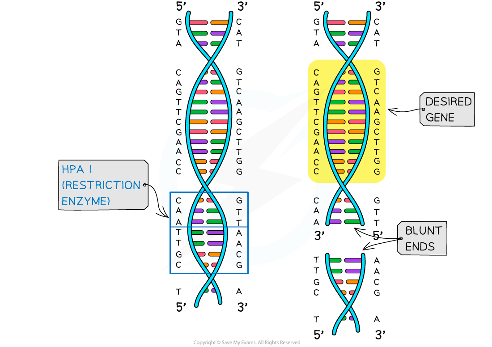
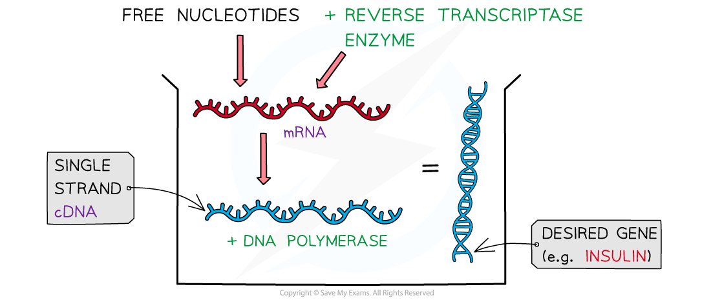
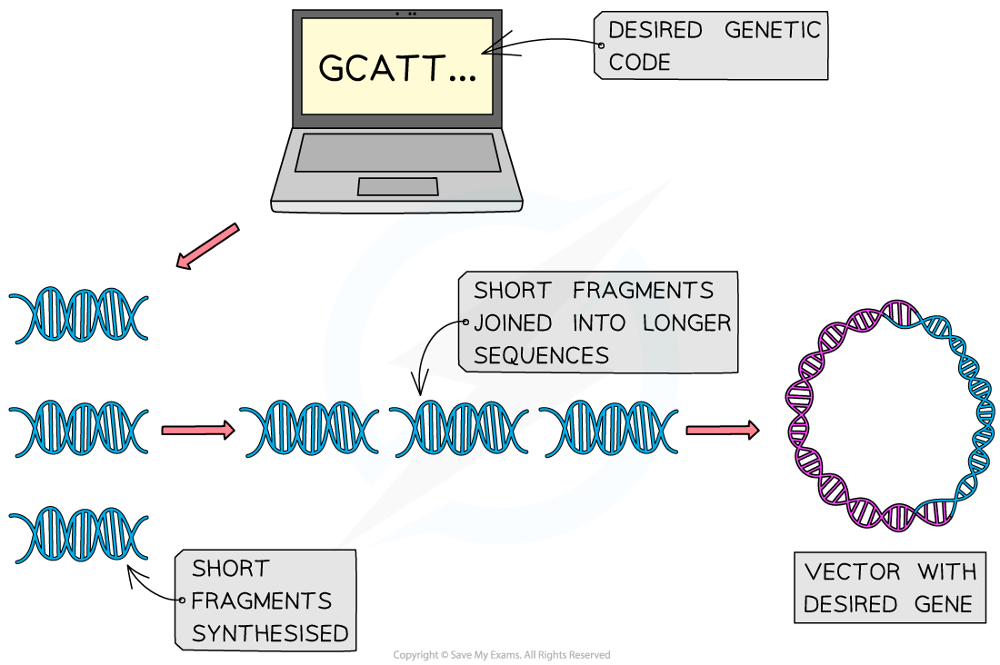

# Isolating the Desired Gene

## Isolating the Desired Gene

> **Spec point** — `spcpt_dzp6Wzcdh5DThPMf` · explain that genes to be transferred into an organism may be:
• extracted from the DNA of a donor organism
• synthesised from the mRNA of a donor organism
• synthesised chemically from nucleotides

## Isolating the desired gene

- The gene with the specific characteristic that is required can be obtained in the following ways:

  - Extracting the gene from the DNA of a donor organism using enzymes (**restriction endonucleases**)
  - Using **reverse transcriptase** to synthesise a single strand of complementary DNA (**cDNA**) from the mRNA of a donor organism
  - Synthesising the gene **artificially** using nucleotides

### Extraction of genes

- The extraction of the gene (containing the desired nucleotide sequence) from the donor organism occurs using **restriction endonucleases**
- Restriction endonucleases are a class of enzymes found in bacteria

  - They are used as a **defence mechanism** by bacteria against bacteriophages (viruses that infect bacteria, also known simply as phages)
- The enzymes **restrict** a viral infection by cutting the viral genetic material into smaller pieces at specific nucleotide sequences **within** the molecule

  - This is why they are called restriction endonuclease (‘endo’ means within)
- They are also referred to simply as **restriction enzymes**
- There are many different restriction endonucleases because each one binds to a **specific restriction site** (specific sequences of bases) on DNA, eg. *HindIII* will always bind to the base sequence AAGCTT
- The restriction endonucleases are named according to the bacteria they are sourced from and which numbered enzyme it is from that source (eg. *HindIII* comes from *Haemophilus influenzae* and it is the third enzyme from that bacteria)
- Restriction endonucleases will separate the two strands of DNA at the specific base sequence by ‘cutting’ the sugar-phosphate backbone in an uneven way to give **sticky ends** or straight across to give **blunt ends**
- Sticky ends result in one strand of the DNA fragment being longer than the other strand
- The sticky ends make it easier to insert the desired gene into another organism's DNA as they can easily form **hydrogen bonds** with the complementary base sequences on other pieces of DNA that have been cut with the **same** restriction enzyme
- When using genes isolated by restriction endonucleases that give blunt ends, nucleotides can be added to create sticky ends

*Restriction endonucleases are used to isolate the desired gene to be transferred to another organism*

### mRNA and reverse transcriptase

- Another method to isolate the desired gene is to use the mRNA that was transcribed for that gene
- Once isolated, the mRNA is then combined with a **reverse transcriptase** enzyme and nucleotides to create a **single strand** of **complementary DNA** (**cDNA**)
- Reverse transcriptase enzymes are sourced from retroviruses and they catalyse the reaction that reverses transcription

  - The **mRNA is used as a template to make the cDNA**
- **DNA polymerase** is then used to convert the single strand of cDNA into a **double-stranded DNA **molecule that contains the desired code for the gene
- This technique for isolating the desired gene is considered advantageous as it is easier for scientists to find the gene because specialised cells will make very specific types of mRNA (eg. β-cells of the pancreas produce many insulin mRNAs) and the **mRNA **(therefore the cDNA)** does not contain introns**

*mRNA and reverse transcriptase are used to isolate the desired gene to be transferred to another organism*

### Artificial synthesis

- As scientists are becoming more familiar with the base sequences for our proteins (proteome) it is possible to synthesise genes **artificially**
- With the knowledge of the genetic code (that is, which amino acids are required), scientists **use computers to generate the nucleotide sequence** (rather than an mRNA template) to produce the gene
- Short fragments of DNA are first produced that are joined to make longer sequences of nucleotides and then[ inserted into vectors ](https://www.savemyexams.com/a-level/biology/cie/25/revision-notes/19-genetic-technology/19-1-principles-of-genetic-technology/genetic-engineering-vectors/?_ai=internal-linking)(eg. plasmids)
- This method is being used to create novel genes used to make vaccines and even to synthesise new bacterial genomes
- This method has the advantage that a synthesised gene does not have to be cut out of an existing genome and will not contain introns or other unnecessary lengths of non-coding DNA

*Desired genes are artificially synthesised to be transferred to another organism.*

> **Exam Hint**
> In your answer it is important to include the names of the enzymes (**restriction endonuclease**, **reverse transcriptase**, **DNA polymerase**) and the product (**cDNA**).
