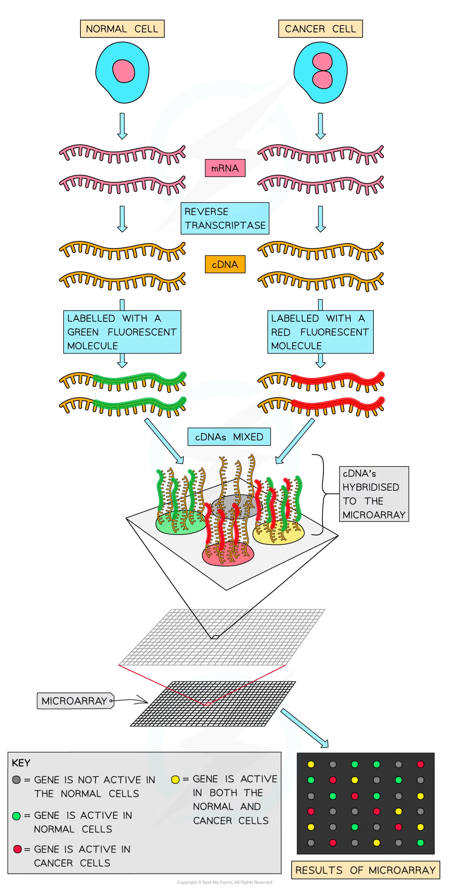

# Microarrays

## Microarrays

> **Spec point** — `spcpt_2Ck9539KdzNQ35Zx` · outline how microarrays are used in the analysis of genomes and in detecting mRNA in studies of gene expression

## Microarrays

- [Microarrays](https://www.savemyexams.com/a-level/biology/cie/22/revision-notes/19-genetic-technology/19-1-principles-of-genetic-technology/19-1-10-microarrays/) are laboratory tools **used to detect the expression** of thousands of genes at the same time and to **identify the genes present** in an organism’s genome
- Microarrays are used in different ways, e.g.

  - **Pathology:** comparison between healthy cells and diseased cells to find the characteristics of the disease
  - **Biotechnology** (e.g. in agriculture to identify insect pests)
  - **Crime** (e.g. forensic analysis)
- As **large numbers of genes** can be studied in a short period of time, microarrays have been very valuable to scientists
- The microarray consists of a small (usually 2cm2) piece of glass, plastic or silicon (also known as chips) that have **probes** attached to a spot (called a gene spot) in a grid pattern

  - There can be 10 000 or more spots per cm2
- Probes are **short lengths of single-stranded DNA** (oligonucleotides) or RNA which are synthesised to be complementary for a specific base sequence (this sequence depends on the purpose of the microarray)

### Using microarrays to analyse genomes

- DNA is collected from the species going to be compared
- Restriction enzymes are used to cut the DNA into fragments
- These fragments are **denatured** to create single-stranded DNA molecules
- These DNA fragments are labelled using** fluorescent tags** (the fragments from the different sources are tagged in different colours, usually red and green)
- Once these fragments are mixed together they are allowed to *hybridise* with the probes on the microarray
- After a set period of time, any DNA that did not hybridise with the probes is washed off
- The microarray is then examined using **ultraviolet light** (which causes the tags to **fluoresce)** or **scanned** (colours are detected by the computer and the information is analysed and stored)
- The presence of the colour indicates where hybridisation has occurred, as the DNA fragment is complementary to the probe

  - If red and green fluorescent spots appear then only one species of DNA has hybridised, however, if the spot is **yellow** then both species have hybridised with that DNA fragment, which suggests that both species have that gene in common
  - If a spot **lacks colour** that indicates the gene is not present in either species

### Using microarrays to study gene expression

- When genes are being expressed or are in their active state, many copies of mRNA are produced by **transcription**
- The corresponding proteins are then produced from these mRNAs during **translation**

  - Thus scientists can indirectly, by assessing the quantity of mRNAs, determine which genes are being expressed in the cells
- Microarrays can be used to detect **whether a gene is being expressed** (a method used to research cancerous vs non-cancerous cells) by detecting the quantity of mRNA present
- To compare which **genes are being expressed **using microarrays the following steps occur:

  - **mRNA** is collected from both types of cells and **reverse transcriptase** is used to convert mRNA into **cDNA**
  - [PCR](https://www.savemyexams.com/a-level/biology/cie/25/revision-notes/19-genetic-technology/19-1-principles-of-genetic-technology/polymerase-chain-reaction/) may be used to increase the quantity of cDNA (this occurs for all samples to remain proportional so a comparison can be made when analysis occurs)
  - **Fluorescent tags** are added to the cDNA
  - The cDNA is then **denatured** to produce **single-stranded DNA**
  - The single-stranded DNA molecules are allowed to **hybridise** with the **probes** on the microarray
  - When the ultraviolet light is shone on the microarray the spots that fluoresce indicate that the gene was transcribed (expressed) and the **intensity of the light** emitting from the spots indicates the **quantity of mRNA** produced (i.e. how active the gene is)
  - If the light being emitted is of **high intensity** then **many mRNA** were present, while a **low intensity** emission indicates **few mRNA** are present

*The process of using microarrays to compare the expression of genes in cancerous and non-cancerous cells. The colours on the microarray identify which genes are active in cancerous cells compared to normal cells*

> **Exam Hint**
> The colours of the fluorescent tags (red, green and yellow) indicate whether a gene is present whereas the intensity of light emitted indicates the level of gene expression (the more light, the more the gene was being expressed) and this relates to the quantity of mRNA present.
