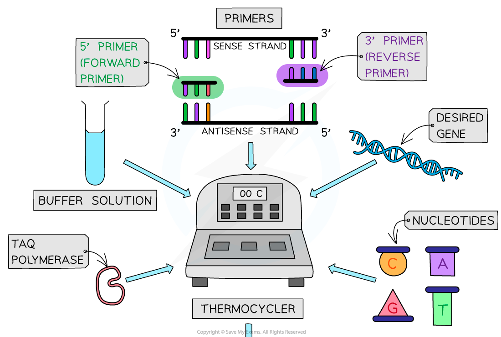
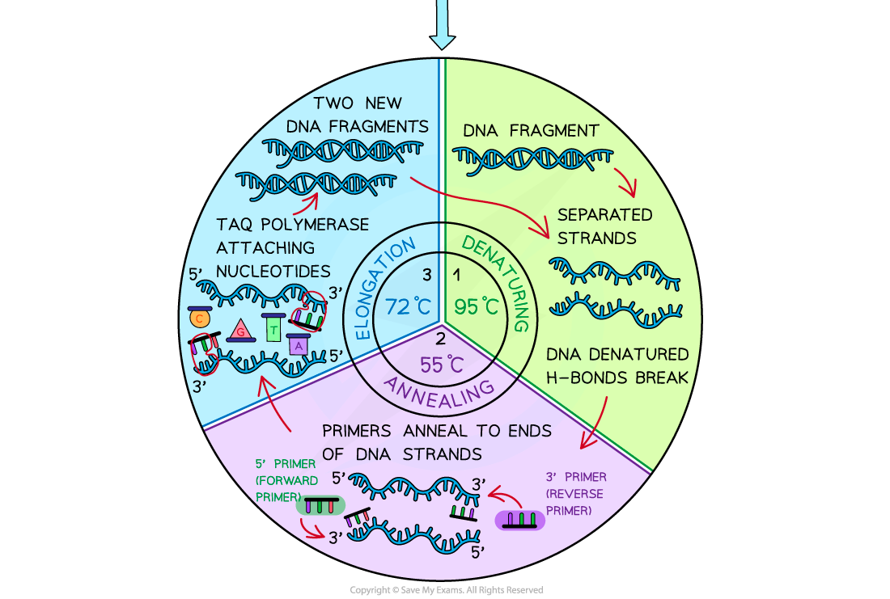

# Polymerase Chain Reaction

## Polymerase Chain Reaction (PCR)

> **Spec point** — `spcpt_MJYm57pF8k2qpvDk` · describe and explain the steps involved in the polymerase chain reaction (PCR) to clone and amplify DNA, including the role of Taq polymerase

## Polymerase chain reaction (PCR)

- **Polymerase chain reaction** (PCR) is a common molecular biology technique used in most applications of gene technology, for example, DNA profiling (eg. identification of criminals and determining paternity) or genetic engineering
- It can be described as an ***in vitro***** method of DNA amplification**
- It is used to produce **large quantities** of specific fragments of DNA from very small quantities (even just one molecule of DNA)

  - By using PCR, scientists can have billions of **identical copies** of the DNA sample within a few hours
- The PCR process involves **three key stages** per cycle. In each cycle, the DNA is doubled so in a standard run of 20 cycles a million DNA molecules are produced

  - The three stages are undertaken in a PCR instrument (or **thermal cycler**) which automatically provides the **optimal temperature** for each stage and controls the **length of time** spent at each stage

### Requirements of PCR reaction

- **Target DNA** being amplified
- **Primers** (forward and reverse) – these are short sequences of single-stranded DNA that have base sequences complementary to the 3’ end of the DNA being copied
- Primers define the region that is to be amplified by signalling to the DNA polymerase where to begin building the new strands
- **DNA polymerase** – is the enzyme used to build the new DNA strand

  - The most commonly used polymerase is ***Taq***** polymerase** as it comes from a thermophilic bacterium *Thermus aquaticus* which means it **does not denature** at the** high temperature** involved during the first stage of the PCR reaction
  - Secondly, its optimum temperature is high enough to prevent annealing of the DNA strands that have not been copied yet
- **Free nucleotides** – used in the construction of the DNA strands
- **Buffer solution** – to provide the optimum pH for the reactions to occur in

### Stages of PCR reaction

- **Denaturation** – the double-stranded DNA is heated to 95°C which breaks the hydrogen bonds that bond the two DNA strands together
- *Annealing* – the temperature is decreased to between 50 - 60°C so that primers (forward and reverse ones) can anneal to the ends of the single strands of DNA
- **Elongation / Extension –** the temperature is increased to 72°C for at least a minute, as this is the optimum temperature for *Taq *polymerase to build the complementary strands of DNA to produce the new identical double-stranded DNA molecules

*The substances required for polymerase chain reaction to occur and the three key stages of the reaction*

> **Exam Hint**
> It is important to know the three stages and the temperatures the reactions occur at during the different stages. You must also know why the *Taq* polymerase is used in PCR.
