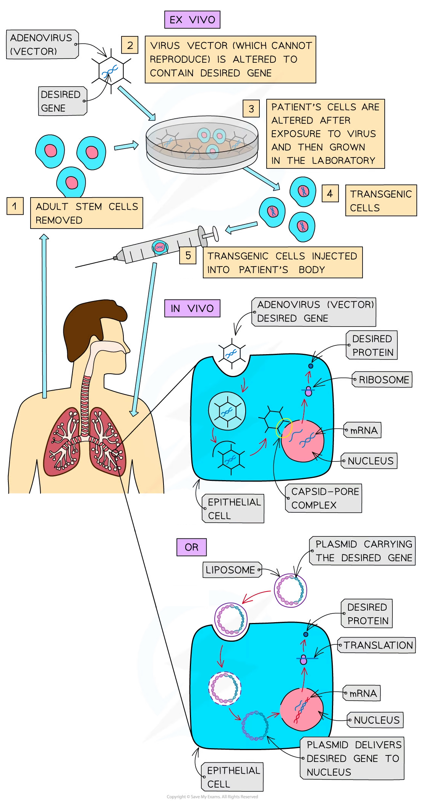

# Gene Therapy

## Gene Therapy

> **Spec point** — `spcpt_28t3QpKd9RRQrmBf` · outline how genetic diseases can be treated with gene therapy, using the examples severe combined immunodeficiency (SCID) and inherited eye diseases

## Gene therapy

- Gene therapy involves using various mechanisms to** alter a person's genetic material** to treat, or cure, diseases
- As scientists gain a better understanding of the human genome (and therefore the location of genes that cause genetic disorders), the possibilities of gene therapy being able to **replace a faulty gene**, **inactivate a faulty gene** or **insert a new gene** are growing
- Experimental techniques are being used to treat and research treatments for genetic diseases such as** severe combined immunodeficiency** (**SCID**), Leber congenital amaurosis – a rare form of blindness, β-thalassaemia and haemophilia B
- Most gene therapies are still in the clinical trial stage because scientists are having difficulty finding delivery systems that can transfer normal alleles into a person’s cells and ensure the gene is correctly expressed once there
- Finding an appropriate delivery system has been one of the problems

  - **Vectors** are currently used as the delivery system, with **viruses** being the most commonly used, but **non-viral vectors** are also being researched (e.g. **liposomes** and **‘naked’ DNA**)
- Viruses (e.g. retroviruses and lentiviruses) are the most commonly used vectors as they have the mechanisms needed to recognise cells and deliver the genetic material into them

- Changes in genetic material are **targeted to specific cells** and so will not be inherited by future generations (as somatic gene therapy does not target the gametes)
- Often the effects of changing the somatic cells are **short-lived**
- There are two types of **somatic gene therapy**:

  - ***Ex vivo*** – the new gene is inserted via a virus vector into the cell **outside the body**
  - Blood or bone marrow cells are extracted and exposed to the virus which inserts the gene into these cells
  - These cells are then grown in the laboratory and returned to the person by an injection into a vein
  - ***In vivo*** – the new gene is inserted via a vector into cells **inside the body**
- There is the potential for new genetic material to be inserted into **germ cells** (cells involved in sexual reproduction e.g. gametes or an early embryo)
- However, this is illegal in humans as any change made to the genetic material of these cells is potentially **permanent** and could therefore be **inherited** by future generations

*The two types of somatic gene therapy - ex vivo and in vivo. Two of the methods scientists are using to alter a patient’s genetic material to treat or cure diseases*

### Severe combined immunodeficiency (SCID)

- **Severe combined immunodeficiency** (SCID) is caused by the body's inability to produce **adenosine deaminase (ADA)**, an enzyme that is key to the **functioning of the immune system**

  - Without this enzyme, children can die from common infections and therefore need to be kept isolated often inside plastic ‘bubbles’
- To treat SCID scientists have used **ex vivo somatic** **gene therapy**
- In early trials, a virus was used to transfer a **normal allele for ADA into T-lymphocytes** removed from the patient, and the cells were then returned via an injection
- This was **not a permanent cure**, as T-lymphocytes are short-lived and are replaced naturally, so patients needed repeated treatments
- The current treatment (approved in Europe in 2016) uses **bone marrow stem cells** instead:

  - **Blood (haematopoietic) stem cells** are removed from the patient’s **bone marrow**
  - A **viral vector** is used to insert the normal **ADA gene** (with its promoter) into the stem cells
  - The gene-corrected stem cells are returned to the patient in a **single infusion** into the blood
  - The stem cells keep **dividing** to make new blood cells, including lymphocytes, that all contain the normal ADA gene, so a single infusion can **cure** SCID
- Originally **retroviruses** were used as the vectors; however, these viruses insert their genes randomly into a host’s genome which means they could insert the gene into another gene or into a regulatory sequence of a gene (which could result in cancer)
- Initial treatments did cause cases of **leukaemia** in children, so researchers switched to using lentiviruses or adeno-associated viruses as vectors
- **Lentiviruses** also randomly insert their genes into the host genome however they can be modified to not replicate, whereas **adeno-associated viruses** do not insert their genes into the host genome and therefore the genes are not passed onto the daughter cells when a cell divides
- This is an issue with short-lived cells like lymphocytes but has not been a problem when used with longer-living cells such as liver cells

### Inherited eye diseases

- An example of a group of inherited eye diseases that causes blindness due to damage to the light receptors in the retina is **Leber Congenital Amaurosis**
- It begins to affect children from birth and by their 20s or 30s, the person is totally blind
- There is no cure for these diseases
- Using **in vivo somatic gene** **therapy,** doctors injected into the retina **adeno-associated viruses** that contained the normal alleles of one of the genes that caused damage to the photoreceptors (there are at least 18 known mutated genes causing this group of diseases)
- All patients that have had the injections have shown improvement in their eyesight

> **Exam Hint**
> Remember that changes made by gene therapy in germ cells would be inherited by future generations, whereas changes in somatic cells are not inherited. Somatic gene therapy can still be a permanent cure if stem cells are treated, e.g. bone marrow stem cells in SCID.
