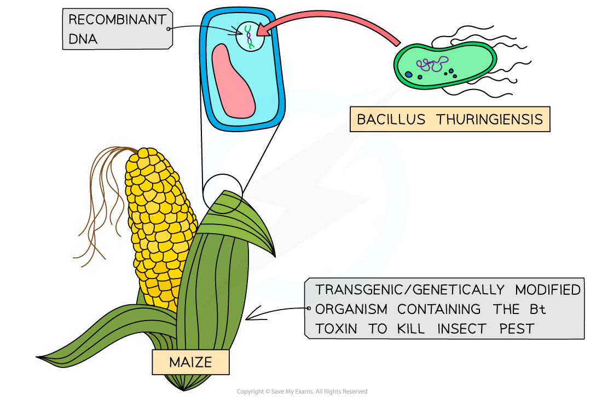

# Genetically Modified Organisms in Agriculture

## Genetic Engineering: Use in Agriculture

> **Spec point** — `spcpt_7WNq8SjWBgf8SvMG` · explain that genetic engineering may help to solve the global demand for food by improving the quality and productivity of farmed animals and crop plants, using the examples of GM salmon, herbicide resistance in soybean and insect resistance in cotton

## Genetic engineering: use in agriculture

- Genetic engineering is a technique used to deliberately modify a specific characteristic (or characteristics) of an organism
- The technique involves **removing a gene** (or genes) with the desired characteristic from **one organism** and **transferring** the gene ([using a vector](https://www.savemyexams.com/a-level/biology/cie/25/revision-notes/19-genetic-technology/19-1-principles-of-genetic-technology/genetic-engineering-vectors/?_ai=internal-linking)) **into another** organism where the **desired gene is then expressed**
- The **genetically engineered organism** will then contain **recombinant** **DNA** and will be a genetically modified organism (GMO)
- Although plants and animals have been genetically engineered to produce proteins used in medicine, the main purpose of genetically engineering them is to meet the global demand for food
- Crop plants have been genetically modified to be:

  - **Resistant to herbicides** – increases productivity/yield
  - **Resistant to pests** – increases productivity/yield
  - **Enriched in vitamins** – increases the nutritional value
- Farmed animals have been genetically modified to grow faster

  - It is rarer for animals to be modified for food production due to** ethical concerns **associated with this practice
- Scientists have genetically modified many organisms including

  - Bacteria (e.g. to produce insulin)
  - Sheep (e.g. to produce a human blood protein known as AAT)
  - Maize (e.g. to be resistant to insect attacks)
  - Rice (e.g. to produce β-carotene to provide vitamin A)
- The benefits of using genetic engineering rather than the more traditional selective breeding techniques to solve the global demand for food are:

  - Organisms with the **desired characteristics** are **produced more quickly**
  - **All organisms** will contain the desired characteristic
  - The desired characteristic may **come from a different species/kingdom**

### GM salmon

- In 2015 AquAdvantage salmon was approved by the US Food and Drug Administration (FDA) for human consumption
- This salmon has been genetically modified (GM) to **grow more rapidly** than non-GM salmon as a result of growth hormone being produced in the salmon throughout the year, instead of just in spring and summer
- The producer therefore has a product to sell in half the time, which increases their yield
- Scientists combined a **growth hormone** gene from a chinook salmon with the [promoter gene](https://www.savemyexams.com/a-level/biology/cie/25/revision-notes/19-genetic-technology/19-1-principles-of-genetic-technology/genetic-engineering-promoters-and-marker-genes/?_ai=internal-linking) from an ocean pout, a cold-water fish

  - The ocean pout fish can grow in near-freezing waters, thus the promoter gene ensured the growth hormone was continually being expressed
- To prevent the GM salmon from reproducing in the wild, all the salmon are female and sterile

### Herbicide resistance in soybean

- Growing **herbicide-resistant soybeans** allows farmers to spray a herbicide on the crop after germination to kill weeds that would otherwise compete with the growing soybeans for light, water and minerals, therefore decreasing the yield
- The resistant gene comes from a strain of the bacterium *Agrobacterium*
- This gene allows an enzyme in the soybean to continue to synthesise three amino acids (**phenylalanine**, **tyrosine** and **tryptophan**) needed to produce proteins required in the growing tips of plants
- The herbicide **glyphosate** inhibits the enzyme in plants without the resistant gene; without the proteins being synthesised, the plants die

### Insect resistance in maize

- Maize has been genetically modified with a gene for the **Bt toxin**, which is taken from the bacterium *Bacillus thuringiensis*
- Maize plants modified with the Bt toxin gene produce their own insecticide
- When an insect ingests parts of the maize plant, the alkaline conditions in their guts activate the toxin (the toxin is harmless to vertebrates as their stomach is highly acidic), killing the insect
- Different strains of** *****B. thuringiensis*** produce different toxins which are toxic to different insect species
- Insect populations have developed resistance to the genes for Bt toxin, reducing effectiveness as a means of protecting crops

*Illustration of a maize plant that has recombinant DNA (DNA from Bacillus thuringiensis)*

> **Exam Hint**
> The syllabus example is insect-resistant **Bt cotton**. The method and the benefits are the same as for Bt maize: the Bt gene from *Bacillus thuringiensis* codes for a toxin that kills insect pests that eat the crop (such as bollworm caterpillars), so less of the crop is damaged, yield increases and less insecticide needs to be sprayed.
