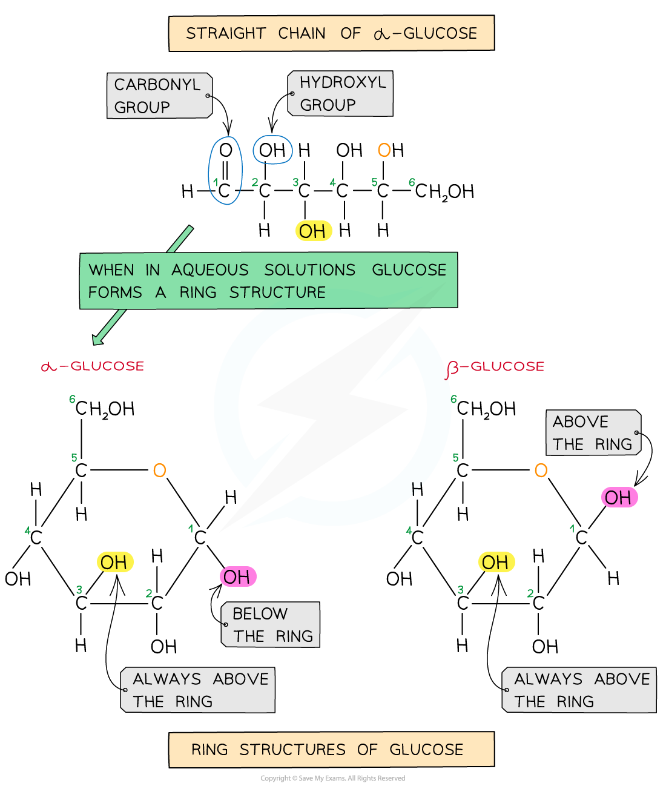
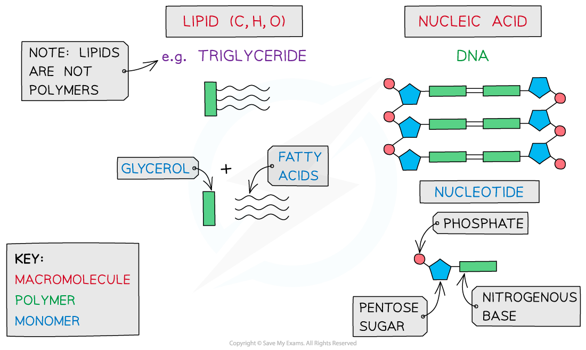
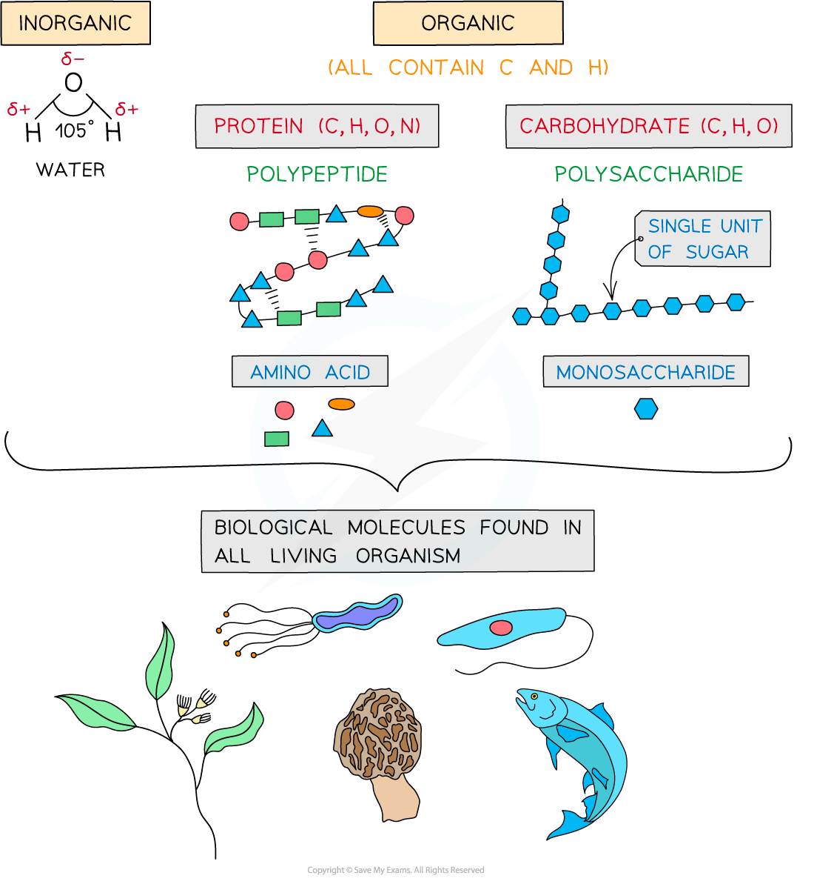

# Biological Molecules: Key Terms

## The Two Forms of Glucose

> **Spec point** — `spcpt_znPxhvPJ2sTjP8zZ` · describe and draw the ring forms of α-glucose and β-glucose

## The two forms of glucose

- The most well-known carbohydrate *monomer* is **glucose**
- Glucose has the molecular formula **C****6****H****12****O****6**
- Glucose is the most common *monosaccharide* and is of central importance to most forms of life
- There are different types of monosaccharide formed from molecules with varying numbers of carbon atom, for example:

  - Trioses (3C) e.g. glyceraldehyde
  - Pentoses (5C) e.g. ribose
  - Hexoses (6C) e.g. glucose
- Glucose exists in two structurally different forms – **alpha (α)** glucose and **beta** **(β) glucose **and is therefore known as an *isomer*

  - This structural variety results in different functions between carbohydrates

*Straight chain and ring structural formula of alpha & beta glucose*

- Different *polysaccharides* are formed from the two **isomers **of glucose

| **Polysaccharide** | **Alpha Glucose** | **Beta Glucose** |
|---|---|---|
| Starch | ✓ | X |
| Glycogen | ✓ | X |
| Cellulose | X | ✓ |

> **Exam Hint**
> You must be able to recognise and **draw **the isomer rings of **α and β** glucose.

## Biological Molecules: Key Terms

> **Spec point** — `spcpt_j2tbmSTT8qfh4Dj8` · define the terms monomer, polymer, macromolecule, monosaccharide, disaccharide and polysaccharide

## Biological molecules: key terms

- The key molecules that are required to build structures that enable organisms to function are:

  - Carbohydrates
  - Proteins
  - Lipids
  - Nucleic Acids
  - Water

*The key biological molecules for living organisms*

- Carbohydrates, proteins, lipids and nucleic acids contain the elements **carbon** (C) and **hydrogen** (H) making them *organic compounds*
- Carbon atoms are key to the organic compounds because:

  - Each carbon atom can form **four** *covalent bonds* – this makes the compounds very stable (as covalent bonds are so strong they require a large input of energy to break them)
  - Carbon atoms can form covalent bonds with oxygen, nitrogen and sulfur
  - Carbon atoms can bond to form **straight chains**, **branched** **chains** or **rings**
- Carbon compounds can form small **single subunits called monomers**,** **that bond with **many repeating subunits** to form large molecules called **polymers**, by a process called *polymerisation*
- **Macromolecules** are very large molecules

  - That contain 1000 or more atoms therefore having a **high molecular mass**
  - Polymers can be macromolecules, however **not** **all** macromolecules are polymers as the subunits of polymers have to be the **same** repeating units

### Carbohydrates

- Carbohydrates are one of the main carbon-based compounds in living organisms
- All molecules in this group contain **C**, **H** and **O**
- As **H** and **O** atoms are always present in the **ratio** of **2:1 **(e.g. water H2O, which is where ‘hydrate’ comes from) they can be represented by the formula **C*****x *****(H****2****O)*****y***
- The three types of carbohydrates are **monosaccharides**, **disaccharides** and **polysaccharides**

**Types of carbohydrate table**

| ** ** | **Monosaccharide** | **Disaccharide** | **Polysaccharide** |
|---|---|---|---|
| Definition | A single sugar monomer, all of which are reducing sugars | A sugar formed from two monosaccharides joined by a glycosidic bond in a condensation reaction | A polymer formed by many monosaccharides joined by a glycosidic bond in a condensation reaction |
| Examples | Glyceraldehyde (3C)  Ribose (5C)  Glucose (6C) | Maltose (*α* glucose + *α* glucose)  Sucrose (*α* glucose + fructose)  Lactose (*α* glucose + *β* galactose) | Cellulose (monomer is *β *glucose)  Starch (monomer is *α *glucose)  Glycogen (monomer is *α *glucose) |
| Function | Energy in respiration  Building blocks of polymers | Sugar in germinating seeds (maltose)  Mammal milk sugar (lactose)  Sugar stored in cane sugar (sucrose) | Energy storage (plants - starch; animals - glycogen)  Structural cell wall (cellulose) |

> **Exam Hint**
> When discussing monomers and polymers, give the definition but also name specific examples e.g. **nucleic acids** – the monomer is a **nucleotide.**
> 
> You need to be able to **define **the terms **monomer**, **polymer**, **macromolecule**, **monosaccharide**, **disaccharide **and **polysaccharide**.
