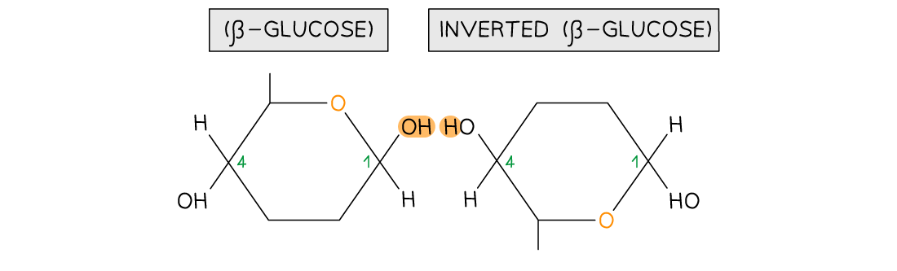
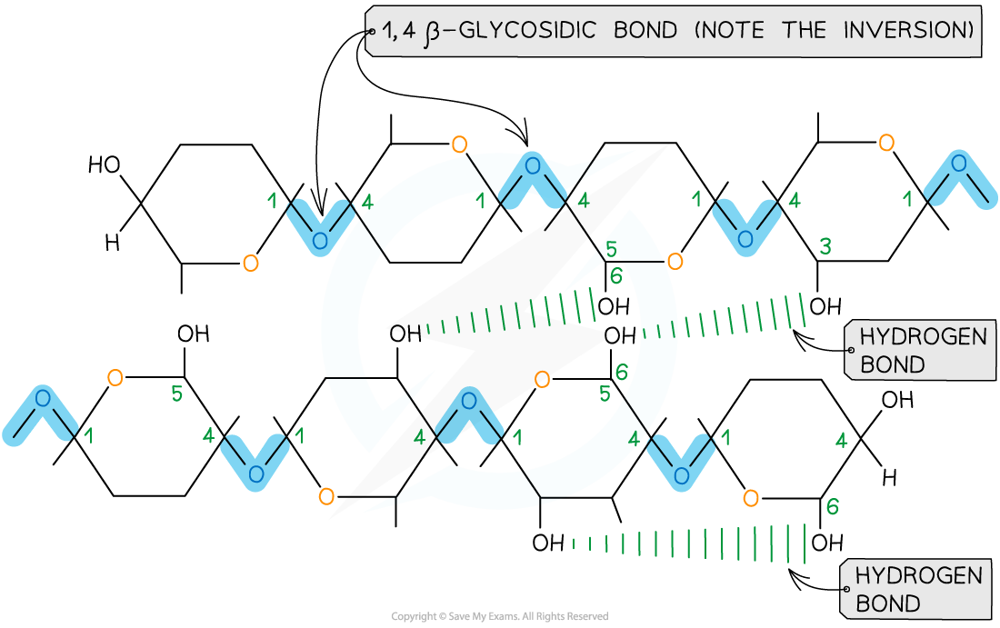
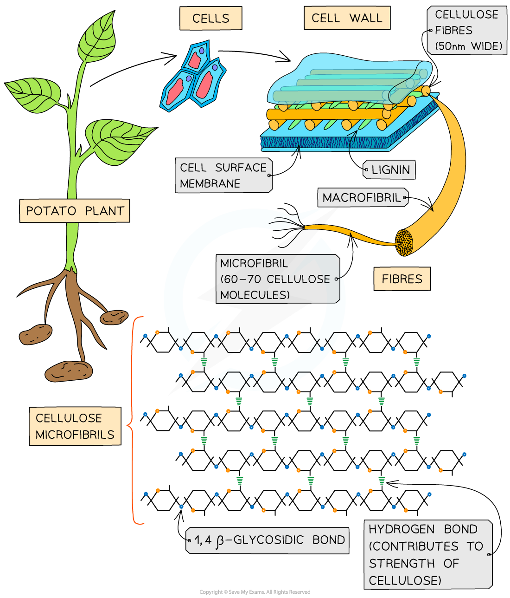

# Cellulose

## Cellulose: Structure & Function

> **Spec point** — `spcpt_hWQmJpYN8yHRvRVm` · describe the molecular structure of the polysaccharide cellulose and outline how the arrangement of cellulose molecules contributes to the function of plant cell walls

## Cellulose: structure & function

- **Cellulose** is an unbranched **polysaccharide**

  - Polysaccharides are macromolecules that are **polymers** formed by **many monosaccharides **joined by **glycosidic** bonds in a **condensation** reaction to form chains
  - These chains may be:
  
    - Branched or unbranched
    - Folded (making the molecule compact which is ideal for **storage**, e.g. starch and glycogen)
    - Straight (making the molecules suitable to **construct **cellular structures, e.g. cellulose) or coiled
    - Polysaccharides are **insoluble** in water

### Cellulose structure

- Is a polymer consisting of **long chains of β-glucose** joined together by 1,4 glycosidic bonds
- As β-glucose is an *isomer* of α-glucose to form the 1,4 glycosidic bonds consecutive β-glucose molecules must be **rotated **180° to each other

*To form the 1,4 glycosidic bond between two β-glucose molecules, the glucose molecules must be rotated to 180° to each other*

- Due to the inversion of the β-glucose molecules **many** **hydrogen** **bonds** form between the long chains giving cellulose it’s **strength**

*Cellulose is used as a structural component due to the strength it has from the many hydrogen bonds that form between the long chains of β-glucose molecules*

### Cellulose function

- Cellulose is the **main structural component **of **cell walls** due to its strength which is a result of the many hydrogen bonds found between the parallel chains of microfibrils
- The **high tensile strength** of cellulose allows it to be stretched without breaking which makes it possible for cell walls to withstand turgor pressure
- The cellulose fibres and other molecules (e.g. lignin) found in the cell wall form a **matrix which increases the strength** of the cell walls
- The **strengthened cell walls** provides **support** to the plant
- Cellulose fibres are **freely permeable** which allows water and solutes to leave or reach the cell surface membrane
- As few organisms have the enzyme (cellulase) to hydrolyse cellulose, it is a source of **fibre**

*The strength and insolubility of cellulose fibres means it is a suitable molecule to construct cell walls*

> **Exam Hint**
> Learn the **monomer** for cellulose, the arrangement of the glycosidic bond (which is dependent on the position of the OH group on carbon 1 and 4) and that cellulose exists in **parallel chains** bonded by **many hydrogen bonds** giving it **high mechanical strength**.
