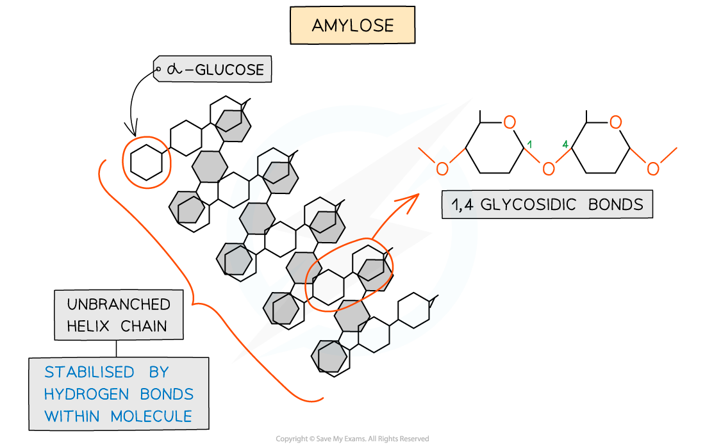
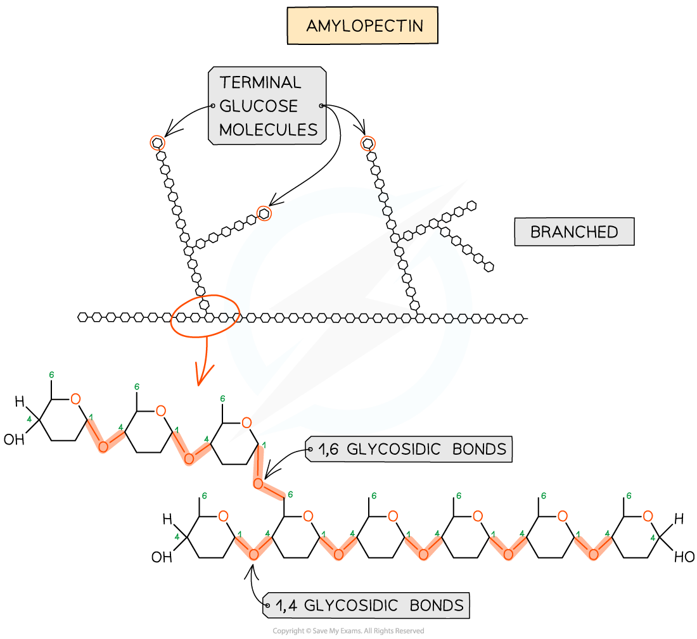
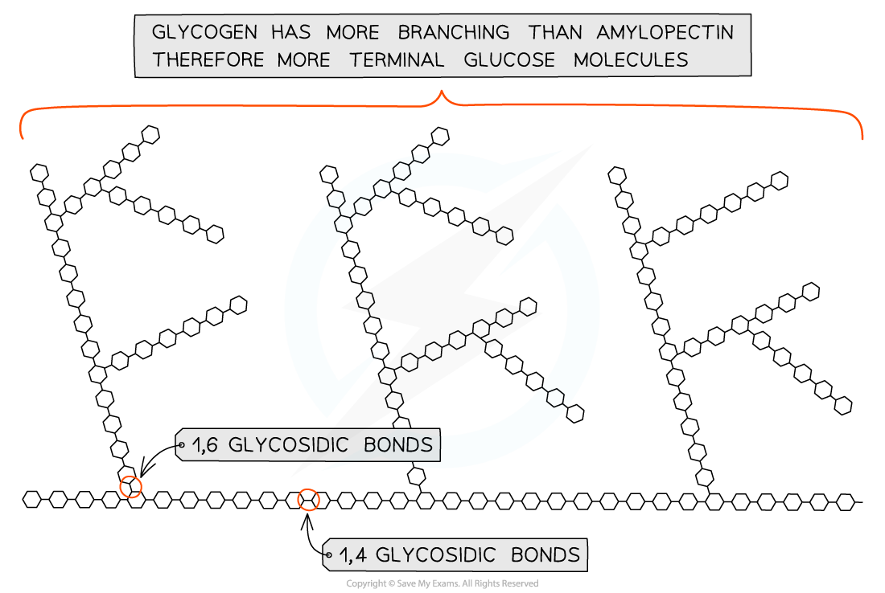

# Starch & Glycogen

## Starch & Glycogen: Structures & Functions

> **Spec point** — `spcpt_G3rCXJPvC5znrMXM` · describe the molecular structure of the polysaccharides starch (amylose and amylopectin) and glycogen and relate their structures to their functions in living organisms

## Starch & glycogen: structures & functions

- **Starch** and **glycogen** are **polysaccharides**
- Polysaccharides are **polymers** formed from **many** **monosaccharides** joined by **glycosidic** bonds to form chains; these chains may be:

  - Branched or unbranched
  - Folded
  - Straight or coiled
- **Starch** and **glycogen** are storage polysaccharides because they are:

  - **Compact**
  
    - Many molecules fit into a small space, so large volumes can be stored inside cells
  - **Insoluble**
  
    - They do not dissolve in the cell cytoplasm, so have **no osmotic effect **on cells; soluble molecules like glucose would lower the water potential of cell cytoplasm, drawing water into cells by osmosis

### Starch

- Starch is the **storage** polysaccharide of **plants**. It is stored as granules in plastids (e.g. chloroplasts)
- Due to the many **monomers **in a starch molecule, it takes longer to digest than glucose
- Starch is constructed from **two** **different** polysaccharides:

  - Amylose (10 - 30% of starch)
  
    - Unbranched helix-shaped chain with 1,4 glycosidic bonds between α-glucose molecules
    - The helix shape enables it to be more compact and thus it is more resistant to digestion

*Amylose is one of the two polysaccharides that forms starch, the storage polysaccharide in plants*

- Amylopectin (70 - 90% of starch)

  - 1,4 glycosidic bonds between α-glucose molecules **but also** 1,6 glycosidic bonds form between glucose molecules creating a **branched** molecule
  - The branches result in many terminal glucose molecules that can be easily hydrolysed for use during cellular respiration or added to for storage

*Amylopectin is the other of the two polysaccharides that forms starch*

### Glycogen

- Glycogen is the **storage** polysaccharide of **animals** and **fungi, **it is **highly branched** and not coiled
- **Liver** and **muscles** cells have a high concentration of glycogen, present as visible granules, as the cellular respiration rate is high in these cells (due to animals being mobile)
- Glycogen is **more branched** than amylopectin making it **more compact** which helps animals **store more**
- The branching enables more free ends where glucose molecules can either be added or removed allowing for condensation and hydrolysis reactions to occur more rapidly – thus the storage or release of glucose can suit the demands of the cell

*Glycogen is a highly branched molecule used as a storage polysaccharide in animals and fungi*

| **Feature** | **Starch** | **Glycogen** |   |
|---|---|---|---|
| **Amylose** | **Amylopectin** |   |   |
| **Monomer** | *α*-glucose | *α*-glucose | *α*-glucose |
| **Branched** | No | Yes | Yes |
| **Helix shape** | Yes | No | No |
| **Glycosidic Bond Present** | 1,4 | 1,4 and 1,6 | 1,4 and 1,6 |
| **Source** | Plants | Plants | Animals |

> **Exam Hint**
> Be clear about the **differences** between starch (amylose and amylopectin) and glycogen.
