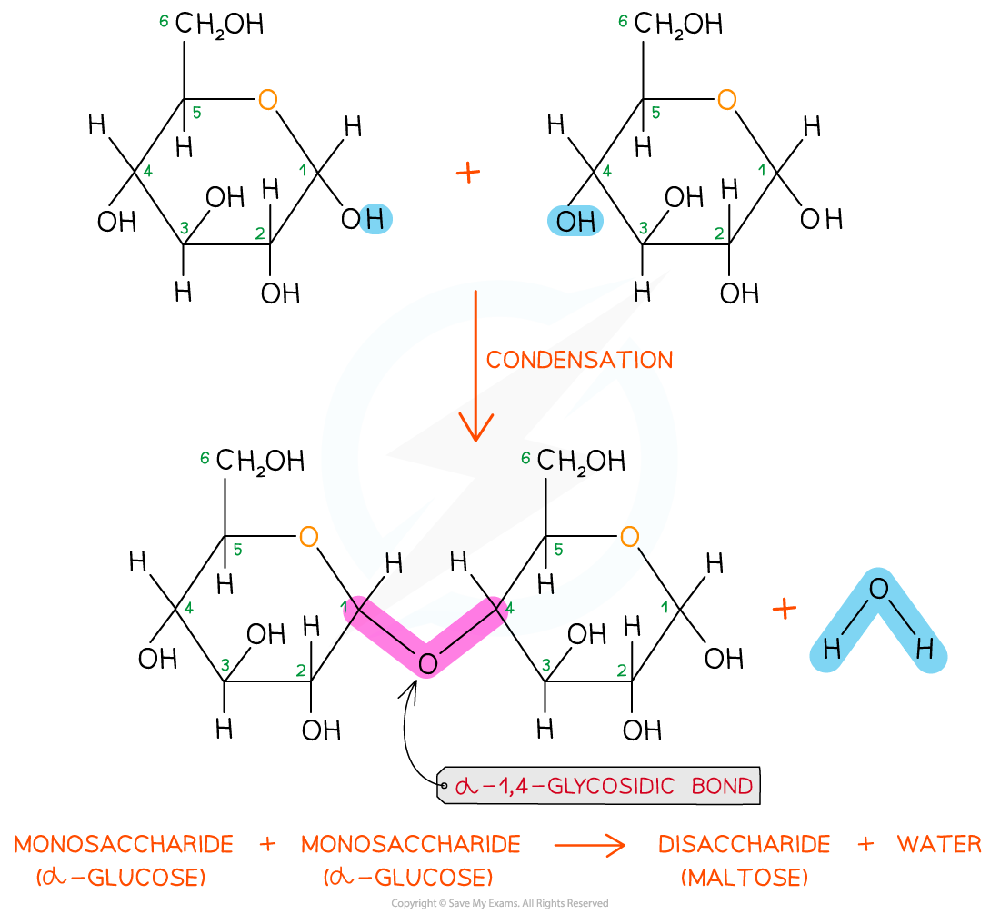
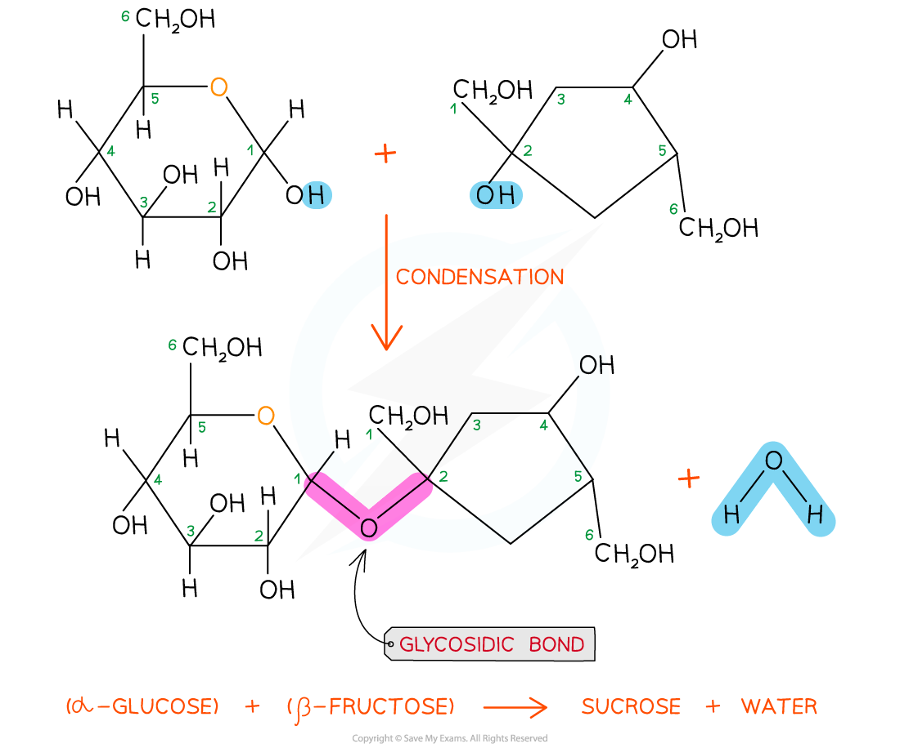
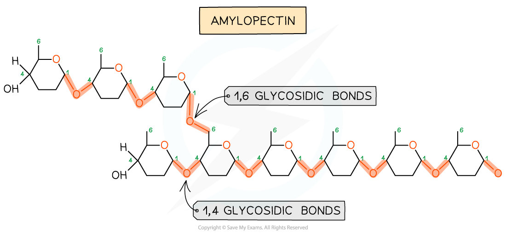
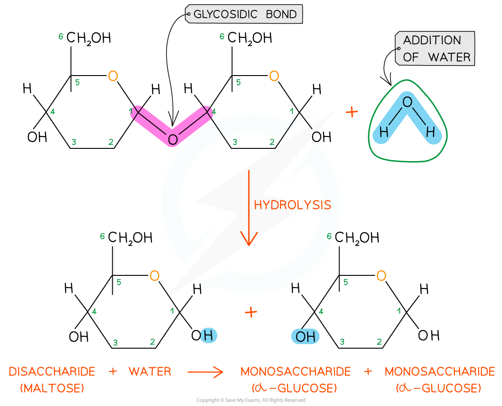
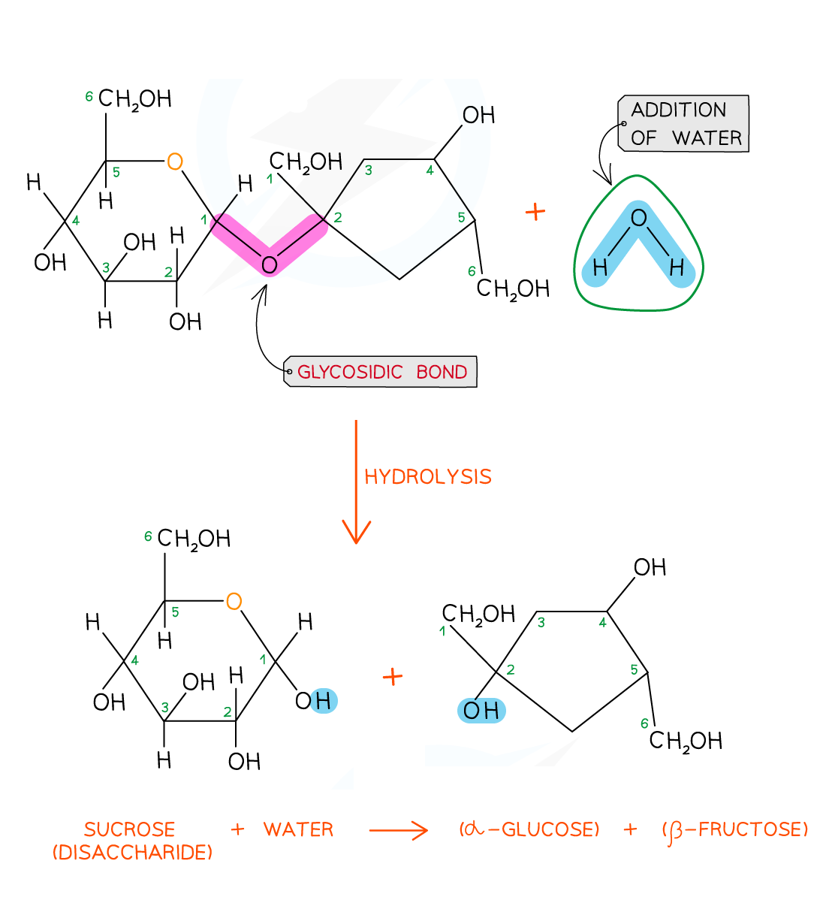

# The Glycosidic Bond

## Forming the Glycosidic Bond

> **Spec point** — `spcpt_FxsS3Xq6sDbCV3P5` · describe the formation of a glycosidic bond by condensation, with reference to disaccharides, including sucrose, and polysaccharides

## Forming the glycosidic bond

- To make **monosaccharides **more suitable for transport and storage, and to have less influence on a cell’s *osmolarity*, they are bonded together to form disaccharides and polysaccharides
- **Disaccharides** and **polysaccharides** are formed when **two hydroxyl** (-OH) groups (on different saccharides) interact to form a **strong covalent bond** called the **glycosidic **bond (the oxygen link that holds the two molecules together)
- Every glycosidic bond results in **one** **water** molecule being **removed**, thus glycosidic bonds are formed by condensation

*The formation of a glycosidic bond by condensation between two monosaccharides (glucose) to form a disaccharide (maltose)*

- Each glycosidic bond is **catalysed by enzymes** specific to which OH groups are interacting
- As there are many different monosaccharides, this results in **different types of glycosidic bonds** forming (e.g maltose has a α-1,4 glycosidic bond and sucrose has a α-1,2 glycosidic bond)

*The formation of a glycosidic bond by condensation between α-glucose and β-fructose to form a disaccharide (sucrose)*

*The formation of glycosidic bonds to create a polysaccharide (amylopectin)*

| **Sugar** | **Type of Glycosidic bond** | **Type of Molecule** |
|---|---|---|
| Maltose | *α* 1,4 | Disaccharide |
| Sucrose | *α* 1,2 | Disaccharide |
| Cellulose | *β* 1,4 | Polysaccharide |
| Amylose | *α* 1,4 | Polysaccharide |
| Amylopectin | *α* 1,4 and *α* 1,6 | Polysaccharide |

> **Exam Hint**
> Make sure you can identify **where the glycosidic bond is** in a carbohydrate.

## Breaking the Glycosidic Bond

> **Spec point** — `spcpt_CDSPvgxH8ktq2sjy` · describe the breakage of a glycosidic bond in polysaccharides and disaccharides by hydrolysis, with reference to the non-reducing sugar test

## Breaking the glycosidic bond

- The **glycosidic bond** is broken when **water** is **added** in a **hydrolysis** (meaning ‘*hydro*’ - with water and ‘*lyse*’ - to break) reaction
- **Disaccharides** and **polysaccharides** are broken down in hydrolysis reactions
- Hydrolytic reactions are **catalysed by enzymes**, these are different to those present in condensation reactions
- Examples of hydrolytic reactions include:

  - The **digestion **of food in the stomach and intestines
  - The **breakdown of stored carbohydrates** in muscle and liver cells for use in cellular respiration

*Glycosidic bonds are broken by the addition of water in a hydrolysis reaction*

- **Sucrose** is a **non-reducing sugar** which gives a **negative** result in a **Benedict’s test**

  - When sucrose is heated with **hydrochloric acid** this provides the water that **hydrolyses** the **glycosidic bond** resulting in two monosaccharides that will produce a positive Benedict's test

*A molecule of glucose and a molecule of fructose are formed when one molecule of sucrose is hydrolysed; the addition of water to the glycosidic bond breaks it*

> **Exam Hint**
> Remember that **disaccharides **hydrolyse to **two** monosaccharides whereas polysaccharides must undergo **many** hydrolytic reactions until they form monosaccharides.
