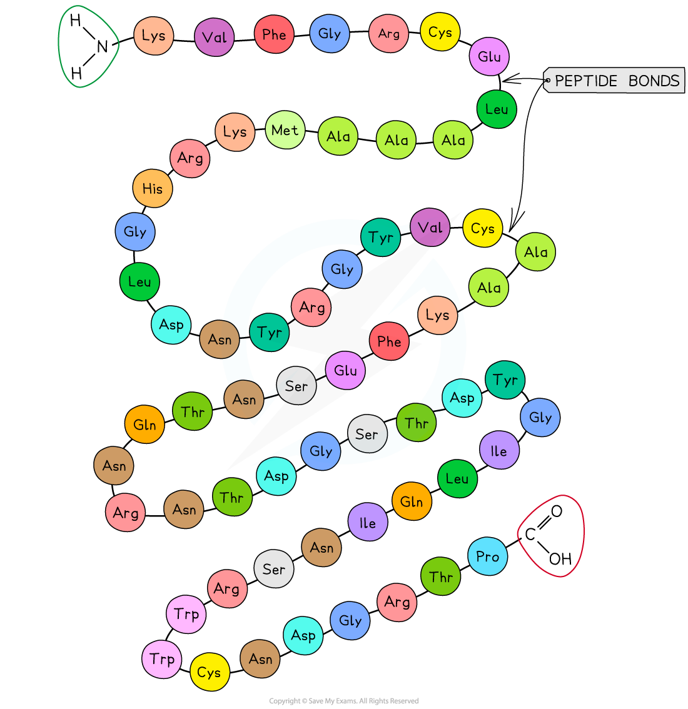
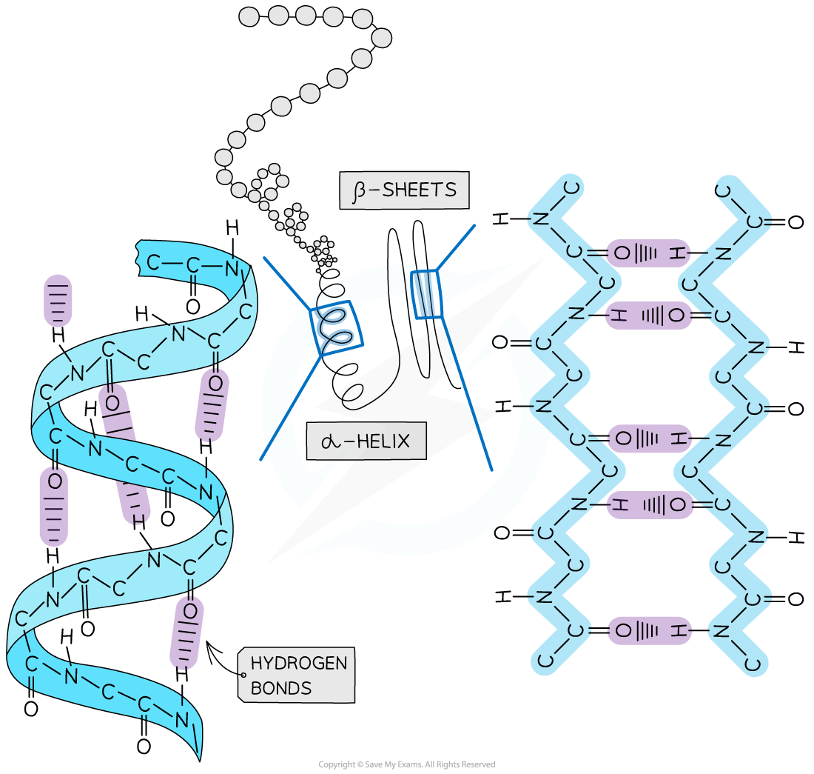
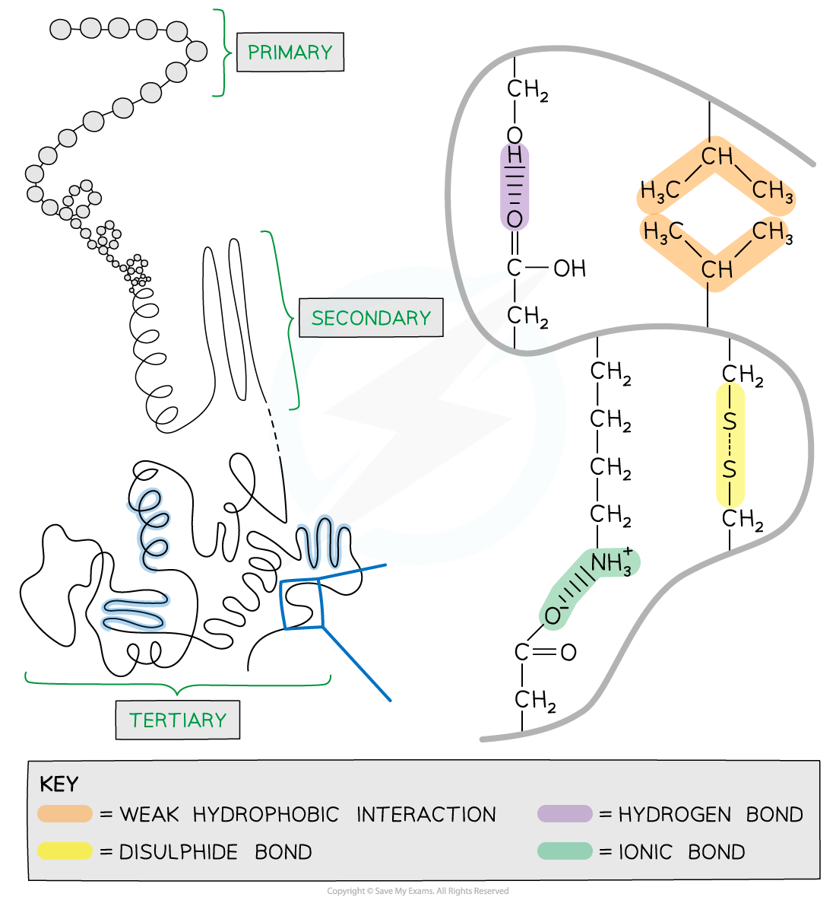
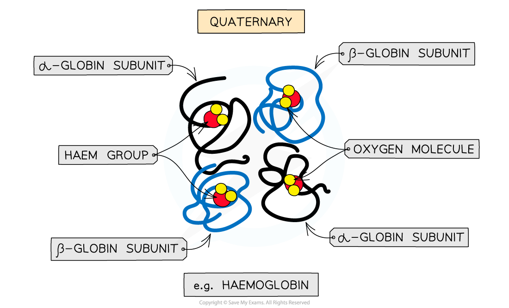

# The Four Levels of Protein Structure

## Proteins: Structures

> **Spec point** — `spcpt_X5TjrFbVtps9vc4Q` · explain the meaning of the terms primary structure, secondary structure, tertiary structure and quaternary structure of proteins

## Proteins: structures

- There are **four** levels of structure in proteins, three are related to a single polypeptide chain and the fourth level relates to a protein that has two or more polypeptide chains
- Polypeptide or protein molecules can have anywhere from 3 amino acids (Glutathione) to more than 34,000 amino acids (Titin) bonded together in chains

### Primary structure

- The **sequence of amino acids **bonded by covalent peptide bonds is the **primary structure** of a protein
- **DNA** of a cell **determines** the primary structure of a protein by instructing the cell to add certain amino acids in specific quantities in a certain sequence

  - This affects the shape and therefore the function of the protein
- The primary structure is **specific** for each protein (one alteration in the sequence of amino acids can affect the function of the whole protein)

*The primary structure of a protein. The three-letter abbreviations indicate the specific amino acid (there are 20 commonly found in cells of living organisms)*

### Secondary structure

- The **secondary structure** of a protein occurs when the weak negatively charged nitrogen and oxygen atoms interact with the weak positively charged hydrogen atoms to form **hydrogen bonds**
- There are two shapes that can form within proteins due to the hydrogen bonds:

  - **α-helix**
  - **β-pleated sheet**
- The **α-helix** shape occurs when the hydrogen bonds form between every **fourth** peptide bond (between the oxygen of the carboxyl group and the hydrogen of the amine group)
- The **β-pleated sheet **shape forms when the protein folds so that **two parts of the polypeptide chain** are **parallel** to each other enabling hydrogen bonds to form between parallel peptide bonds
- Most **fibrous** proteins have secondary structures (e.g. collagen and keratin)
- The **secondary structure** **only** relates to **hydrogen bonds** forming between the **amino group **and the **carboxyl group** (the ‘protein backbone’)
- The hydrogen bonds can be broken by high temperatures and pH changes

*The secondary structure of a protein with the α-helix and β-pleated sheet shapes highlighted. The magnified regions illustrate how the hydrogen bonds form between the peptide bonds*

### Tertiary structure

- Further conformational change of the secondary structure leads to additional bonds forming between the **R groups **(side chains)
- The additional bonds are:

  - **Hydrogen **(these are between R groups)
  - **Disulfide**(only occurs between cysteine amino acids, sometimes referred to as a disulfide bridge)
  - **Ionic** (occurs between charged R groups)
  - Weak **hydrophobic interactions** (between non-polar R groups)
- This structure is common in **globular** proteins such as antibodies

*The tertiary structure of a protein with hydrogen bonds, ionic bonds, disulphide bonds and hydrophobic interactions formed between the R groups of the amino acids*

### Quaternary structure

- Occurs in proteins that have **more than one** polypeptide chain working together as a functional macromolecule, for example, haemoglobin
- Each polypeptide chain in the quaternary structure is referred to as a **subunit** of the protein

*The quaternary structure of a protein. This is an example of haemoglobin which contains four subunits (polypeptide chains) working together to carry oxygen*

| **Bonds** | **Level** |   |   |
|---|---|---|---|
| **Primary** | **Secondary ** | **Tertiary** |   |
| **Peptide** | ✓ | ✓ | ✓ |
| **Hydrogen** | X | ✓ (only between the amine and carboxyl groups) | ✓ (only between the R, amine and carboxyl groups) |
| **Disulfide** | X | X | ✓ |
| **Ionic** | X | X | ✓ |
| **Hydrophobic interactions** | X | X | ✓ |

> **Exam Hint**
> Familiarise yourself with the difference between the four structural levels found in proteins, noting which bonds are found at which level.
> 
> Remember that in **secondary **structures the hydrogen bonds form **between the amino and carboxyl groups**, whereas in **tertiary **structures the hydrogen bonds form **between the R groups**.
