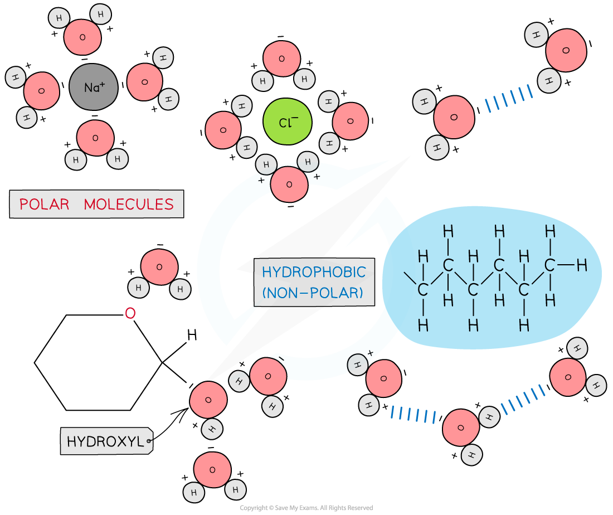

# The Role of Water in Living Organisms

## Water Molecules: In Living Organisms

> **Spec point** — `spcpt_fyXgy8Bw2j7WjCTS` · explain how hydrogen bonding occurs between water molecules and relate the properties of water to its roles in living organisms, limited to solvent action, high specific heat capacity and latent heat of vaporisation

## Water molecules: in living organisms

- Water has many essential roles in living organisms due to its properties:

  - The **polarity** of water molecules
  - The presence and number of **hydrogen bonds** between water molecules

### Solvent

- As water is a **polar molecule** many ionic compounds (e.g. sodium chloride) and covalently bonded polar substances (e.g. glucose) will dissolve in it

  - This allows **chemical reactions** to occur within cells (as the dissolved solutes are more chemically reactive when they are free to move about)
  - *Metabolites* can be transported efficiently (except non-polar molecules which are *hydrophobic*)

*Due to its polarity water is considered a universal solvent*

### High specific heat capacity

- The specific heat capacity of a substance is the **amount of thermal energy required to raise the temperature of 1kg of that substance by 1°C**. Water’s specific heat capacity is 4200 J/kg°C
- The **high specific heat capacity** is due to the **many hydrogen bonds** present in water

  - It takes a lot of thermal energy to break these bonds, and a lot of energy is released when they form, so the temperature of water does not fluctuate greatly
- The advantage for living organisms is that it:

  - Provides suitable **habitats**
  - Allows for **constant temperatures** within bodies and cells to be maintained (this ensures enzymes have the optimal temperatures)
  
    - This is because a large increase in energy is needed to increase the temperature of water

### Latent heat of vaporisation

- In order to **change state** (from liquid to gas) a large amount of thermal energy must be absorbed by water to **break the** **hydrogen bonds** and evaporate
- This is an advantage for living organisms as only a little water is required to evaporate from the surface of the organism in order to lose a great amount of heat energy
- This provides a **cooling** effect for living organisms, for example the transpiration from leaves or evaporation of water in sweat from the skin

| **Property** | **Role in Living Organisms** | **Reason** |
|---|---|---|
| Solvent | Allows chemical reactions to occur  Transport medium | Polarity of water |
| High specific heat capacity | Allows water to be a suitable habitat  Optimal temperature maintained within cells and bodies | Presence of many hydrogen bonds |
| High latent heat of vaporisation | Coolant | Presence of many hydrogen bonds |

> **Exam Hint**
> When discussing the role water has in living organisms remember to mention the ‘**why**’ in relation to its properties (i.e. it is an excellent solvent **because **of to the polar nature of water molecules).
