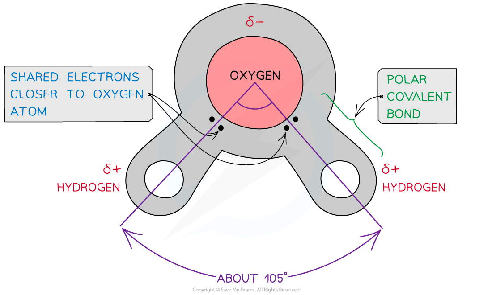
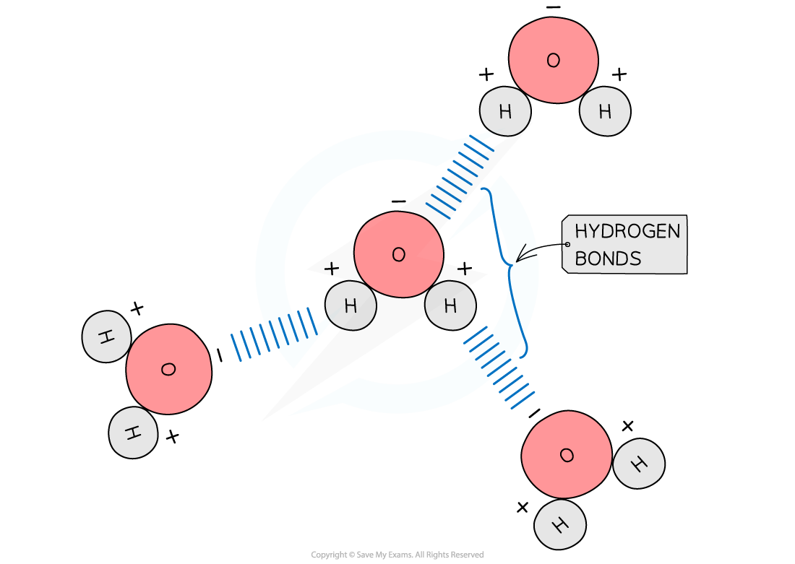

# Water & the Hydrogen Bond

## Water Molecules: Hydrogen Bonds

> **Spec point** — `spcpt_cBbGXQsmr5mscJvq` · explain how hydrogen bonding occurs between water molecules and relate the properties of water to its roles in living organisms, limited to solvent action, high specific heat capacity and latent heat of vaporisation

## Water molecules: hydrogen bonds

- Water is of great biological importance. It is the medium in which all metabolic reactions take place in cells

  - Between 70% to 95% of the mass of a cell is water
- As 71% of the Earth’s surface is covered in water it is a major habitat for organisms
- Water is composed of atoms of **hydrogen **and **oxygen**

  - One atom of oxygen combines with two atoms of hydrogen by sharing electrons so they are **covalently bonded**
- Although water as a whole is electrically neutral the **sharing** of the **electrons** is **uneven **between the oxygen and hydrogen atoms

  - The oxygen atom attracts the electrons more strongly than the hydrogen atoms, resulting in:
  
    - A **weak negatively charged region** on the oxygen atom (δ-)
    - A **weak positively charged region** on the hydrogen atoms(δ+)
  - This results in the asymmetrical shape of water molecules
  - This separation of charge due to the electrons in the covalent bonds being unevenly shared is called a **dipole**
  
    - When a molecule has **one **end that is negatively charged and **one **end that is positively charged it is also a **polar molecule**
- Water is a **polar** molecule

*The covalent bonds of water make it a polar molecule*

- **Hydrogen bonds** form **between **water molecules

  - As a result of the polarity of water hydrogen bonds form between the positive and negatively charged regions of **adjacent water molecules**
- Hydrogen bonds are weak, when there are few, so they are constantly breaking and reforming

  - However when there are large numbers present they form a strong structure
- Hydrogen bonds contribute to the many properties water molecules have that make them so important to living organisms:

  - An excellent **solvent** – many substances can dissolve in water
  - A relatively **high specific heat capacity**
  - A relatively **high latent heat of vaporisation**
  - Water is less dense when a solid
  - Water has high surface tension and cohesion
  - It acts as a reagent

*The polarity of water molecules allows hydrogen bonds to form between adjacent water molecules*

> **Exam Hint**
> It is important to know where the hydrogen bonds form **between water molecules** (oxygen of one water molecule to the hydrogen atom of another).
> 
> Don't get confused with the covalent bonds** between the atoms within a water molecule**.
