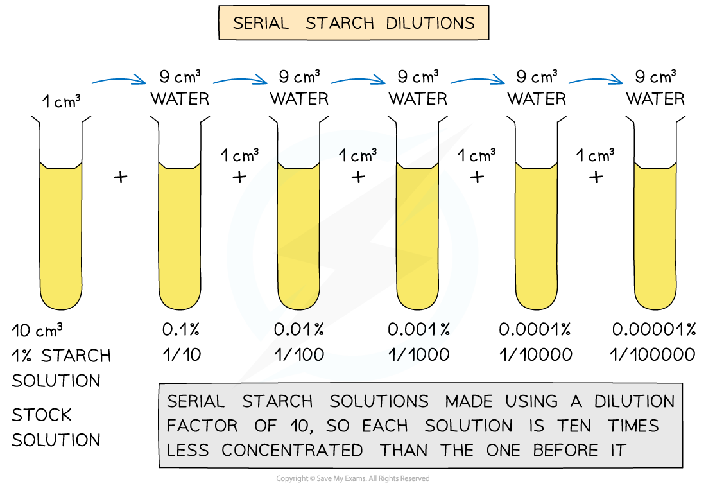

# Colorimetry

## Colorimetry to Measure Enzyme Activity

> **Spec point** — `spcpt_tvQVXXR5PMSKDsN6` · outline the use of a colorimeter for measuring the progress of enzyme-catalysed reactions that involve colour changes

## Colorimetry to measure enzyme activity

- A **colorimeter** is able to measure **light absorbance** (how much light is absorbed) or **light transmission **(how much light passes through) a substance
- Colorimetry can be used in any enzyme-catalysed reaction that involves** colour change**
- As the colour breaks down the **transmission increases** or **light absorption decreases** and this can be used to **measure the rate of the reaction**
- For example, a colorimeter can be used to follow the progress of a **starch-amylase catalysed reaction** as the amylase breaks the starch down into maltose
- This can be carried out as follows:

  1. **Colorimeter calibration**: this is an important step in a colorimetric investigation and in this case a weak iodine solution can be used to calibrate the colorimeter as the end point (or 100% transmission)
  2. Preparation of a starch solution of **known concentration** (stock solution), from which a range of concentrations are made using **serial dilutions** (method outlined in diagram below)
  3. Following calibration and switching on the red filter (a colour the blue-black starch-iodine solution absorbs strongly, so absorbance changes most with starch concentration), the colorimeter is used to **measure the percentage absorbance or percentage transmission values**
  4. A **calibration graph** is then plotted of starch concentration (X-axis) vs percentage absorbance or percentage transmission (Y-axis)

*Serial dilution of starch to make a range of concentrations*

> **Exam Hint**
> Always calibrate the colorimeter with a blank before taking any measurements.
> 
> If you skip this, the readings won’t be accurate because the colorimeter won’t be zeroed. Examiners may award a specific mark for stating that **a blank (such as distilled water or weak iodine solution)** must be used to **set the absorbance to 0** before testing your samples.
