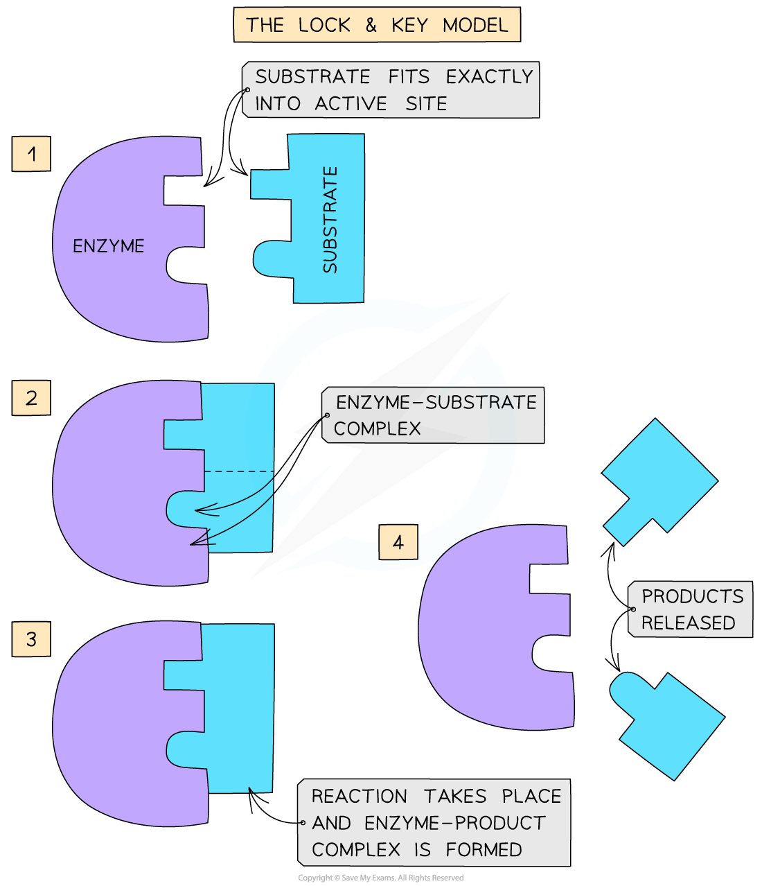
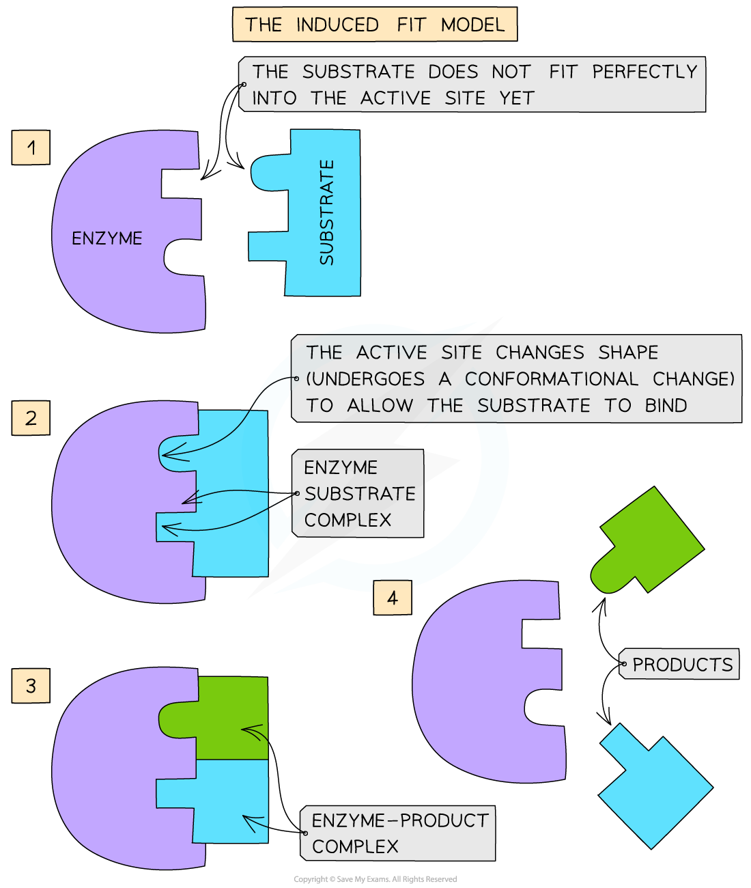

# How Enzymes Work

## How Enzymes Work 

> **Spec point** — `spcpt_pfk32Wj43vx3M5YT`

## How enzymes work

### The lock-and-key hypothesis

- Enzymes are **globular proteins**
- This means their **shape** (as well as the shape of their **active site**) is determined by the complex tertiary structure of the protein that makes up the enzyme

  - This means their shape is **highly specific**
- In the 1890’s the first model of enzyme activity was described by Emil Fischer:

  - He suggested that both enzymes and substrates were **rigid structures** that **locked** into each other very **precisely**, much like a key going into a lock
  - This is known as the ‘**lock-and-key hypothesis**’
- This was later **modified** and **adapted** to our current understanding of enzyme activity, permitted by advances in techniques in the molecular sciences

*The lock-and-key hypothesis*

### The induced-fit hypothesis

- The **modified** **model** of enzyme activity is known as the ‘**induced-fit hypothesis**’
- Although it is very similar to the lock and key hypothesis, in this model the enzyme and substrate **interact** with each other:

  - The enzyme and its active site (and sometimes the substrate) can **change shape** **slightly** as the substrate molecule enters the enzyme
  - These changes in shape are known as **conformational changes**
  - This ensures an **ideal binding arrangement** between the enzyme and substrate is achieved
  - This **maximises the ability of the enzyme to catalyse the reaction**

*The induced-fit hypothesis*

> **Exam Hint**
> Don't forget – our current understanding of enzyme-substrate interactions is based on the induced-fit hypothesis.
