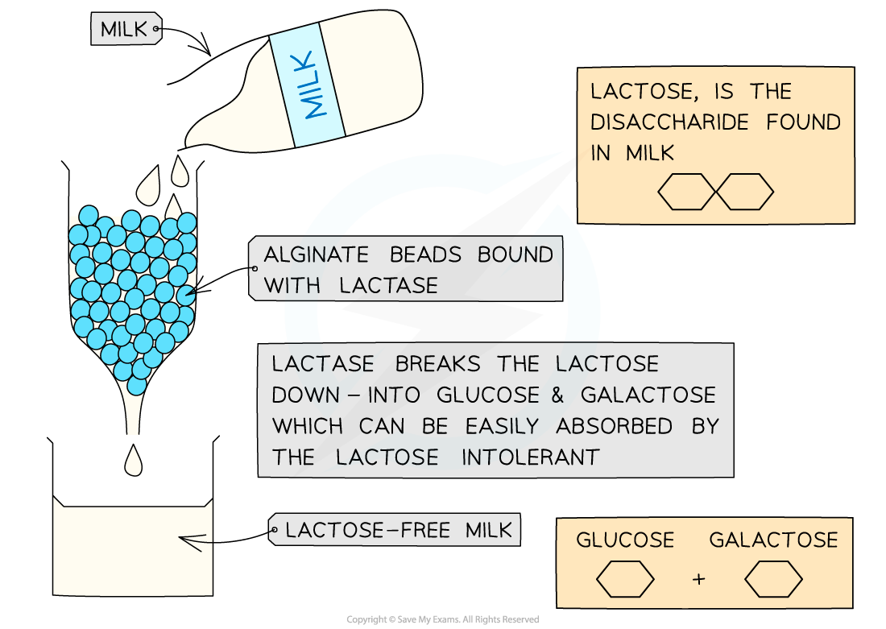
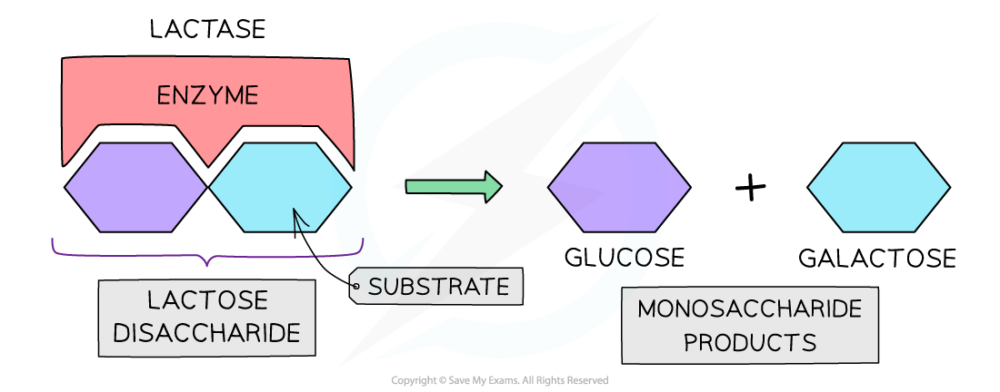

# Enzyme Activity: Immobilised v Free

## Enzyme Activity: Immobilised Vs. Free

> **Spec point** — `spcpt_CTDYxDJvx7F7SK8Q` · investigate the difference in activity between an enzyme immobilised in alginate and the same enzyme free in solution, and state the advantages of using immobilised enzymes

## Enzyme activity: immobilised v free

- Enzymes can be added to **solutions** and are thereby considered **‘free’** or they can be **immobilised**

  - Investigations with free enzymes are carried out with an enzyme added to a solution
  - Depending on the needs of an investigation, substrate can be added directly to the solution or the enzyme solution can be added in a more controlled way to a substrate
- Immobilised enzymes are enzymes that have been bound to an **inert**, **stationary** and **insoluble** material such as **alginate**
- The substrate is then **passed over** the immobilised enzyme and the product is collected
- **Advantages** to this method:

  - There is **no enzyme in the product** (the product is **uncontaminated**) and therefore there is no need to further process or filter the end product
  - The immobilised enzyme can be **reused multiple times** which is both efficient and **cost-effective** (enzymes are **expensive**)
  - Immobilised enzymes have a **greater tolerance of temperature and pH changes** (immobilisation often makes enzymes more **stable**)
- A practical application of immobilised enzymes used in the food industry is in the **production of lactose-free milk**:

  - Milk is a valuable source of nutrients containing protein, fat and the carbohydrate lactose
  - Lactose is a disaccharide that is broken down into glucose and galactose
  - 5-10% of the UK population are lactose intolerant

*Using immobilised enzyme to modify milk*

- Using the enzyme lactase, as shown above, is an efficient way to **remove lactose from milk** and to provide lactose intolerant individuals with a way of consuming milk without suffering intolerance symptoms:

  - The enzyme lactase can be immobilised using **alginate beads**
  - Milk is run through the column of lactase-containing beads
  - The lactase *hydrolyses* the lactose in the milk to **glucose** and **galactose**
  - This ensures the milk is lactose-free
  - It can also then be used to make **other lactose-free dairy products**

*Lactose is a disaccharide that is broken down by lactase into the monosaccharides glucose and galactose*
