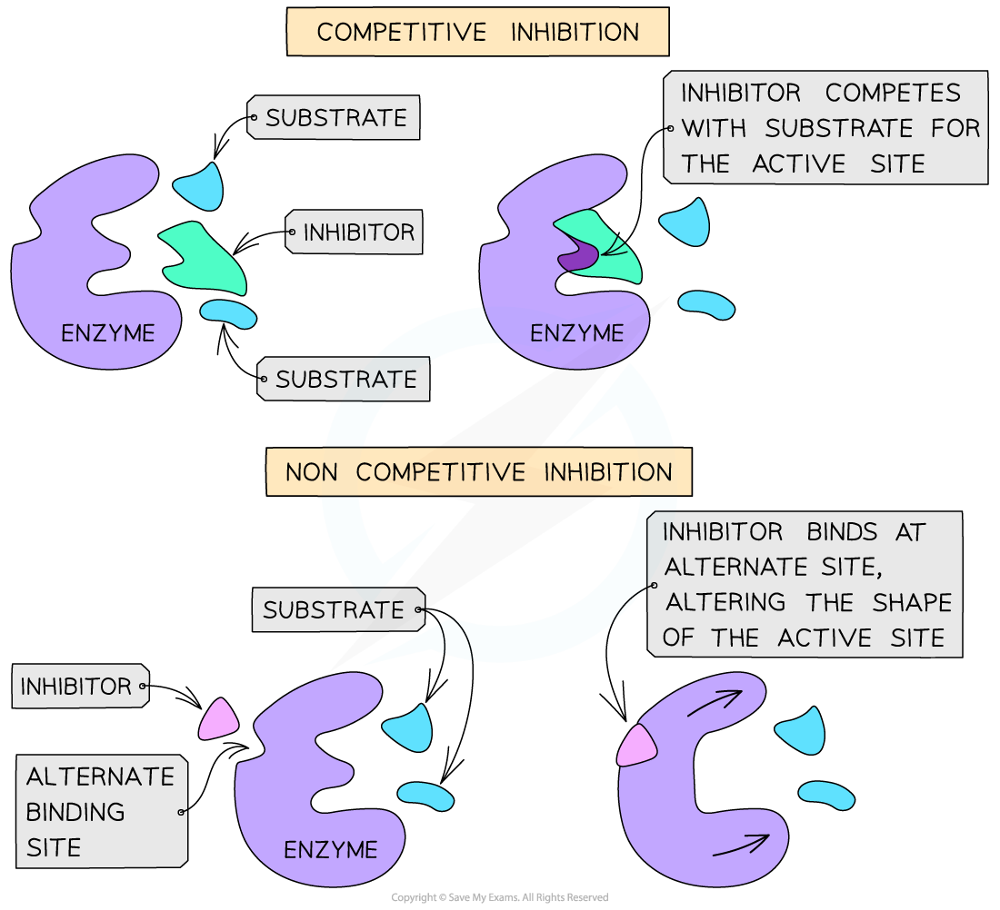
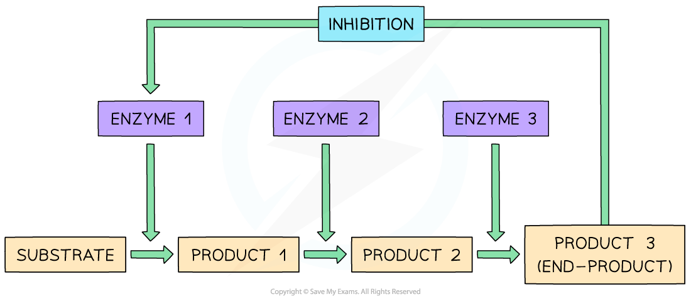

# Enzyme Inhibitors

## Enzyme Inhibitors

> **Spec point** — `spcpt_3TDXQvgSfTP4TR3W` · explain the effects of reversible inhibitors, both competitive and non-competitive, on enzyme activity

## Enzyme inhibitors

- An enzyme's activity can be **reduced **or **stopped**, temporarily, by a **reversible inhibitor**
- There are **two types** of reversible inhibitors:

  - **Competitive** inhibitors have a **similar shape** to that of the **substrate** molecules
  
    - This means they **compete** with the substrate for the active site
  - **Non-competitive** inhibitors **bind** to the enzyme at an **alternative site**, which **alters the shape of the active site**
  
    - This **prevents** the **substrate** from **binding** to it

*Competitive and non-competitive inhibition by reversible inhibitors *

- Reversible inhibitors can act as **regulators** in **metabolic pathways**
- Metabolic reactions must be very **tightly controlled** and **balanced**, so that no single enzyme can ‘run wild’ and continuously and uncontrollably generate more and more of a particular product
- Metabolic reactions can be **controlled** by using the **end-product** of a particular sequence of metabolic reactions as a** non-competitive, reversible inhibitor**:

  - As the enzyme converts substrate to product, the process is itself **slowed down** as the **end-product** of the reaction binds to an alternative site on the original enzyme, changing the shape of the active site and preventing the formation of further enzyme-substrate complexes
  - The end-product can then **detach** from the enzyme and be used elsewhere, allowing the active site to **reform** and the enzyme's shape to return to an **active state**
  - This means that as product levels fall, the enzyme begins catalysing the reaction once again, in a continuous **feedback loop**
  - This process is known as **end-product inhibition**

*End-product inhibition*
