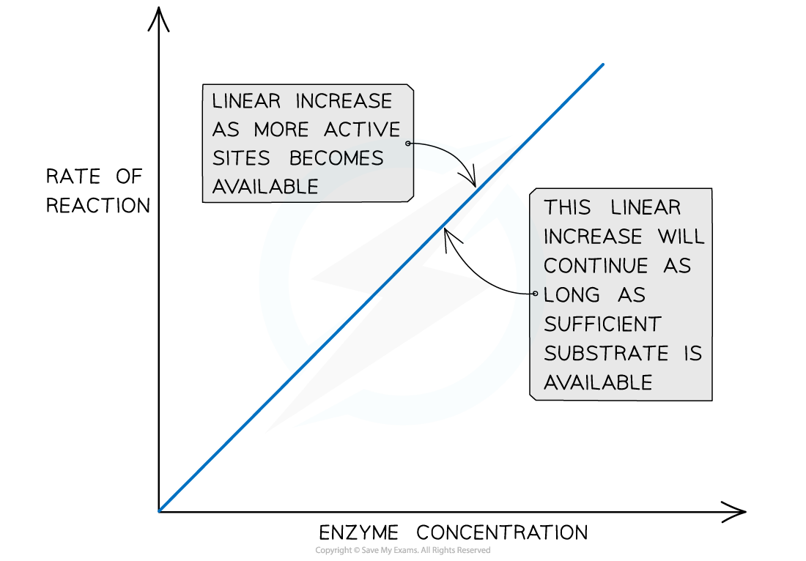

# Rate: Enzyme Concentration

## Rate: Enzyme Concentration

> **Spec point** — `spcpt_8pYFKNwVYdDsXStP` · investigate and explain the effects of the following factors on the rate of enzyme-catalysed reactions:
• enzyme concentration

## Rate: enzyme concentration

- Enzyme concentration affects the rate of reaction
- The **higher** the **enzyme concentration** in a reaction mixture:

  - The **greater the number of active sites** available
  - The **greater the likelihood of enzyme-substrate complex formation**
- As long as there is **sufficient substrate available**, the initial rate of reaction** increases linearly** with enzyme concentration
- If the amount of substrate is limited, at a certain point any further increase in enzyme concentration will **not increase** the reaction rate as the amount of substrate becomes a **limiting factor**

*The effect of enzyme concentration on the rate of an enzyme-catalysed reaction*

> **Exam Hint**
> Always mention substrate availability when explaining the effect of increasing enzyme concentration.
> 
> A common mistake is to say that *“more enzymes always increase the rate”* — but this is only true **while there is enough substrate present**. In exams, you should state that if substrate becomes limiting, the rate will **level off** **even if enzyme concentration keeps increasing**.
