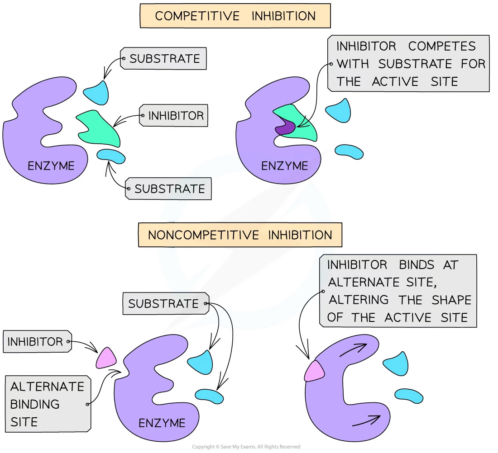
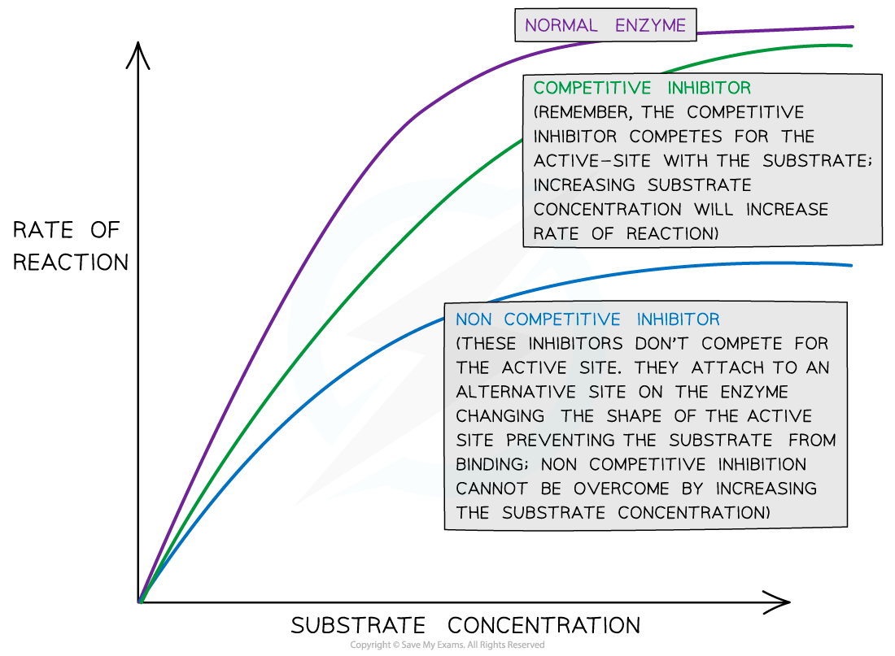

# Rate: Inhibitor Concentration

## Rate: Inhibitor Concentration

> **Spec point** — `spcpt_s7Pr8MSh689GQ949` · investigate and explain the effects of the following factors on the rate of enzyme-catalysed reactions:
• inhibitor concentration

## Rate: inhibitor concentration

- There are **two types** of inhibitors:

  - **Competitive** inhibitors have a **similar shape** to that of the **substrate** molecules
  
    - This means they **compete** with the substrate for the active site
  - **Non-competitive** inhibitors **bind** to the enzyme at an **alternative site**, **altering the shape of the active site**
  
    - This **prevents** the **substrate** from **binding** to it

*The two types of inhibitors, competitive and non-competitive, can affect the formation of enzyme-substrate complexes*

- Both types of inhibitors **slow down** or **stop** enzyme activity
- **Increasing** the concentration of an inhibitor **reduces the rate of reaction**

  - Eventually, if inhibitor concentration continues to be increased, the reaction will **stop completely**
- For **competitive inhibitors**, countering the increase in inhibitor concentration by increasing the substrate concentration **can** **increase** the rate of reaction once more

  - This is because more substrate molecules mean they are more likely to collide with enzymes and form enzyme-substrate complexes before the inhibitor can bind
- For **non-competitive inhibitors**, increasing the substrate concentration **cannot** **increase** the rate of reaction once more

  - This is because the shape of the active site of the enzyme remains changed, so enzyme-substrate complexes are still unable to form despite the high number of substrate molecules present

*The effect of inhibitor concentration on the rate of an enzyme-catalysed reaction*

> **Exam Hint**
> While a competitive inhibitor will lower the initial rate of reaction (by occupying some of the available active sites), eventually the same amount of product will be produced as would have been produced without the competitive inhibitor (the maximal rate is not affected).
> 
> Non-competitive inhibitors lower the initial rate of reaction and the maximal rate of reaction (a lower amount of product is produced than would normally be produced).
