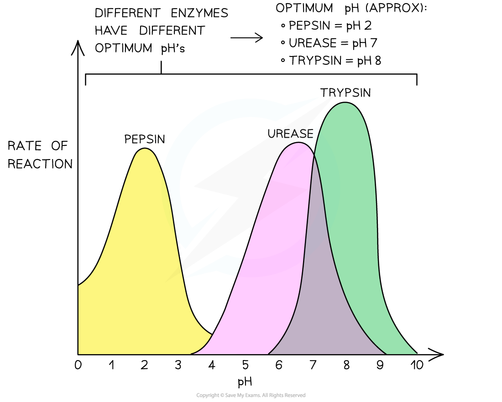

# Rate: pH

## Rate: pH 

> **Spec point** — `spcpt_R5d6Fv5YpQTQKyfB` · investigate and explain the effects of the following factors on the rate of enzyme-catalysed reactions:
•pH (using buffer solutions)

## Rate: pH

- All enzymes have an **optimum pH** which is a pH at which they operate best
- Enzymes are **denatured** at extremes of pH

  - **Hydrogen** **and ionic bonds** hold the tertiary structure of the protein (i.e. the enzyme) together
  - Below and above the optimum pH of an enzyme, solutions with an excess of H+ ions (acidic solutions) and OH- ions (alkaline solutions) can cause these **bonds** to **break**
  - This **alters the shape of the active site**, which means enzyme-substrate complexes form less easily
  - Eventually, enzyme-substrate complexes can no longer form at all
  - At this point, **complete denaturation** of the enzyme has occurred
- Where an enzyme functions, can be an indicator of its optimal environment:

  - E.g.** pepsin** is found in the stomach, an acidic environment at pH 2 (due to the presence of **hydrochloric acid** in the stomach’s gastric juice)
  - Pepsin’s optimum pH, not surprisingly, is pH 2

*The effect of pH on the rate of an enzyme-catalysed reaction for three different enzymes (each with a different optimum pH)*

- When investigating the effect of pH on the rate of an enzyme-catalysed reaction, you can use **buffer solutions** to measure the rate of reaction at** different pH values**:

  - Buffer solutions each have a **specific pH**
  - Buffer solutions **maintain** this specific pH, even if the reaction taking place would otherwise cause the pH of the reaction mixture to **change**
  - A **measured volume** of the buffer solution is added to the reaction mixture
  - This **same volume** (of each buffer solution being used) should be added for each pH value that is being investigated

> **Exam Hint**
> Temperature can both affect the speed at which molecules are moving (and therefore the number of enzyme-substrate collisions in a given time), and can denature enzymes (at high temperatures).
> 
> pH, however, does not affect collision rate but only disrupts the ability of the substrate to bind with the enzyme. This reduces the number of successful collisions until the active site changes shape so much that no more successful collisions can occur.
