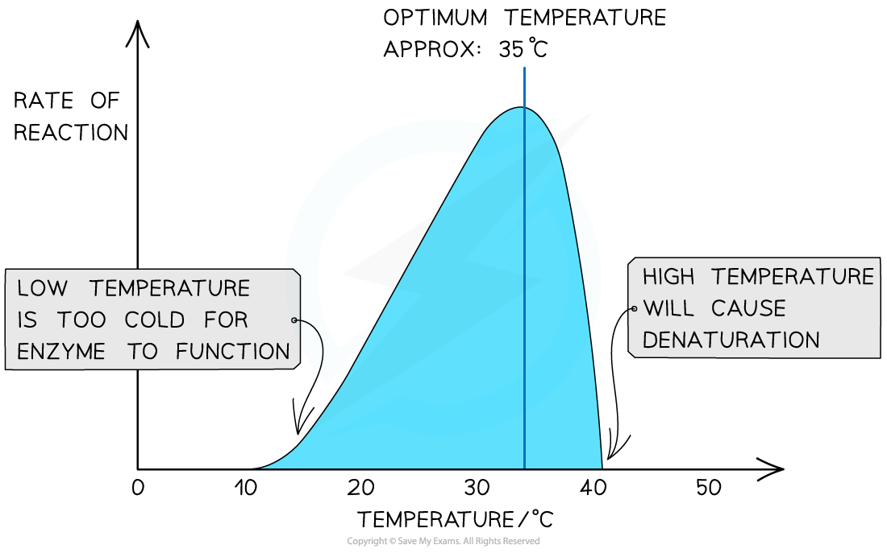

# Rate: Temperature

## Rate: Temperature

> **Spec point** — `spcpt_bYyPMjCRQjyxV8S6` · investigate and explain the effects of the following factors on the rate of enzyme-catalysed reactions:
• temperature

## Rate: temperature

- Enzymes have a **specific optimum temperature**

  - This is the temperature at which they catalyse a reaction at the **maximum rate**
- **Lower temperatures** either **prevent** reactions from proceeding or **slow them down** this is because:

  - Molecules move relatively **slowly at lower temperatures**
  - Therefore there is a **lower frequency of successful collisions** that occur between substrate molecules and the active site of the enzyme
  - So there are **less frequent enzyme-substrate complexes **formed
  - Substrates and enzymes collide with **less energy**, making it less likely for bonds to be formed or broken (stopping the reaction from occurring)
- **Higher temperatures speed up reactions **this is because:

  - Molecules move more **quickly** at higher temperatures
  - Which results in** higher frequency of successful collisions** between substrate molecules and the active sites of enzymes
  - So there are **more frequent enzyme-substrate complexes** formed
  - Substrates and enzymes collide with **more energy**, making it more likely for bonds to be formed or broken (allowing the reaction to occur)
- However, as temperatures continue to increase, the rate at which an enzyme catalyses a reaction **drops sharply**, as the enzyme begins to **denature**:

  - **Bonds** (e.g. hydrogen bonds) holding the enzyme molecule in its precise shape start to **break**
  - This causes the **tertiary structure** of the protein (i.e. the enzyme) to **change**
  - This **permanently damages** the **active site**, preventing the **substrate** from **binding**
  - **Denaturation** has occurred if the substrate can no longer bind
  - Very few human enzymes can function at temperatures above 50°C
  
    - This is because humans maintain a body temperature of about 37°C, therefore even temperatures exceeding 40°C will cause the denaturation of enzymes

*The effect of temperature on the rate of an enzyme-catalysed reaction. Enzyme activity will have an optimum temperature specific for each enzyme. *

> **Exam Hint**
> When answering questions about reaction rates for enzyme-catalysed reactions, make sure to explain ***how ***the temperature affects the speed at which the molecules (enzymes and substrates) are moving and how this, in turn, affects the number of successful collisions.
