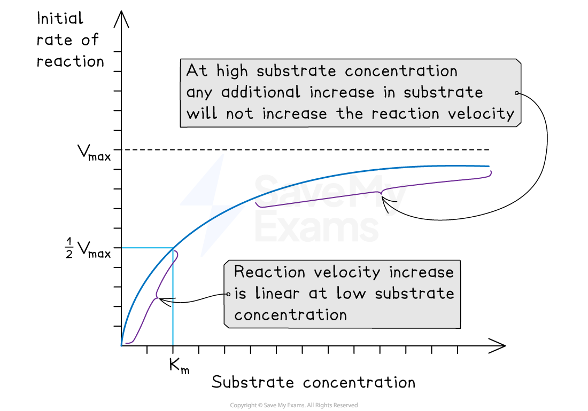

# Vmax & the Michaelis-Menten Constant

## Vmax & the Michaelis-Menten Constant 

> **Spec point** — `spcpt_wv2C4yNwGPxKZdyn` · explain that the maximum rate of reaction (Vmax) is used to derive the Michaelis–Menten constant (Km), which is used to compare the affinity of different enzymes for their substrates

## Vmax & the Michaelis-Menten constant

- **Substrate concentration** affects the **rate of catalysis** in an enzyme-substrate reaction

  - When the substrate concentration is **fixed** (and enzyme concentration is kept constant) the **initial rate **of reaction is **fastest**
  - As substrate is used up (converted to product), the substrate concentration falls, so there are fewer enzyme-substrate collisions and the reaction rate **falls**
- The **Michaelis-Menten model** describes the kinetics of such enzyme catalysed reactions
- In this model, two values are used to describe an enzyme catalysed reaction:

  - The **maximal rate or maximal velocity** (**V****max**)
  - The **Michaelis-Menten constant **(**K****m**)
- These values are derived from the **reaction rate at different substrate concentrations**
- The maximum rate of reaction (Vmax) is used to derive the Michaelis–Menten constant (Km)

  - This is then used to **compare** the **affinity** of different enzymes for their substrates

### Michaelis-Menten enzyme kinetics

- The **Michaelis-Menten model** is used to investigate the **kinetics** of enzyme catalysed reactions (enzyme kinetics is an area in biochemistry that studies how different variables affect reaction rates)
- The rate of reaction is measured at different substrate concentrations, producing a graph like the one below
- The two important values deduced are:

  - The **V****max**** **(maximum rate of reaction at saturating substrate concentrations)
  - The **K****m**, which is the substrate concentration at **½V****max  **(this is also known as the **Michaelis-Menten constant**)
  
    - The Michaelis-Menten constant is the **substrate concentration** at which the enzyme works at **half its maximum rate**
    - At this point, **half of the active sites of the enzyme are occupied** by substrate molecules
    - The **higher** the affinity of the enzyme for the substrate, the **lower** the substrate concentration needed for this to occur
    - This is why the Michaelis-Menten constant is a measure of the **affinity** of an enzyme for its substrate
- There is an **inverse relationship** between the **K****m**** **and the affinity of an enzyme for its substrate
- An enzyme with a **high** **K****m**** **has a **low affinity** for its substrate and an enzyme with a **low** **K****m**** **has a **high affinity** for its substrate

*A graph showing the effect of substrate concentration on initial reaction rate, with Vmax, ½Vmax and Km values shown*

> **Exam Hint**
> Make sure you can identify the Vmax and the Km on a graph like the one above.
