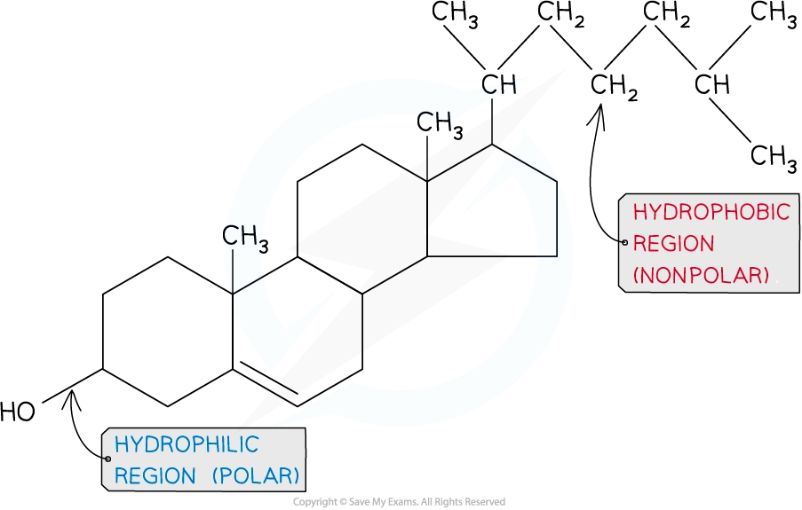
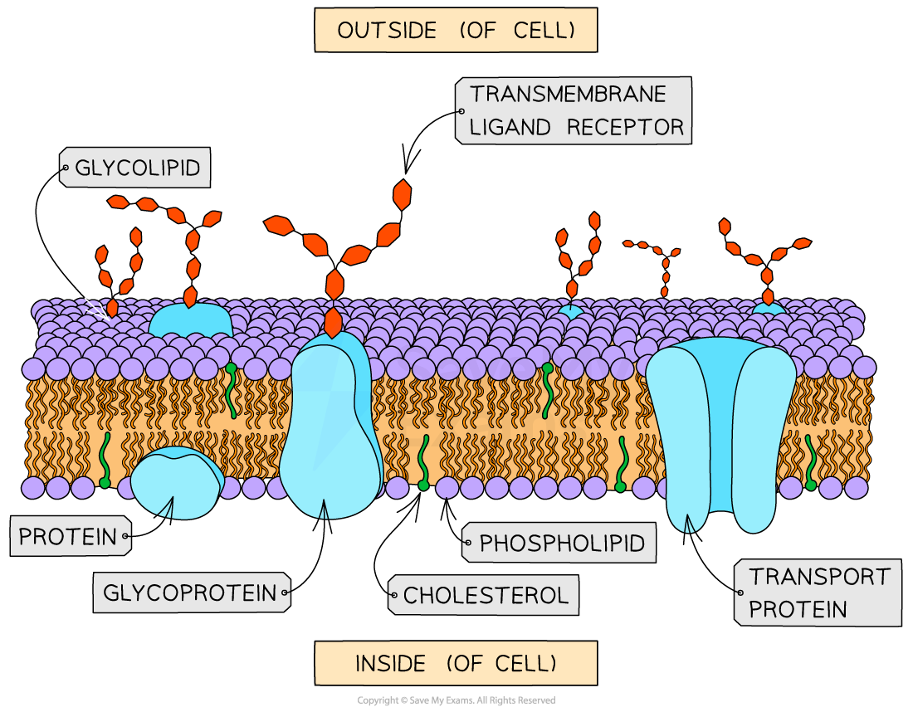

# Components of Cell Surface Membranes

## Phospholipids, Cholesterol, Glycolipids, Proteins & Glycoproteins

> **Spec point** — `spcpt_7Tp7py97CX8RZBjn` · describe the arrangement of cholesterol, glycolipids and glycoproteins in cell surface membranes

## Phospholipids, cholesterol, glycolipids, proteins & glycoproteins

- The cell membranes of all organisms generally have a similar structure
- Cell membranes contain several different types of molecules:

  - Three types of lipid:
  
    - **Phospholipids**
    - **Cholesterol**
    - **Glycolipids **(also containing carbohydrates)
  - Two types of proteins:
  
    - **Glycoproteins **(also containing carbohydrates)
    - **Other proteins** (e.g., transport proteins)

- **Phospholipids**:

  - Form a **bilayer** (two layers of phospholipid molecules)
  - Hydrophobic tails (fatty acid chains) point in towards the membrane interior
  - Hydrophilic heads (phosphate groups) point out towards the membrane surface
  - Individual phospholipid molecules can move around within their own monolayers by diffusion

- **Cholesterol**:

  - Cholesterol molecules also have hydrophobic tails and hydrophilic heads
  - Cholesterol fits **between phospholipid molecules** and orientated the same way (head out, tail in)
  - It is only found in eukaryotic membranes; it is **absent in prokaryotes membranes**

*The structure of cholesterol shows that it has a hydrophilic region (the -OH group) and a hydrophobic region (a hydrocarbon chain). This gives the molecule a dual character that allows it to fit inside a phospholipid bilayer.*

- **Glycolipids**:

  - These are **lipids with carbohydrate chains** attached
  - These carbohydrate chains project out into whatever fluid is surrounding the cell (they are found on the **outer phospholipid monolayer)**

- **Glycoproteins**:

  - These are **proteins with carbohydrate chains** attached
  - These carbohydrate chains also project out into whatever fluid is surrounding the cell (they are found on the **outer phospholipid monolayer)**

- **Proteins**:

  - The proteins embedded within the membrane are known as **intrinsic proteins** (or **integral** proteins)
  - They can be located in the** inner or outer phospholipid monolayer**
  - **Most commonly, they span the entire membrane** – these are known as **transmembrane proteins**
  - **Transport proteins** are an example of transmembrane proteins as they cross the whole membrane
  - Proteins can also be found on the inner or outer surface of the membrane, these are known as **extrinsic proteins **(or **peripheral** proteins)

*Membrane proteins (shown in light blue) can span the whole membrane (intrinsic) or just occupy one side of it (extrinsic).*

> **Exam Hint**
> Make sure you can **draw** and **label** all the above structures on a diagram of the fluid mosaic model of cell membranes. You also need to be able to state the **functions** of the structures.
> 
> 
