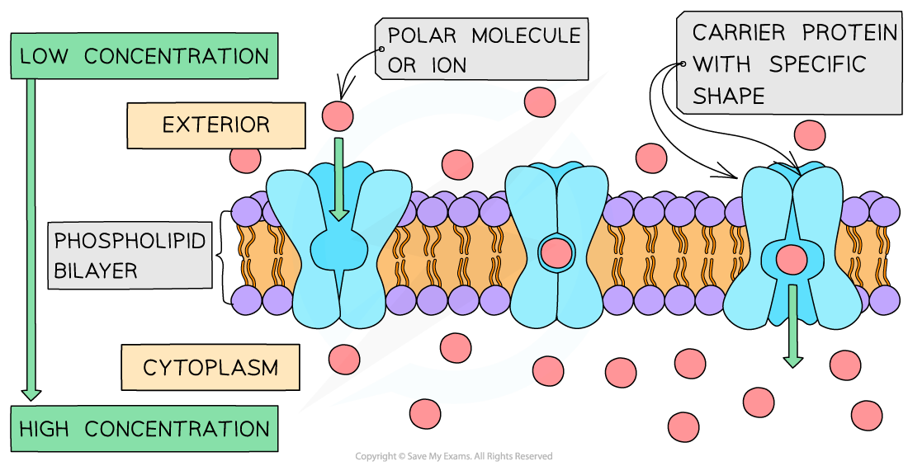

# Active Transport

## The Process of Active Transport

> **Spec point** — `spcpt_wrmSDhh3NT6rb6vR` · describe and explain the processes of active transport

## The process of active transport

- Active transport is the movement of molecules and ions through a cell membrane from a region of **lower concentration** to a region of **higher concentration** using **energy from respiration**
- Active transport requires **carrier proteins** (each carrier protein being **specific **for a particular type of molecule or ion)
- Although facilitated diffusion also uses carrier protein, active transport is different as it requires an** input of additional energy**

  - The energy is required to make the carrier protein **change shape**, allowing it to transfer the molecules or ions across the cell membrane
  - The energy required is provided by hydrolysis of **ATP** (adenosine triphosphate), which is produced during respiration

*A carrier protein changing shape during active transport*

> **Exam Hint**
> Be careful not to get carrier proteins and channel proteins confused when answering questions on active transport.
> 
> Active transport requires **carrier proteins** (transmembrane transport proteins that undergo conformational change) **not** channel proteins.
