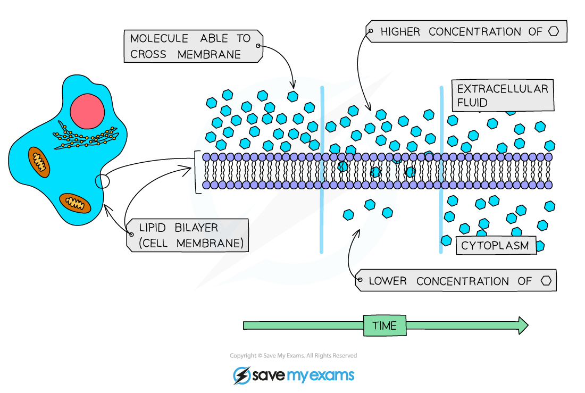
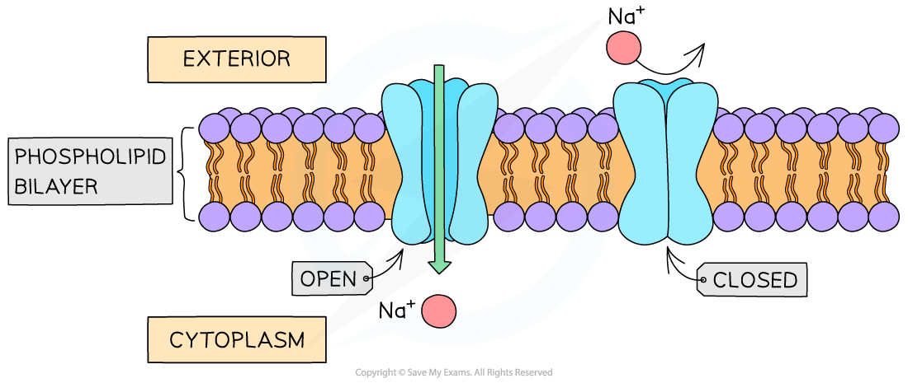
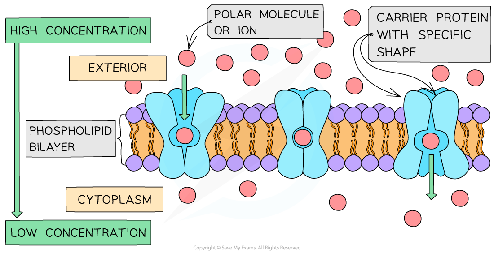

# Diffusion

## Diffusion & Facilitated Diffusion

> **Spec point** — `spcpt_3NTMxMTvgW6SYynz` · describe and explain the processes of simple diffusion, facilitated diffusion.

## Diffusion & facilitated diffusion

- Diffusion is a type of **transportation**
- It can be defined as:

***The net movement of a substance from a region of its higher concentration to a region of its lower concentration, as a result of the random motion of its molecules or ions***

- The molecules or ions move **down a concentration gradient**
- The random movement is caused by the **natural kinetic energy** of the molecules or ions

*Diffusion across the cell membrane*

- As a result of diffusion, molecules or ions tend to reach an equilibrium situation (given sufficient time), where they are evenly spread within a given volume of space
- The **rate** at which a substance diffuses across a membrane depends on several factors:

| **Factor** | **How the factor affects the rate of diffusion** |
|---|---|
| 'Steepness' of the concentration gradient | This is the difference in the concentrations of the substance on both sides of the surface  If there are more molecules on one side of a membrane than on the other, at any one moment more molecules will move randomly across the membrane from that side than from the other side  A greater difference in concentration means a greater difference in the number of molecules passing in the two directions within a given time, and therefore a faster rate of diffusion |
| Temperature | Molecules and ions have more kinetic energy at higher temperatures  They move faster, resulting in a higher rate of diffusion |
| Surface area | The greater the surface area across which diffusion is taking place, the greater number of molecules or ions that can cross it at any one moment and therefore, faster diffusion occurs  The surface area of cell membranes can be increased by folding (eg. microvilli in an intestinal epithelium cell or cristae in a mitochondrion)  As a cell increases in size, the surface area to volume ratio decreases, which slows down the rate that substances can diffuse through a cell as the distance required to move becomes too great |
| Properties of molecules or ions | Large molecules diffuse more slowly than smaller ones as they require more energy to move  Uncharged and non-polar molecules diffuse directly across the phospholipid bilayer  Non-polar molecules diffuse more quickly than polar ones because they are soluble in the non-polar central layer of the phospholipid bilayer |

### Facilitated diffusion

- Certain substances cannot diffuse through the phospholipid bilayer of cell membranes. These include:

  - **Large polar molecules** such as glucose and amino acids
  - **Ions** such as sodium ions (Na+) and chloride ions (Cl-)
- Because most substances in biology are water-soluble, facilitated diffusion is required by **a large majority of molecules** that diffuse across membranes
- These substances can only cross the phospholipid bilayer with the help of certain proteins
- This form of diffusion is known as **facilitated diffusion**
- There are two types of proteins that enable facilitated diffusion:

  - **Channel proteins**
  - **Carrier proteins**
- Channel and carrier proteins are **highly specific** (they only allow one type of molecule or ion to pass through)

#### Channel proteins

- Channel proteins are **water-filled pores**
- They allow **charged substances** (ions) to diffuse through the cell membrane
- The diffusion of these ions does not occur freely, most channel proteins are ‘gated’

  - This means that part of the channel protein on the inside surface of the membrane can move in order to close or open the pore
- This allows the channel protein to control the exchange of ions

*A channel protein (open and closed)*

#### Carrier proteins

- Unlike channel proteins which have a fixed shape, **carrier proteins can switch between two shapes**
- This causes the binding site of the carrier protein to be open to one side of the membrane first, and then open to the other side of the membrane when the carrier protein switches shape
- The direction of movement of molecules diffusing across the membrane depends on their **relative concentrations** on each side of the membrane
- Net diffusion of molecules or ions into or out of a cell will occur **down a concentration gradient** (from an area containing many of that specific molecule to an area containing less of that molecule)

*A carrier protein changing shape during facilitated diffusion*

> **Exam Hint**
> Remember – the movement of molecules from high concentration to low concentration is **diffusion**.
> 
> If this movement requires the aid of a protein (for example because the molecule is charged and cannot pass directly through the phospholipid bilayer) this is *facilitated *diffusion.
