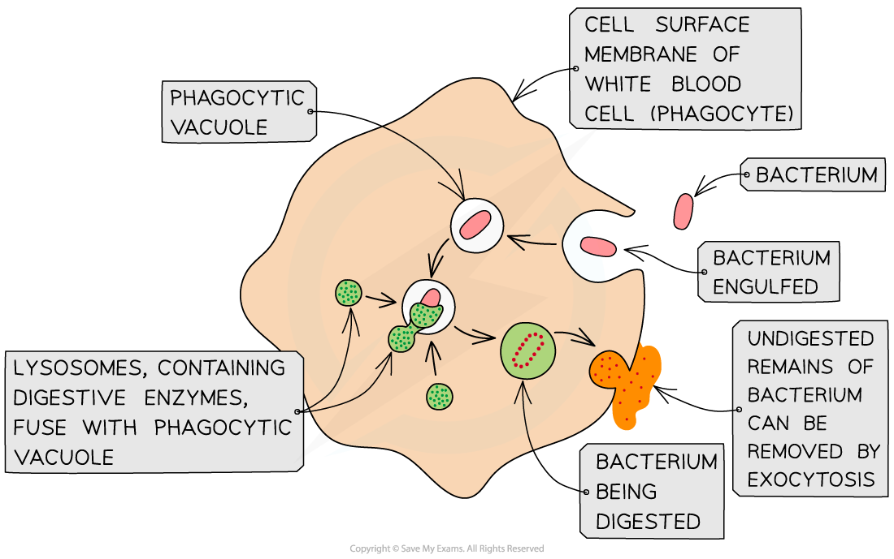
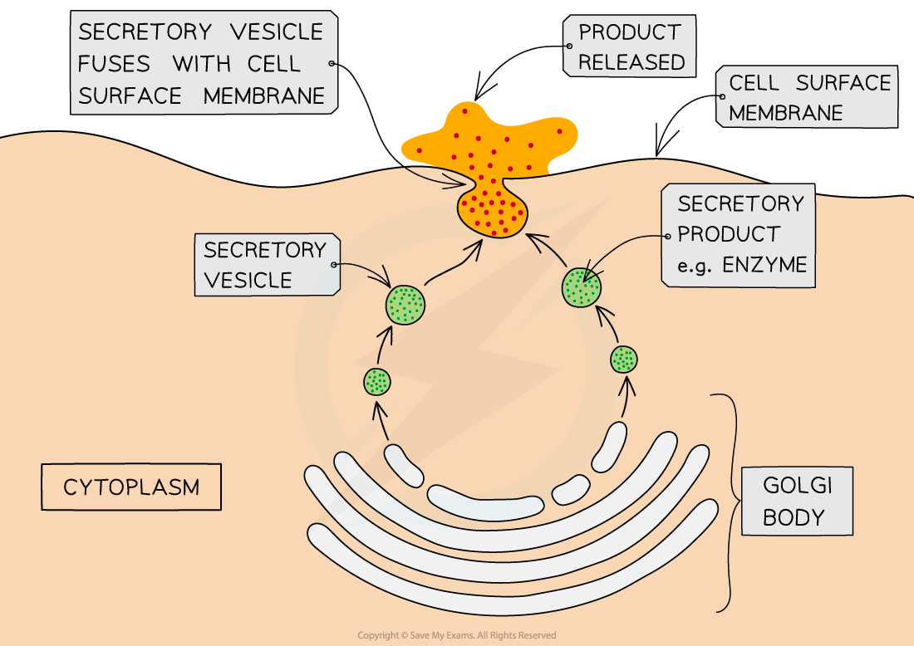

# Endocytosis & Exocytosis

## Endocytosis & Exocytosis

> **Spec point** — `spcpt_ZZwwNNy6YSYPS9Nk` · describe and explain the processes of endocytosis and exocytosis

## Endocytosis & exocytosis

- The processes of diffusion, osmosis and active transport are responsible for the transport of **individual molecules or ions** across cell membranes
- However, the **bulk transport of larger volumes of materials** into or out of cells is also possible
- Examples of these larger quantities of materials that might need to cross the membrane include:

  - Large molecules such as proteins or polysaccharides
  - Parts of cells
  - Whole cells e.g., bacteria
- Bulk transport **into** cells = **endocytosis**
- Bulk transport **out** of cells = **exocytosis**

  - These two processes **require energy input** (from ATP), so they are **active processes**, but they are not called active transport (which uses carrier proteins)

### Endocytosis

- Endocytosis is the process by which the cell surface membrane folds inwards and **engulfs material**, forming a small sac (or ‘**endocytic vesicle**’) around it
- There are two forms of endocytosis:

  - **Phagocytosis**:
  
    - This is the bulk intake of **solid material** by a cell
    - Cells that specialise in this process are called **phagocytes**
    - The vacuoles formed are called phagocytic **vacuoles**
    - An example is the engulfing of bacteria by phagocytic white blood cells
  - **Pinocytosis**:
  
    - This is the bulk intake of **liquids**

*The process of phagocytosis of a bacterium by a phagocyte (white blood cell)*

### Exocytosis

- Exocytosis is the process by which materials are removed from, or **transported out of**, cells (the **reverse of endocytosis**)
- The substances to be released (such as **enzymes **or **hormones**) are packaged into **secretory vesicles** formed from the **Golgi body**
- These vesicles then travel to the cell surface membrane
- Here they **fuse** with the cell membrane and **release their contents** outside of the cell
- An example is the **secretion **of digestive enzymes from pancreatic cells

*The process of exocytosis*

> **Exam Hint**
> Remember – active transport, endocytosis and exocytosis all require the input of **energy**. This energy is provided by the hydrolysis of ATP produced during respiration.
> 
> To get the mark in the exam you have to specifically state '**exocytosis**' for bulk transport out of the cell and '**endocytosis**' for bulk transport into the cell. Simply stating 'bulk transport' is not specific enough, the examiner will want to know **what type** of bulk transport and for this you need to state the scientific name!
