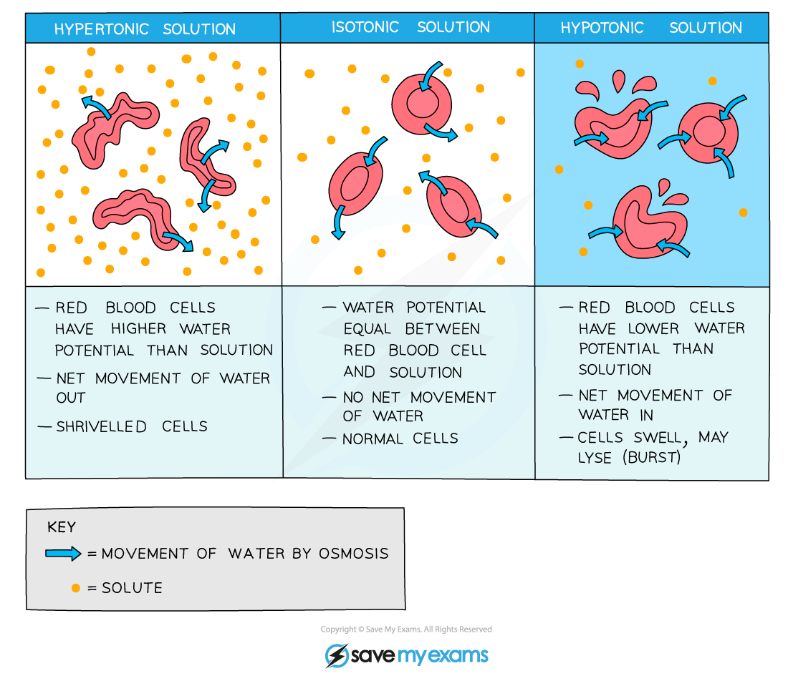

# Osmosis in Animals

## Osmosis: Animal Cells

> **Spec point** — `spcpt_rDTT3rVwwZRGtS68` · explain the movement of water between cells and solutions in terms of water potential and explain the different effects of the movement of water on plant cells and animal cells

## Osmosis: animal cells

- Osmosis is the **net movement of water molecules** from a region of **higher water potential **(dilute solution) to a region of **lower water potential** (concentrated solution), through a selectively permeable membrane
- Like plant cells, **animal cells can also lose and gain water as a result of osmosis**
- Because **animal cells do not have a supporting cell wall** (unlike plant cells), the results of this loss or gain of water on the cell are more **severe**

  - For example, if an animal cell is placed in a solution with a **lower water potential **than the cell (such as a concentrated sucrose solution), water will **leave** the cell through its selectively permeable cell surface membrane by **osmosis**
  
    - This will cause the cell to **shrink** and **shrivel up**
    - This occurs when the cell is in a **hypertonic environment** (the solution outside of the cell has a **higher solute concentration** than the inside of the cell)
  - Conversely, if an animal cell is placed in **pure water** or a **dilute solution**, water will **enter** the cell through its selectively permeable cell surface membrane by **osmosis**, as the pure water or dilute solution has a **higher water potential**
  
    - The cell will continue to **gain **water by osmosis until the cell membrane is stretched too far and the cell **bursts (cytolysis)**, as it has no cell wall to withstand the increased pressure created
    - This occurs when the cell is in a **hypotonic environment** (the solution outside of the cell has a **lower solute concentration** than the inside of the cell)
- This is why a constant water potential **must** be maintained inside the bodies of animals
- If an animal cell is in an **isotonic environment** (the solution outside of the cell has the** same solute concentration** as the inside of the cell), the movement of water molecules into and out of the cell occurs at the **same rate** (**no net movement of water**)

  - This means there is **no change to the cells**

*Effect of osmosis on animal cells*

> **Exam Hint**
> Be careful with your scientific terminology—animal cells **do not** **plasmolyse** because they do not have a cell wall.
> 
> In a solution with a lower water potential than the cell itself, animal cells will **shrink**.
> 
> **Plasmolysis only occurs in plant cells.**
