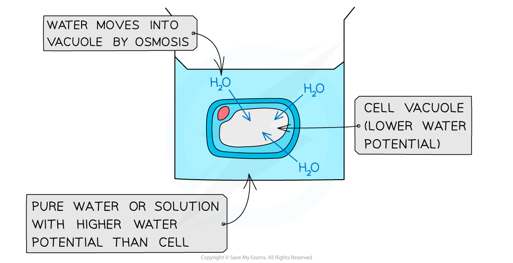
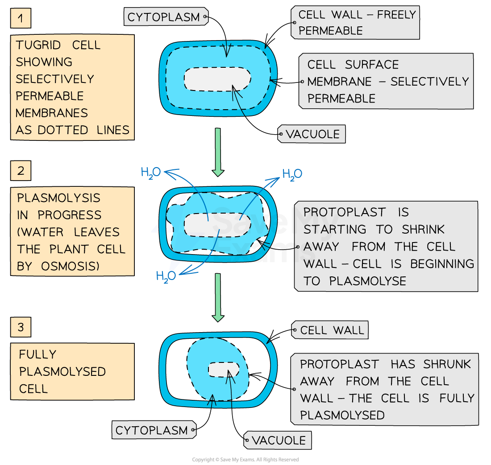

# Osmosis in Plant Cells

## Osmosis: Plant Cells

> **Spec point** — `spcpt_BjvmcQkpScfhp7gh` · explain the movement of water between cells and solutions in terms of water potential and explain the different effects of the movement of water on plant cells and animal cells

## Osmosis: plant cells

- Osmosis is the **net movement of water molecules** from a region of **higher water potential **(dilute solution) to a region of **lower water potential** (concentrated solution), through a selectively permeable membrane
- If a plant cell is placed in **pure water** or a **dilute solution**, water will **enter** the plant cell through its selectively permeable cell surface membrane by **osmosis**

  - This is because the pure water or dilute solution has a **higher water potential** than the plant cell
- As water enters the **vacuole** of the plant cell, the **volume** of the plant cell **increases**
- The expanding **protoplast** (living part of the cell inside the cell wall) pushes against the cell wall and **pressure builds up** inside the cell

  - The inelastic cell wall prevents the cell from bursting
  - The pressure created by the cell wall also **stops too much water entering** and this also helps to prevent the cell from bursting
- When a plant cell is fully inflated with water and has become rigid and firm, it is described as fully **turgid**
- This turgidity is important for plants as the effect of all the cells in a plant being firm is to provide **support** and **strength** for the plant

  - This allows the plant to **stand upright** with its leaves held out to absorb sunlight
- If plants do not receive enough water the cells cannot remain rigid and firm (turgid) and the plant **wilts**

*Osmosis of water into a plant cell*

- If a plant cell is placed in a solution with a **lower water potential **than the plant cell (such as a concentrated sucrose solution), water will **leave** the plant cell through its selectively permeable cell surface membrane by **osmosis**
- As water leaves the **vacuole** of the plant cell, the volume of the plant cell **decreases**
- The protoplast gradually shrinks and no longer exerts pressure on the cell wall
- As the protoplast continues to shrink, it begins to pull away from the cell wall
- This process is known as **plasmolysis**

  - The plant cell is **plasmolysed**

*Plasmolysis of a plant cell that has been placed in a solution with a lower water potential than the cell itself<*

> **Exam Hint**
> Remember—plant cell membranes are composed of a phospholipid bilayer and are selectively permeable (only certain molecules can cross), whereas plant cell walls are made of cellulose and are freely permeable.
