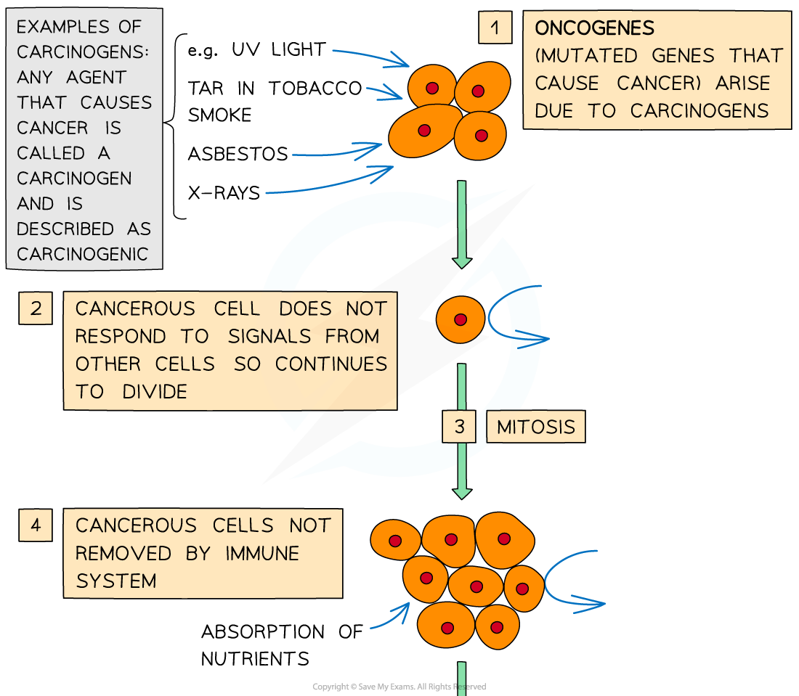
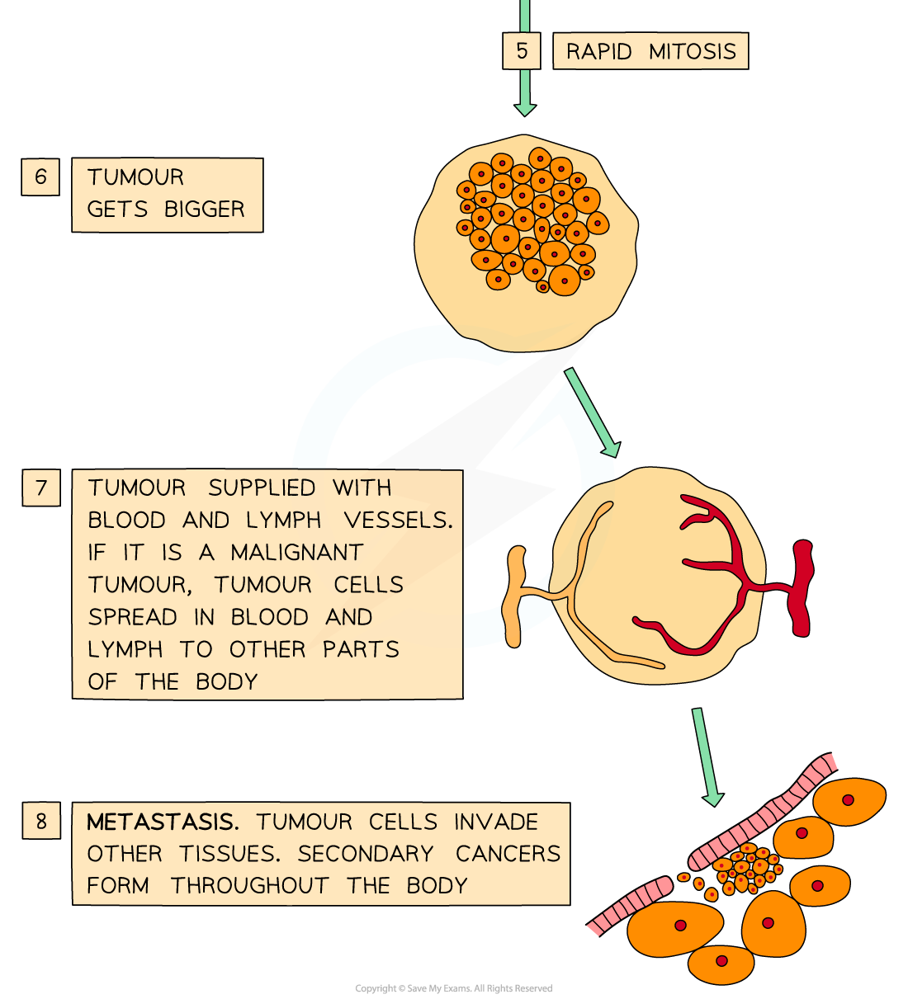

# How Tumours Form

## How a Tumour Forms

> **Spec point** — `spcpt_YmB9qRdqJCxnx9pG` · explain how uncontrolled cell division can result in the formation of a tumour

## How a tumour forms

- Cancers demonstrate how important it is that **cell division** is **precisely controlled**, as cancers arise due to **uncontrolled mitosis**
- Cancerous cells divide repeatedly and uncontrollably, forming a **tumour** (an irregular mass of cells)
- Cancers start when **changes occur in the genes that control cell division**
- A change in any gene is known as a **mutation**

  - If the mutated gene is one that **causes** **cancer**, it is referred to as an **oncogene**
  
    - Mutations are common events and don’t lead to cancer most of the time
    - Most mutations either result in **early cell death** or result in the cell being destroyed by the **body’s immune system**
    - As most cells can be easily replaced, these events usually have no harmful effect on the body
- The mutations that result in the generation of cancerous cells **do not result in early cell death or in the cell being destroyed by the body’s immune system**

  - This means that the **harmful mutation** occurring in the original cell can be **passed on** to all that cell’s descendants

- **Carcinogens** are any agents that may cause cancer (e.g. UV light, tar in tobacco smoke, and X-rays)

  - If the agent causes cancer it is described as **carcinogenic**

### Benign vs malignant tumours

- Some tumours (such as warts) do not spread from their original site – these are known as **benign** tumours and **do not cause cancer**
- Some tumours spread through the body, invading and destroying other tissues – these are known as **malignant** tumours and **cause cancer**

  - Malignant tumours interfere with the normal functioning of the organ / tissue in which they have started to grow (e.g. they may block the intestines, lungs, or blood vessels
  - Malignant tumour cells can **break off the tumour and travel through the blood and / or lymphatic system** to form **secondary growths** in other parts of the body
  - The spreading of cancers in this way is known as **metastasis**
  - Metastasis is very dangerous as it can be **very difficult to detect, locate, and remove** secondary cancers

*Stages in the development of cancer*

> **Exam Hint**
> Make sure you know examples of carcinogens. Also, you should know that some viruses (known as oncoviruses) cause cancer and can therefore also be described as carcinogens.
