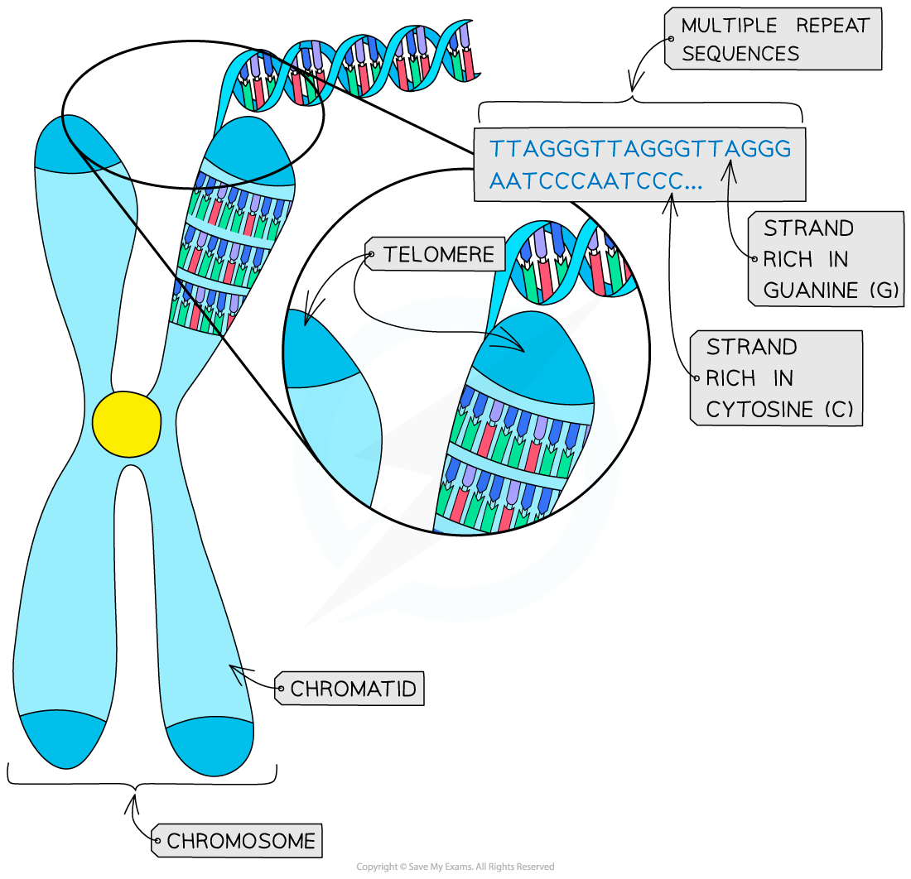

# The Role of Telomeres

## The Significance of Telomeres

> **Spec point** — `spcpt_YkXfHxFdHpdmtnQW` · outline the role of telomeres in preventing the loss of genes from the ends of chromosomes during DNA replication

## The significance of telomeres

- The **ends** of the chromatids in chromosomes are ‘sealed’ with **protective structures** called **telomeres**

  - They are made of **non-coding DNA** (DNA that does not contain genes) that is made up of short base sequences that are repeated many times (multiple repeat sequences)
- The main function of telomeres is to ensure that the **very ends** of the DNA molecules are included when the DNA is replicated in the S phase of interphase, before the cell divides by mitosis

  - This is because the copying enzyme responsible for DNA replication is **unable to run right to the very end of the DNA molecule** and stops a little short of the end
  - If this end part of the DNA molecule contained an important gene, that piece of genetic information would be **lost **during DNA replication
  - In each subsequent cell division, a little more genetic information would be lost
- Telomeres therefore act as a **‘buffer’ region** of non-essential DNA

  - **They ensure that no important coding sections near the ends of the DNA molecules are left out of the replication process**
  - This **ensures no genes are lost during cell division** (the loss of vital genes can even result in cell death) and allows for continued replication of a cell

*A telomere with multiple repeat sequences*

> **Exam Hint**
> Telomeres are similar to the coding regions of DNA molecules in that they are made of the **same nucleotides**. However, telomeres' base sequences are **non-coding**, meaning they do not code for proteins.
