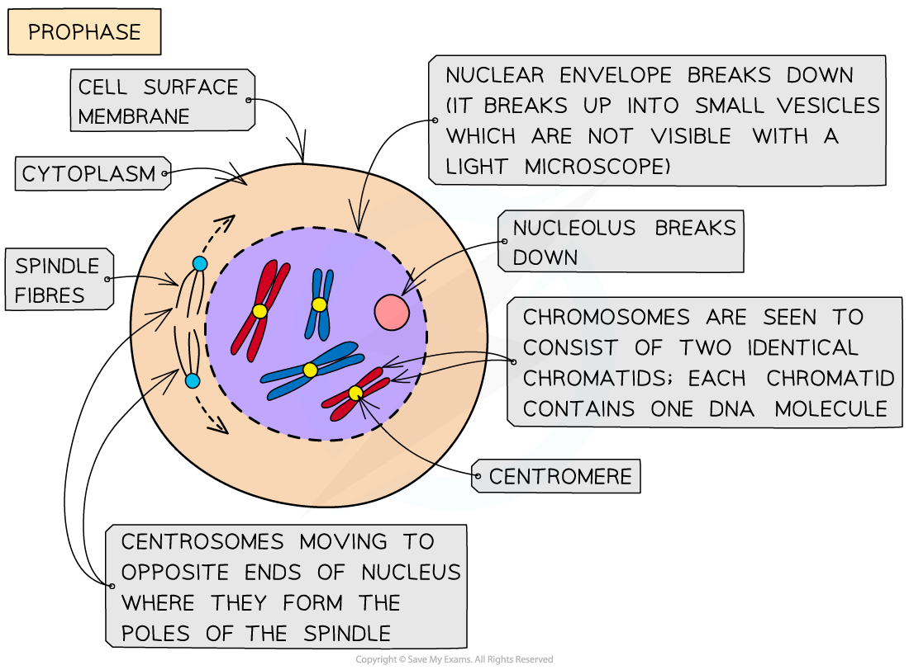
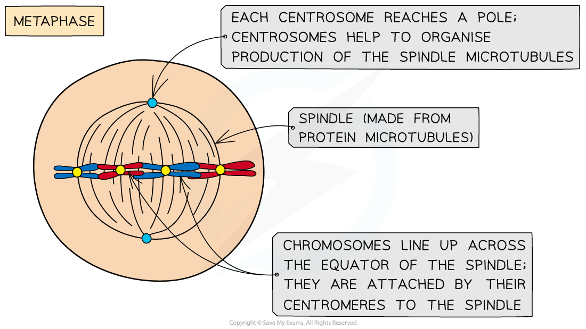
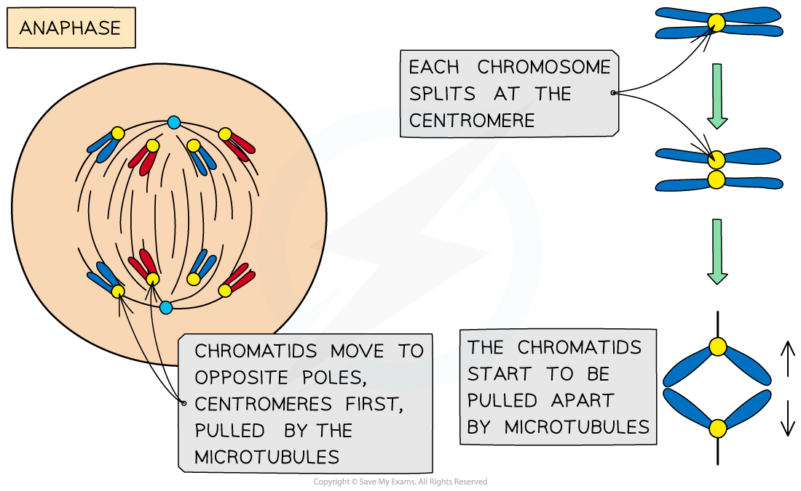
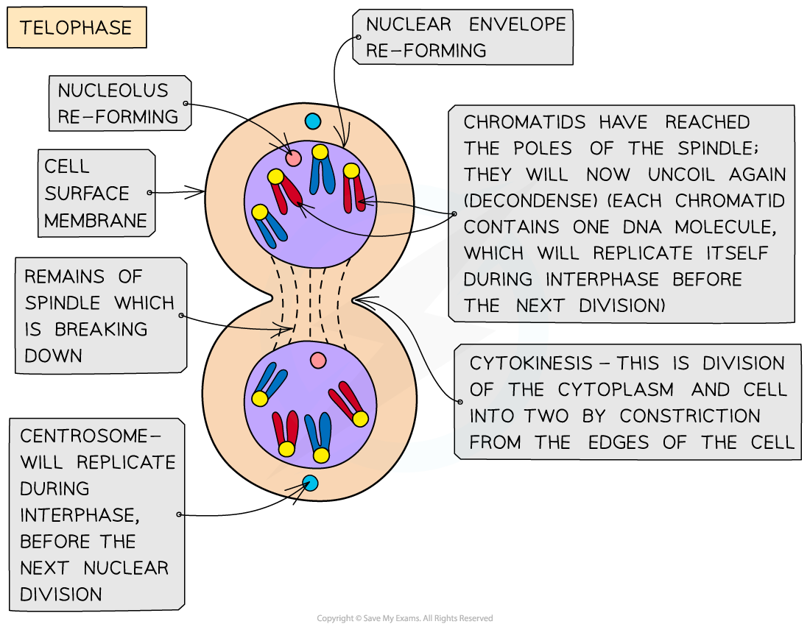

# The Stages of Mitosis

## Mitosis: The Stages

> **Spec point** — `spcpt_9ZpT3Yq4bK5qNTdM` · describe the behaviour of chromosomes in plant and animal cells during the mitotic cell cycle and the associated behaviour of the nuclear envelope, the cell surface membrane and the spindle

## Mitosis: the stages

- Mitosis is the process of nuclear division by which **two genetically identical daughter nuclei** are produced that are also genetically identical to the parent cell nucleus (they have the same number of chromosomes as the parent cell)
- Although mitosis is actually one continuous process, it can be divided into **four main stages**
- These stages are:

  - **Prophase**
  - **Metaphase**
  - **Anaphase**
  - **Telophase**
- Most organisms contain many chromosomes in the nuclei of their cells (e.g. humans have 46) but the diagrams below show mitosis of an animal cell with only four chromosomes, for the sake of simplicity
- The different colours of the chromosomes are just to show that **half **are from the **female parent** and **half** from the **male parent**

### Prophase

- Chromosomes **condense** (and are now visible when stained)
- The chromosomes consist of **two identical chromatids** called **sister chromatids**

  - Each sister chromatid contains **one DNA molecule**
  - They are joined together at the *centromere*
- The two *centrosomes *(replicated in the G2 phase just before prophase) move towards **opposite poles** (opposite ends of the nucleus)
- **Spindle fibres** (protein **microtubules**) begin to emerge from the centrosomes (consists of two centrioles in animal cells)
- The **nuclear envelope **(nuclear membrane) **breaks down** into small vesicles

*Prophase*

### Metaphase

- **Centrosomes** reach **opposite poles**
- **Spindle fibres** (protein microtubules) continue to **extend from centrosomes**
- Chromosomes **line up at the equator** of the spindle (also known as the metaphase plate) so they are equidistant to the two centrosome poles
- Spindle fibres (protein microtubules) reach the chromosomes and **attach to the centromeres**
- Each **sister chromatid** is attached to a spindle fibre originating from **opposite poles**

*Metaphase*

### Anaphase

- The sister chromatids **separate at the centromere** (the centromere divides in two)
- Spindle fibres (protein microtubules) begin to **shorten**
- The separated sister chromatids (**now called chromosomes**) are **pulled to opposite poles** by the spindle fibres (protein microtubules)

*Anaphase*

### Telophase

- Chromosomes arrive at opposite poles and begin to **decondense**
- **Nuclear envelopes** (nuclear membranes) begin to **reform** around each set of chromosomes
- The **spindle fibres break down**

*Telophase*

> **Exam Hint**
> Make sure you learn the four stages of mitosis and what is happening to the DNA molecules (one chromatid contains one DNA molecule) at each stage.
> 
> Learn **‘PMAT’** (prophase, metaphase, anaphase, telophase) to help you remember the order of the stages!
> 
> After interphase but before the parent cell undergoes mitosis, the human parent cell nucleus actually contains 92 DNA molecules! This is because during interphase (S phase), the 46 DNA molecules in the parent cell have replicated to form sister chromatids. As human cells have a diploid number of 46 this replication results in 92 molecules.
> 
> This ensures the two daughter cells will be **diploid **(have 46 chromosomes each) when mitosis occurs. Remember to read the questions carefully as **only human diploid cells have 46 chromosomes **so if the question refers to another organism, its diploid number will be different.
