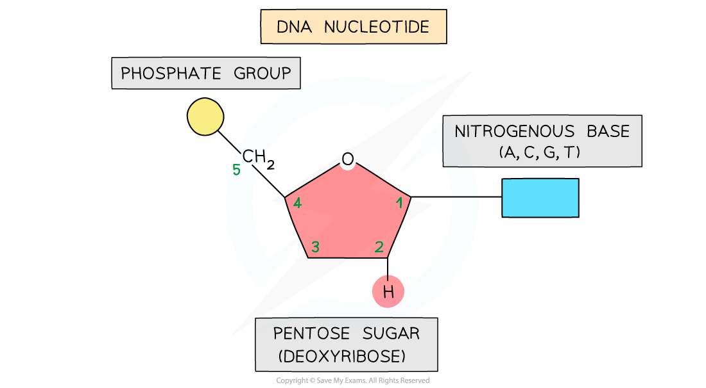
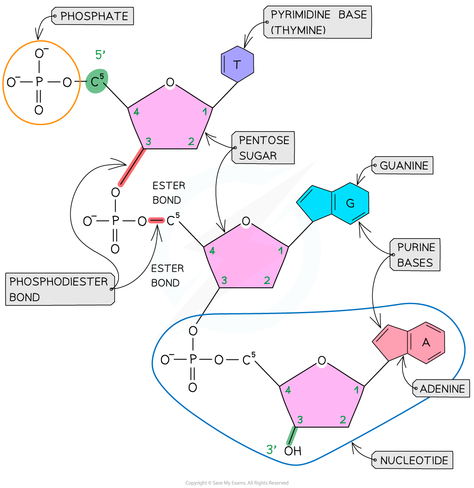
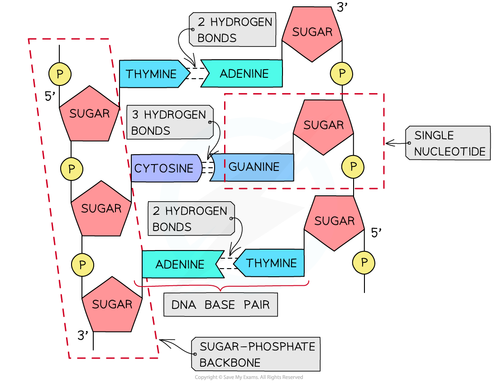
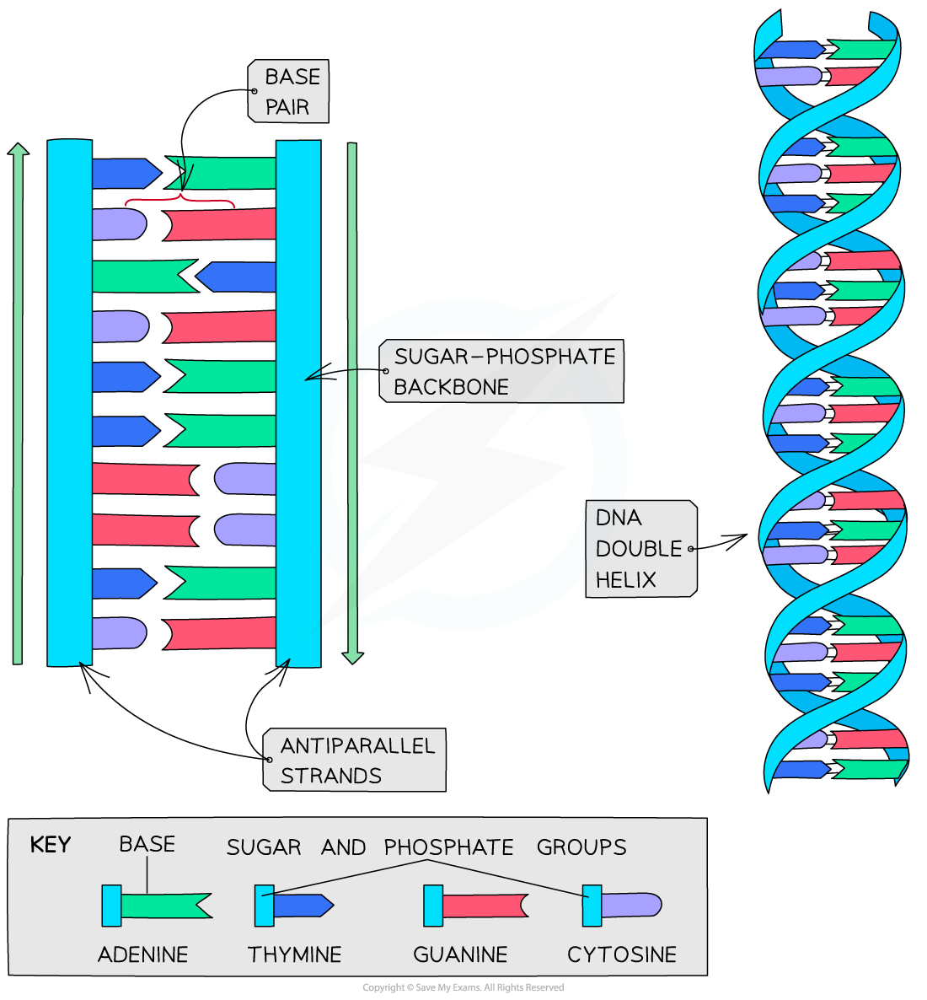

# The Structure of DNA

## DNA Structure

> **Spec point** — `spcpt_T9jMkYympKsynvzH` · describe the structure of a DNA molecule as a double helix, including:
• the importance of complementary base pairing between the ′ to ′ strand and the ′ to ′ strand (antiparallel
strands)
• differences in hydrogen bonding between C–G and A–T base pairs
• linking of nucleotides by phosphodiester bonds

## DNA structure

- The nucleic acid DNA is a **polynucleotide**—it is made up of **many nucleotides** bonded together in a **long chain**

*A DNA nucleotide*

- DNA molecules are made up of **two polynucleotide strands** lying side by side, running in opposite directions

  - The strands are said to be **antiparallel**
- Each DNA polynucleotide strand is made up of **alternating deoxyribose sugars and phosphate groups bonded together **to form the **sugar-phosphate backbone**
- These bonds are **covalent** **bonds** known as **phosphodiester bonds**

  - The phosphodiester bonds link the **5-carbon of one deoxyribose sugar** molecule to the phosphate group from the same nucleotide
  - The phosphate group is linked by another phosphodiester bond to the **3-carbon of the deoxyribose sugar molecule of the next nucleotide in the strand**
  - Each DNA polynucleotide strand is said to have a **3’ end and a 5’ end** (these numbers relate to which carbon on the pentose sugar could be bonded with another nucleotide)
  - As the strands run in opposite directions (they are **antiparallel**), one is known as the **5’ to 3’ strand** and the other is known as the **3’ to 5’ strand**
- The nitrogenous bases of each nucleotide project out from the backbone towards the interior of the double-stranded DNA molecule

*A single DNA polynucleotide strand showing the positioning of the ester bonds*

### Hydrogen bonding

- The two antiparallel DNA polynucleotide strands that make up the DNA molecule are **held together by hydrogen bonds** between the nitrogenous bases
- These hydrogen bonds always occur between the **same pairs of bases**:

  - The purine **adenine** (A) always pairs with the pyrimidine **thymine** (T)
  
    - **Two hydrogen bonds** are formed between these bases
  - The purine **guanine** (G) always pairs with the **pyrimidine** cytosine (C)
  
    - **Three hydrogen bonds** are formed between these bases
  - This is known as **complementary base pairing**
  - These pairs are known as **DNA base pairs**

*A section of DNA—two antiparallel DNA polynucleotide strands held together by hydrogen bonds*

### Double helix

- DNA is not two-dimensional as seen in the diagram above
- DNA is described as a *double helix*
- This refers to the **three-dimensional shape** that DNA molecules form

*DNA molecules form a three-dimensional structure known as a DNA double helix*

> **Exam Hint**
> Make sure you can:
> 
> - **Name the different components of a DNA molecule** (sugar-phosphate backbone, nucleotide, complementary base pairs, phosphodiester bonds, hydrogen bonds)
> - **Locate these on a diagram**
> 
> You must know **how many hydrogen bonds** occur between the different base pairs.
> 
> Remember that the bases are complementary so **the number of A = the number of T **and **the number of C = the number of G**.
> 
> You could be asked to determine how many bases are present in a DNA molecule if given the number of one of the bases.
