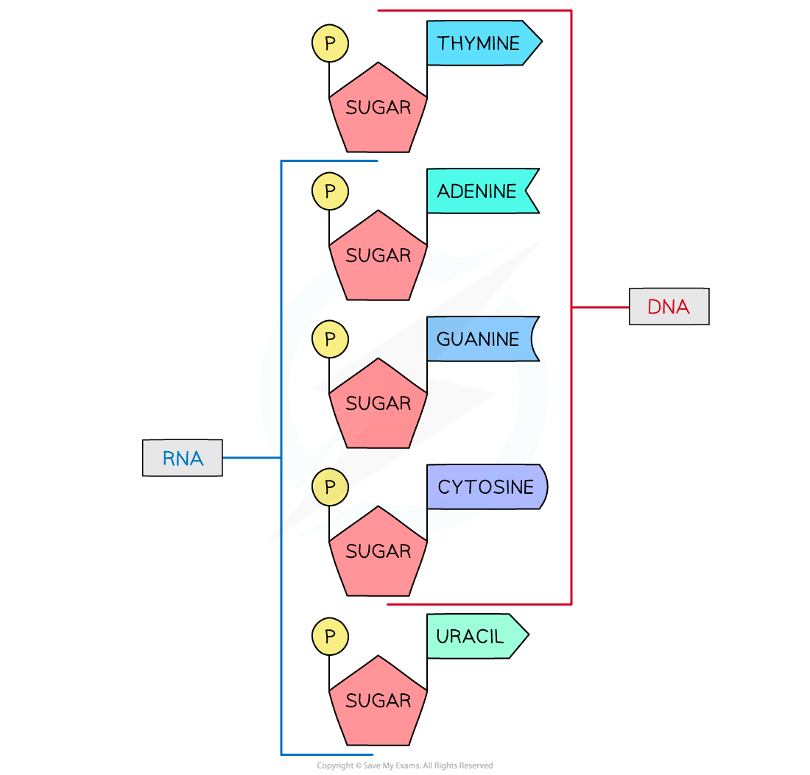
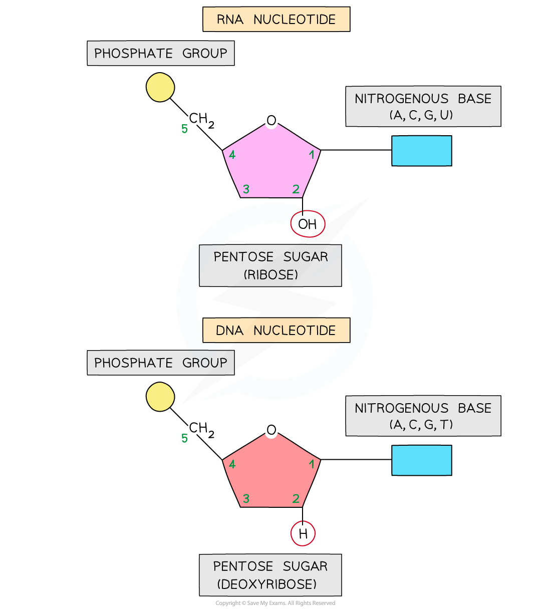
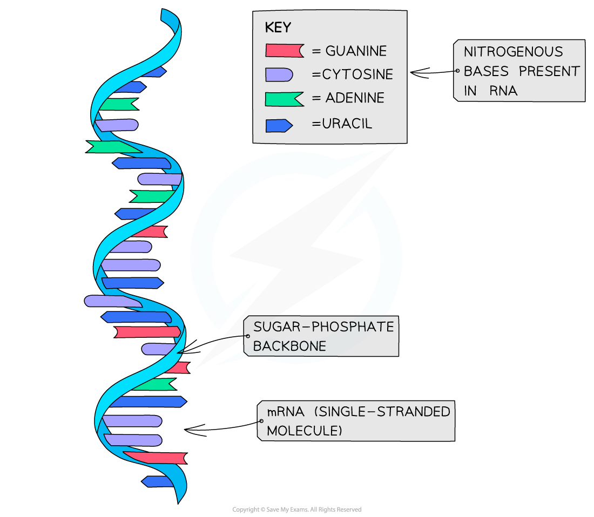

# The Structure of RNA

## RNA Structure

> **Spec point** — `spcpt_Pz8RpB6zVhsqpwQP` · describe the structure of an RNA molecule, using the example of messenger RNA (mRNA)

## RNA structure

- **Like DNA**:

  - The nucleic acid RNA (ribonucleic acid) is a **polynucleotide**
  
    - It is made up of **many nucleotides** linked together in a **long chain**
  - RNA nucleotides contain the nitrogenous bases adenine (A), guanine (G) and cytosine (C)
- **Unlike DNA**:

  - RNA nucleotides **never contain** the nitrogenous base **thymine** (T)
  
    - In place of this they contain the nitrogenous base **uracil** (U)
  - RNA nucleotides contain the pentose sugar **ribose** (instead of deoxyribose)
  - RNA molecules are only made up of **one polynucleotide strand** (they are single-stranded)
- Each RNA polynucleotide strand is made up of **alternating ribose sugars and phosphate groups linked together**

  - The nitrogenous bases of each nucleotide projecting out sideways from the single-stranded RNA molecule

| **Properties** | **DNA** | **RNA** |
|---|---|---|
| Pentose sugar | Deoxyribose | Ribose |
| Bases | Adenine (A) **Thymine (T)** Cytosine (C) Guanine (G) | Adenine (A) **Uracil (U)** Cytosine (C) Guanine (G) |
| Number of strands | Double-stranded (double helix) | Single-stranded |

*There is much overlap of the nucleotides found in DNA and RNA; RNA nucleotides contain uracil (U) instead of thymine (T) and the sugar ribose instead of deoxyribose*

*An RNA nucleotide compared with a DNA nucleotide*

- The **sugar-phosphate bonds** (between different nucleotides in the same strand) are *covalent bonds* known as **phosphodiester bonds**

  - These bonds form what is known as the **sugar-phosphate backbone** of the RNA polynucleotide strand
  - The phosphodiester bonds link the **5-carbon of one ribose sugar** molecule to the phosphate group from the same nucleotide, which is itself linked by another phosphodiester bond to the **3-carbon of the ribose sugar molecule of the next nucleotide **in the strand
- An example of an RNA molecule is **messenger RNA **(**mRNA**)

  - mRNA is the transcript copy of a gene that encodes a specific polypeptide

*Messenger RNA (mRNA) provides a good example of the structure of RNA*

> **Exam Hint**
> You need to know the **difference **between **DNA **and **RNA **molecules (bases, number of strands, pentose sugar present).
